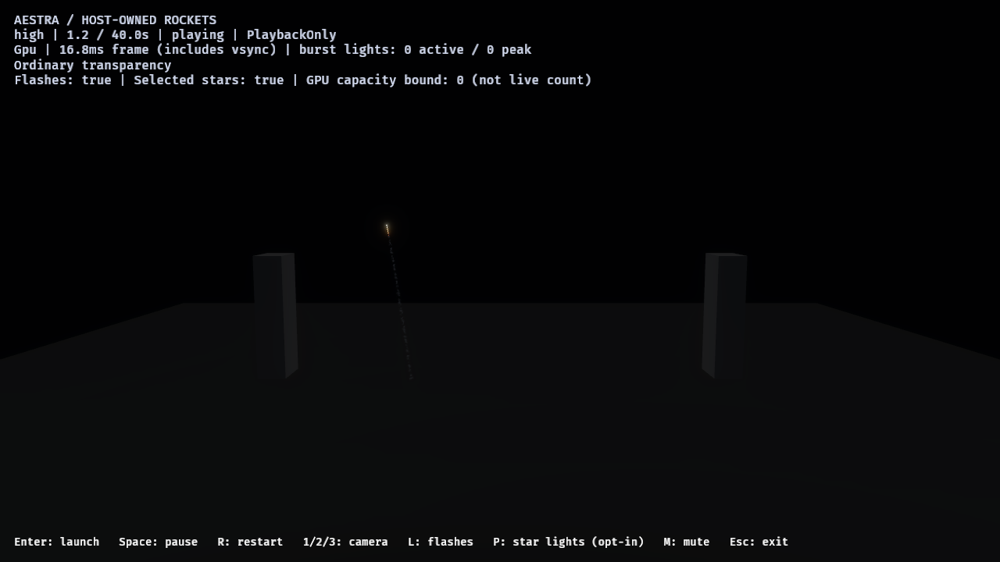
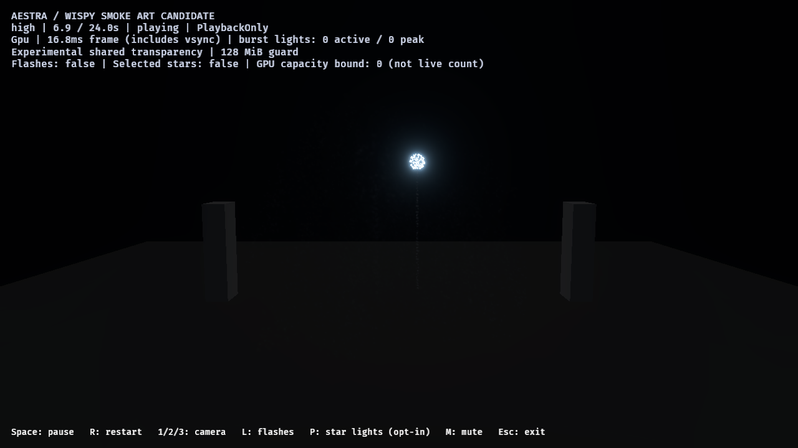

# Audience-camera smoke tuning — 2026-10-28

The opt-in `--tuned-smoke` candidate now shows a deposited rocket wake promptly,
keeps star-path smoke legible at the normal audience distance, and lets a later
burst reveal older haze. These are saved appearance/material changes using
existing Aestra APIs. No runtime change, additional particles, light-count increase
or new admission ceiling is required. CLI defaults and original calibrated control
assets remain unchanged. This advances the smoke draft; it is not final AAA art.

## Reference and changes

Reviewed the supplied video at approximately 02:12 and 02:15, using the prior
decoded reference frames. At the first anchor, thin filaments and nearby haze
pick up fresh burst color; at the second, much of the sky is dark again while
old structures remain faintly visible. Camera exposure, bloom, scale and shell
families differ, so the recording supports qualitative lifecycle/silhouette
comparison, not calibrated opacity, light energy or particle counts. Its hash and
anchors are retained in the [JSON evidence](audience-smoke-2026-10-28.json).

The old launch opacity peaked at normalized age 0.2: 1.4–1.8 seconds for the
host's 7–9-second wake particles, after the normal 1.3-second rocket fuse. The new
peak is at age 0.012, roughly 84–108 ms after deposition. A wider fresh silhouette
helps adjacent samples read as a wake at audience distance. The first draft's
smaller silhouette remained too faint; its two native runs remain in the evidence.

Star-path peak opacity rises from 0.0325/0.01625 to 0.075/0.0375 for point/gold
families, with an earlier fade-in and progressively thinner older smoke. Burst
smoke also becomes visible sooner and fades more strongly late in life. The
existing eroding mask, particle motion, lifetime, emission, distance samplers,
event routes, seeds, luminous modules and all capacity budgets stay intact.

Local scene-light gain changes from 0.02 to 0.035 for launch/burst materials and
from 0.08 to 0.24 for star-path materials. Ambient remains (0.055, 0.06, 0.07),
avoiding a permanent brightening of the quiet sky. These are art values, not
physical scattering coefficients. The authoring tool regenerates the same named
candidate assets; historical source hashes and pre-change snapshots preserve the
earlier revision separately.

Rocket wake before and after at 1.2 seconds, normal audience camera:




The fixed wake region [480,310]–[540,485], excluding the bright head, gains mean
8-bit RGB [0.352, 0.456, 0.471], with 2,834 changed pixels. This is a subtle,
thin wake rather than a bright exhaust plume. Discrete sampling and billboard
structure can still be visible; moving/side-view acceptance remains open.

## Older-haze light controls

The authored two-shell pair uses the audience camera, fixed HDR/bloom and explicit
experimental shared transparency. Four matched variants retain simulation:
both scene-light families on/off, each with star-path smoke visible/hidden through
material density. Hiding smoke does not remove its particles or event demand.
Scene-light disablement is recorded explicitly; disabled selected-light metadata
is unavailable rather than a measured zero-capacity observation.

At 6.9 seconds, the latest GPU population observation contains 11,209 older gold
path-smoke particles and no older stars, flash particles or embers. The younger
blue shell has stars and a flash, but its observed star-path count is zero. The
region [500,200]–[620,360] excludes that new burst's bright core.

Subtracting combined-visible minus combined-hidden minus unlit-visible plus
unlit-hidden gives mean signed 8-bit RGB:

| Time | RGB difference |
|---|---|
| 6.7s, before the blue break | [0, 0, 0] |
| 6.9s, blue break | [0.722, 1.921, 3.833] |
| 7.4s | [0.081, 0.165, 0.218] |
| 8s | [0.095, 0.171, 0.288] |
| 16s and 23s | [0, 0, 0] |

This supports localized recoloring of retained smoke, rather than just a brighter
star sprite. Async image/count delivery, new smoke outside the latest observation,
alpha ordering, tone mapping and bloom prevent exact photometric or causal
isolation. The zero late difference means the extra scene-light response is gone;
it does not mean every smoke particle has already retired at 16 seconds.




## Native lifecycle and pacing

Sixteen runs deliver 102 captures: pre-change and interim-draft spaced/pair
sequences, final spaced/pair and visibility/lighting controls, high/medium/low
twelve-rocket overlap, three ordinary high overlap runs and one separate profile.
Windows, RTX 4070 SUPER/Vulkan, 1280×720, audience camera, PlaybackOnly, no audio.
The existing development executable from activation qualification is reused;
authored assets are loaded from disk. No compilation runs alongside native runs.
The runner chooses an explicit 24-owner workload budget; the normal host has no
default count ceiling.

All available cumulative event demand/acceptance totals match within mode/tier
across before/draft/final and lighting/visibility controls. All observed source
overflows, omitted expansions and destination rejections are zero. Ordinary/profile
lanes retain star-path bookkeeping only, so absent all-link records there are not
interpreted as zero. Each spaced host run completes five launches/detonations;
each overlap run completes twelve. Final gameplay/VFX owners and live particles
are zero. Enabled selected-light paths retire to a zero capacity bound; peak bounds
remain high 96, medium 48, low 24, not measured live-light counts.

The pair's fragment scans report zero global drops/invalid links. The final
visible pair still records 2,101 pixels over the local sort limit (88 with path
smoke hidden). These count work for the existing full-target overflow merge sort,
not approximate blending or lost layers by themselves. This does not establish
general cross-draw compositing. The normal
host uses ordinary depth-sorted transparency, a distinct qualified scope.
Each image run records one global-cache pending update with its prepared view
ready; ordinary/profile runs record none. Image-lane timings are not cost evidence.

| Ordinary high overlap | Launch p95 / max ms | Launch intervals >33.33 ms | Active sparks p95 ms | Idle p95 / max ms |
|---|---:|---:|---:|---:|
| A | 18.1073 / 22.8460 | 0 | 17.8789 | 17.9658 / 34.1180 |
| B, retained noisy run | 18.5495 / 42.1241 | 4 | 17.6245 | 30.5567 / 84.1905 |
| C, follow-up | 17.4341 / 18.7734 | 0 | 17.6319 | 16.9692 / 31.6914 |

The separate profile still measures mean/max presentation construction at
0.009875/0.013 ms, launch-phase CPU playback p95 0.1364 ms and maximum 0.7021 ms.
Observed launch GPU simulation p95 is 3.5379 ms and transparent pass p95 0.9155 ms.
Scopes are asynchronous/nested and must not be added or treated as frame-paired
incremental cost. The removed 30 ms material-construction stalls do not recur in
this profile. The noisy ordinary run is unexplained and retained; no stable
whole-game frame-time or production-finale certification is claimed.

See the [machine-readable evidence](audience-smoke-2026-10-28.json) for every
phase distribution, activation record, population witness, admission total,
binary/source/report/image fingerprint and comparison region. Raw artifacts are
under `target/fireworks-f8/audience-smoke-*-2026-10-28`; pre-change source snapshots
are in `audience-smoke-before-sources-2026-10-28` there. Earlier review fingerprints
remain historical snapshots rather than hashes of this revised candidate.

## Reproduce and continue

```powershell
cargo run --release --locked -p aestra-demo-fireworks -- --tuned-smoke --star-lights
& ./benchmarks/fireworks/run-smoke-look-review.ps1 -OutputDirectory target/fireworks-f8/audience-review -Mode host-spaced -Camera audience -Variants tuned -SampleTimes '1.2,1.4,2,4.4,5,7.4,8,12,14,18,23,36'
```

The runner now supports `host-spaced`, camera selection, `-HideStarSmoke` and
independent `-NoStarLights`/`-NoFlashLights` controls. Hidden-smoke runs require the
image lane. `-Cost` and `-Cost -Instrumented` remain separate ordinary/profile lanes.

50 demo/authoring tests pass, including a regression for wake visibility within
100 ms and late dilution, saved-asset regeneration and all-tier workload preservation.
Strict all-target Clippy with and without audio, Rust formatting, PowerShell syntax
and diff checks pass. No default art adoption occurs in this step.

The [subsequent camera review](smoke-views-2026-10-28.md) now covers sampled motion
and side/near views, and verifies execution of the existing overflow merge sort.
Next is independent-host ordinary/shared-transparency qualification before
default adoption or a different smoke representation. Final photographic smoke,
larger-finale performance and generic fluid injection remain separate gates.
