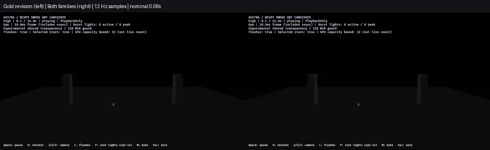
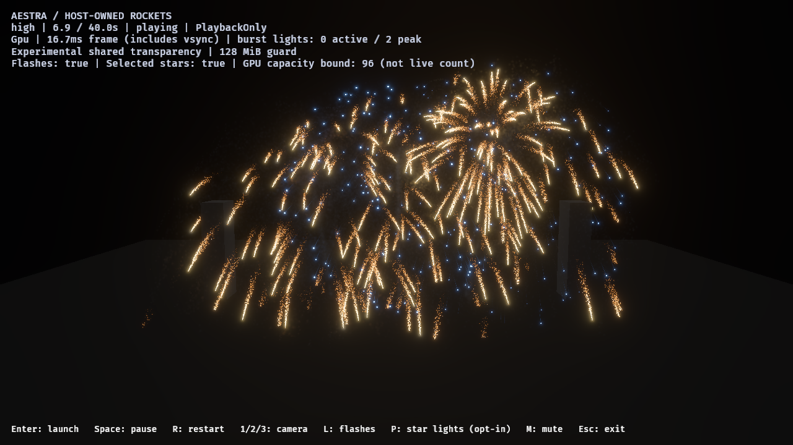

# F8 point-star smoke and mixed-family audience review

This records the world-anchored revision. The subsequent
[advection review](f8-smoke-advection-2026-10-29.md) adds effect-clock pattern drift;
the measurements below remain specific to the anchored version.

The point-star family now has a separate `fireworks_point_star_reference_smoke`
candidate using the gold revision's coherent world-space material. A new saved
`fireworks_shell_reference_smoke` pair preserves the existing timing, seeds,
placements and blue palette override. Fresh review overlays replace both families
under their existing IDs; the default project/showcase remains unchanged.

The gold effect and shared program/function are **byte-for-byte unchanged** from
the [gold-only motion revision](f8-coherent-smoke-motion-2026-10-29.md). All 97
original showcase asset fingerprints still match. No runtime or shader changes
were needed for this pass; the same preserved release binary loads the new art.

## Art changes and reference assessment

The point-star wake uses the shared soft core; its dense star paths erode without
that core. Their size curve is now **0.65 / 1.2 / 2.4 / 3.2**, compared with the
gold family's unchanged **0.8 / 1.6 / 3.1 / 4.0** at normalized ages 0 / .25 / .65 / 1.
Point-star opacity remains twice the gold draft's opacity: a .065 peak versus
.0325, preserving the family distinction without adding particles. Compared with
the old point-star draft, fresh opacity is lower and the finite late tail stronger.
Smoke motion, lifetimes, birth routes, budgets, colors and light outputs/gains are
preserved. The point-star source's default is warm white; the pair/host makes it
blue through the existing exposed color override.

The supplied video, especially the 132–135-second smoke sequence, favors thin
residual paths and smoke that stays subordinate to bright star heads. In the
audience captures the narrower blue-family paths avoid filling the gaps between
the gold branches; gold tails and blue heads remain distinguishable. Near captures
stress dense overlap and intentionally retain the existing cropped framing.
Individual billboard texture is still visible, and the density field remains
world-anchored rather than physically advected. This is an opt-in art draft, not
final photographic/AAA acceptance. Exposure and world scale are not calibrated
to the reference, and its scenery/audio are not reproduced here.

## Native checks and failed iteration

All final lanes use high tier, native RTX 4070 SUPER/Vulkan, optimized release,
1280×720 HDR/TonyMcMapface, bloom .15, Msaa::Off, PlaybackOnly and audio off.

| Final image lane | Captures | Maximum attempted fragments across frame | Observed loss / final alive |
|---|---:|---:|---|
| Reused gold-only pair control | 282 | 867,368 | 0 / 0 |
| Both families, forward pair | 282 | 855,361 | 0 / 0 |
| Both families, gameplay audience | 7 | 5,893,975 | 0 / 0 |
| Both families, gameplay near | 7 | 20,155,097 | 0 / 0 |

All **578 captures** deliver. The two gameplay lanes preserve 12 launches,
detonations and flashes, **374,514 gold-tail ember / 115,283 star-path smoke births**,
zero source overflow/expansion omission/destination rejection, and zero final
gameplay rockets/VFX owners. Node/head storage remains **47,923,200 bytes** under
the existing 128 MiB ceiling; this is not total VRAM. Attempted frame totals across
regions are not simultaneous pool demand. The existing benchmark owner budget
is 24 with no admission waits; normal showcase admission stays uncapped.

The first mixed-family draft reused gold's wider star-smoke size curve. Audience
passed, but near overlap dropped **478,659 fragments**. That failed report,
project and author snapshot remain local and are fingerprinted in the
[ledger](f8-blue-gold-smoke-2026-10-29.json). The final point-star paths are narrower,
matching the reference's thin trails. No births, lifetimes or light gains were
cut, and no storage ceiling was raised to make the check pass.

The animation reuses the previous gold-only control sequence because its binary,
gold/material assets, camera, seed and sample times match. The new sequence is an
independent forward capture, not an exact frame pair. Each has 282 samples from
0.0833–23.5 seconds at nominal 12 Hz, with request lag below 50 ms (recorded in the
ledger). The labeled WebP downsizes each side to 512×288 and uses lossy encoding;
native PNGs remain the evidence. No replay, exposure adjustment or frame
interpolation is used. This is not a frame-rate recording.

## Separate release cost observation

One fresh sequential pair compares the previous gold-only overlay with the new
mixed-family overlay on the same binary, outside screenshot/build workloads.
Render-graph GPU p95:

| Phase | Gold-only revision ms | Mixed-family revision ms |
|---|---:|---:|
| Launch / overlap | 9.612 | 9.479 |
| Active fireworks | 11.075 | 10.587 |
| Smoke drain | 9.720 | 9.221 |
| Idle | 2.247 | 2.244 |

Both profiles pass observed capacity and cleanup. The narrower footprint is
compatible with the audience budget in this observation; one pair does not
establish a causal speedup, repeatable performance baseline or stable 60 FPS.
Phases are classified asynchronously. Render-graph timestamps exclude presentation
and some uploads; nested scope quantiles must not be added.

## Authoring and next gate

The author utility now regenerates both family effects, the pair and their shared
material/function. Regression tests preserve every nonappearance module, material
light/color values, renderer/scene-output contracts, pair seed/transform/palette/
timing and budget routes. Both families and the pair compile and resolve public
GPU material bindings at high/medium/low tiers. Two author tests, strict demo
Clippy and workspace formatting pass; only high has new native art qualification.

Use the [demo preview commands](../../demos/fireworks/README.md#f8-gold-smoke-reference-draft)
for either family, the pair or a fresh gameplay overlay. The ledger records actual
project manifests, source/binary/report/image hashes and the retained failure.

Next address smoke advection and the remaining billboard structure against the
video, then review final art/default adoption. Keep other-tier/hardware, audio,
environment and production-finale/F9 acceptance separate. The frozen v1 showcase
is unchanged.
