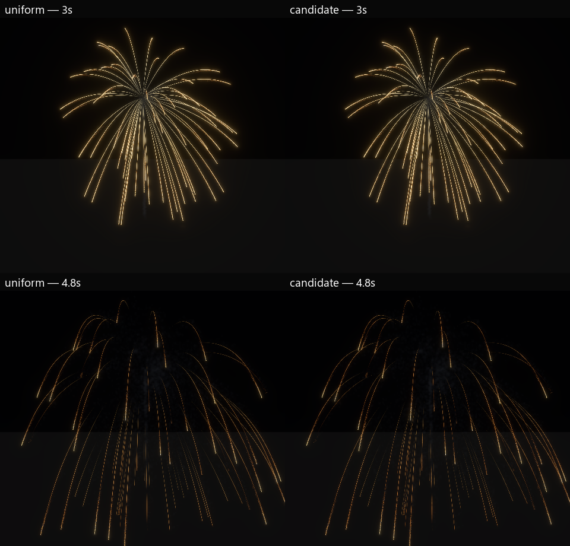
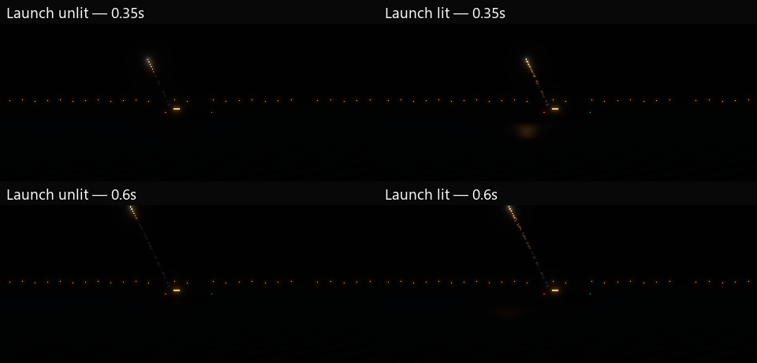

# F8: emission grain and launch-water lighting

The gold-filament study now uses a reusable **Emission Grain** material function.
It modulates brightness with two spatial noise scales and a stable strand seed,
with an optional warm tint driven by normalized age. Derivatives suppress detail
that cannot be resolved at the current view distance. There is no animated noise
phase, new particle demand or firework-specific renderer branch.

The effect exposes **Tail burn grain**, **Tail grain frequency** and **Tail color
cooling**. The editor can open the saved ribbon material and reusable function;
see the [authoring instructions](../../docs/examples/emission_grain.md).

The first grained draft was barely distinguishable at audience distance. Width
multiplies recorded particle size: its nominal 0.075 width and 0.22 head size gave
only about 0.0165 world units of fresh strip width. The refinement uses width
0.24 (about 0.053 effective), trail gain 52 and residual ember gain 3 instead of
32/6. It gives the connected strand more energy without enlarging the head or
adding particles. The rejected draft's source, captures and ledger remain under
`target/fireworks-f8/grain-first-draft-2026-10-31` and the original raw run folder.

The saved **uniform** control disables grain and extra color cooling, retaining
the same refined history, geometry, births and material shader. The older
**control** asset still preserves the original short-history look. The study
remains separate from the eight-family variety show and the frozen v1 workload.

The refined shape still looks too orderly relative to the reference video.
Grain is a usable authoring control, not final photographic realism approval.
Trail age is recorded sample age: the tint does not implement thermal evolution
of each retained history point. Temporal burn progression remains art work.

## Launches illuminate the sea

The offshore host now attaches a warm 180,000-lumen, 90-unit-range shadowless
point light to each gameplay rocket while it burns. The existing authoritative
transform drives it; detonation and restart despawn it with the rocket, while
pause preserves its position. No particle readback or extra clock is introduced.
Burst/selected-star light policies are unchanged. `--no-launch-lights` and the
runner's `-NoLaunchLights` supply an explicit sea-scene control.

The ordinary PBR water now shows a warm launch highlight, and the deck is a
receiver too. The water-only native LDR ROI `(480,590)–(720,668)` excludes the
boat, sky, particles and HUD. Its mean luminance rises from 1.673 to 2.738 at
0.15 seconds and 1.656 to 2.220 at 0.35 seconds with launch lighting enabled.
These are capture values on a 0–255 scale, not physical illuminance or exact
frame-matched measurements. The highlight diminishes as the rocket ascends.

This does not close realistic water. The roadmap now explicitly calls for
multi-scale waves, Fresnel/specular response, broken launch highlights toward
the observer and coherent aerial firework reflections, with roughness/view and
GPU-cost controls. The current moving point light is direct scene illumination;
there is no mirrored particle rendering or additional VFX simulation.

## Validation and scope

The [ledger](f8-burn-grain-launch-light-2026-10-31.json) fingerprints the reports,
assets, binaries and retained images. All-tier native uniform/candidate runs
provide 42 images, with identical accepted births per tier, no observed
fragment/event loss and complete particle cleanup. Four editor-viewport captures
render the reusable material. Two medium-tier offshore controls provide 14
images; both deliver five launches/detonations, identical VFX birth counts and
zero final rocket/VFX owners or particles.

The 56-test demo suite and authoring regression pass. Lifecycle coverage includes
calibration, lit sea and unlit sea, paused motion, detonation and restarting an
active rocket. Strict Clippy with optional audio, formatting and runner syntax
checks pass. These are image/functional checks, not ordinary frame-time or total
VRAM qualification. The existing 128 MiB shared OIT guard is unchanged, and the
earlier F9 failures remain open.
