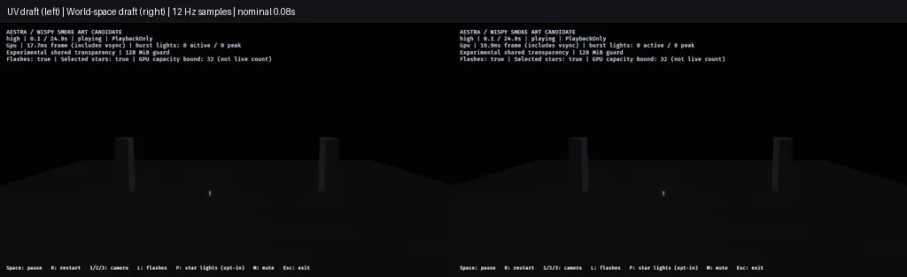

# F8 coherent smoke and forward motion review

This review records the gold-only revision. The later
[mixed-family review](f8-blue-gold-smoke-2026-10-29.md) extends it to the point-star
family while retaining the gold asset/material fingerprints unchanged. The
measurements below belong to the earlier revision.

The opt-in gold smoke draft now samples a coarse density field in world space,
shared by overlapping billboards. Young wake samples have a soft core and less
rotation; dense star paths retain erosion without that core. The launch size and
opacity curves make overlapping deposits wider and softer. Births, simulation,
lifetimes, colors, light gains, luminous renderers and storage ceilings remain
unchanged. All 97 original showcase asset fingerprints still match.

This improves the wake's continuity and replaces fine independent noise with
larger patches. Individual billboard shapes remain visible, and the result is
still a draft. The blue family has not been retuned. The supplied video remains
a qualitative reference, especially the smoke around 132–135 seconds; there is
no calibrated exposure, distance or world-scale match.



The animation contains **282 samples per version at nominal 12 Hz**, from
0.0833 to 23.5 seconds, played over 23.5 seconds. Each side is downscaled to
512×288 and encoded as lossy WebP; unaltered native PNGs and hashes remain in
the [ledger](f8-coherent-smoke-motion-2026-10-29.json). It is sampled forward
playback, not a performance recording or exact frame-paired comparison. Requests
lag their nominal times by at most 33.4 ms; no replay, frame interpolation or
exposure changes are used. The two source runs are independent.

## Material support and regression coverage

The first native attempt correctly rejected the material: portable sprite/ribbon
shader lowering exposed world position internally for irradiance, but rejected
it as an authored input. `MaterialInput::WorldPosition` now uses that same existing
varying for authored sprite/ribbon expressions, without enabling lighting or adding
bindings. Mesh behavior remains intact; unused inputs remain opt-in. Lit materials
read one shared world-position varying rather than duplicating it.

The material contract suite passes **31 tests**, including Naga validation,
SPIR-V/HLSL emission and stage-interface checks for world position with and without
lighting across sprite, ribbon and mesh domains. The author regression now checks
public `PresentedEffect` GPU material binding at every tier, in addition to core
compilation and deterministic asset regeneration. This catches unsupported GPU
inputs that core compilation alone permits. It also checks material values so
scene-light gains and ambient/color values cannot change unnoticed.

The noise is a coarse two-dimensional field projected from world XYZ, not a
volumetric density simulation. It is world-anchored rather than physically
advected with each smoke parcel. That remaining behavior and billboard texture
need art review before default adoption.

## Final native checks

Both motion versions use the **same rebuilt release binary**. The control loads
the preserved first-draft overlay, not newly regenerated assets. The candidate
loads `target/fireworks-f8/f8-coherent-project-qualified-2026-10-29`. Both use
the same two-shell authored calibration fixture. Audience/near checks separately
use gameplay-owned rockets; no viewer implementation is imported.

All lanes use high tier, PlaybackOnly, audio off, RTX 4070 SUPER/Vulkan,
1280×720 HDR/TonyMcMapface, bloom 0.15 and Msaa::Off. Motion uses the existing
shared-list fixture; host overlap uses the existing 4×4 partition setting.

| Final image case | Captures | Maximum attempted fragments across the frame | Observed loss / final alive |
|---|---:|---:|---|
| Previous UV draft, forward pair | 282 | 800,987 | 0 / 0 |
| Coherent draft, forward pair | 282 | 867,368 | 0 / 0 |
| Coherent draft, gameplay audience | 6 | 6,611,199 | 0 / 0 |
| Coherent draft, gameplay near | 6 | 22,678,263 | 0 / 0 |

All **576 captures** deliver. Both gameplay image lanes preserve 12 launches,
detonations and flashes; 374,514 gold-tail ember and 115,283 star-path smoke births
remain accepted with zero source overflow, expansion omission or destination
rejection. Gameplay rockets and VFX owners drain to zero. The existing benchmark
owner budget is 24, with zero admission waits; normal showcase admission stays
uncapped. Node/head storage remains **47,923,200 bytes** under the unchanged
128 MiB ceiling, not total VRAM. Attempted totals across partitions are not
simultaneous pool demand or proof of arbitrary-overlap headroom.

The later blue burst still reveals lingering smoke after the gold stars/embers
have died. At the nearest 6.917-second sample, asynchronous observations retain
11,209 old gold star-smoke particles, while the younger blue shell already has
128 of its own smoke particles. This sample alone cannot isolate the old smoke's
lighting contribution; the earlier draft's four-way controls are recorded in the
[first reference review](f8-gold-smoke-reference-2026-10-29.md).

### Retained failed iteration

Applying the fresh core to every smoke particle passed audience overlap but failed
near overlap with **33,140 dropped fragments**. That report, project and author/mask
snapshots are retained locally and fingerprinted in the ledger. The final material
uses an explicit instance parameter: the shared launch/burst instance enables the
core; the dense star-path instance leaves it off. No particles were removed, light
gains reduced, owner cap added or storage ceiling increased to obtain the final pass.
The initial unsupported-input log is retained too.

## Separate release cost pair

One sequential original-draft/candidate profile pair, separate from screenshots
and without overlapping builds or other GPU work, reports render-graph GPU p95:

| Phase | Previous UV draft ms | Coherent draft ms |
|---|---:|---:|
| Launch / overlap | 9.110 | 9.625 |
| Active fireworks | 10.549 | 11.086 |
| Smoke drain | 9.642 | 9.740 |
| Idle | 2.222 | 2.248 |

Active p95 is about **0.537 ms / 5.1% higher in this pair**. The softer density has
a cost; do not present this as a free quality improvement. This is one observational
pair with asynchronous phase classification, not causal attribution, a repeated
performance baseline or stable-60-FPS certification. Both profiles complete with
zero observed fragment loss and full cleanup. Render-graph timestamps exclude
presentation and some uploads; nested scope quantiles must not be added.

## Reproduce and next priority

Use the [current demo commands](../../demos/fireworks/README.md#f8-gold-smoke-reference-draft)
to generate a fresh overlay and preview it. To capture a forward sequence through
the existing review runner:

```powershell
$samples = (1..282 | ForEach-Object { ($_ / 12.0).ToString('F6', [Globalization.CultureInfo]::InvariantCulture) }) -join ','
& ./benchmarks/fireworks/run-smoke-look-review.ps1 -OutputDirectory target/fireworks-motion-review -Binary target/release/fireworks.exe -ProjectRoot target/fireworks-reference-preview -Mode pair -Camera audience -Variants tuned -Tiers high -Transparency shared -SampleTimes $samples -RequireLossFree
```

The ledger records binary/source hashes, actual per-run project manifests, native
image hashes, request times and the failed iteration. The preview is a labeled,
downscaled visual convenience; native capture data remains the evidence.

Next review the blue family and overlapping audience composition against the
reference, keeping smoke subordinate to bright stars. Further reduce visible
billboard structure and assess advection before adopting the draft. Medium/low
native art, other hardware, audio/environment and production-finale/F9 acceptance
remain open. The frozen v1 showcase is unchanged.
