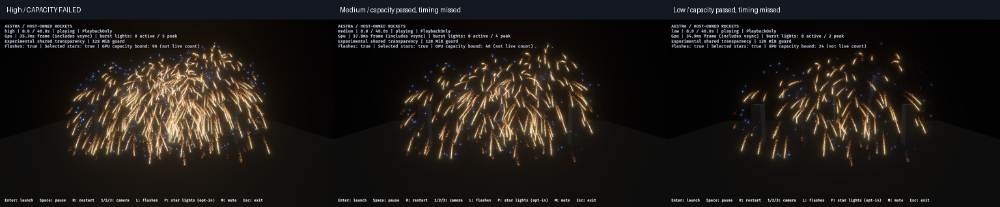

# Frozen smoke tiers and the first named 32-shell finale

**Result:** medium/low smoke integration passes the bounded 12-shell checks.
The 32-shell finale exposes high-tier transparency loss, and all three tiers miss
a 16.67 ms reference render-graph GPU interval. These failed gates remain open;
completion and cleanup do not qualify the finale for production.

## Workload and editor benefit

`--launch-pattern finale` launches 32 alternating point-star/gold rockets at
0.15-second intervals over 4.65 seconds. The existing 40-second host clock includes
their finite wake/burst tails. Origins, velocity, fuse and detonation remain host
gameplay; Aestra runs the same editable effects/materials through PlaybackOnly.
No new runtime particle, event, owner or light limits are introduced.

The named count is a benchmark schedule, not an admission ceiling. No
`--max-owners` is passed for finale runs. A host test verifies all 32 detonations,
64 retained test owners and a subsequent manual launch reaching 66 owners. The
v1 showcase remains the original 12-shell candidate. The benchmark wrapper now
checks exact workload completion, owner retirement and particle-event admission;
truncated audits or lost source/expansion/destination work fail explicitly.

The shared smoke kernel, both sample editor effects and both shared material
files match the preceding depth-review hashes. All 97 original showcase asset
hashes also match. No smoke controls, births, lifetimes or authored quality
profiles were retuned. Both **Smoke Material Lab** and **Smoke Wake Lab** now have
native editor-viewport captures at medium and low, including retained wake and
drain samples. This qualifies reusable editor content and provides a repeatable
stress workload for the shared runtime; it is not a demo-only shader change.

All 53 demo tests and four author/regeneration tests pass. Strict demo Clippy,
Rust formatting, PowerShell syntax and diff checks pass.

## Bounded medium/low smoke checks

Native RTX 4070 SUPER/Vulkan, 1280×720 HDR/TonyMcMapface, bloom 0.15,
Msaa::Off, audio off, PlaybackOnly and 4×4 experimental OIT. All four image lanes
retain 12 launches/detonations/flashes and zero final rockets, VFX owners and
particles. Particle-event audit counts are complete, with no source overflow,
expansion omission or destination rejection.

| Tier/view | Images | Maximum attempted fragments across frame | Dropped / invalid links |
|---|---:|---:|---:|
| Medium audience | 12 | 2,061,911 | 0 / 0 |
| Low audience | 12 | 1,106,302 | 0 / 0 |
| Medium near | 7 | 7,129,194 | 0 / 0 |
| Low near | 7 | 3,891,247 | 0 / 0 |

Medium admits 187,992 gold embers and 57,603 star-path smoke births; low admits
98,046 and 29,509 respectively, identically across audience/near runs. These are
the existing tier policies, not dropped work. The audience runs use the preserved
prior demo binary; near/finale runs use the rebuilt binary adding only the named
host schedule. Both binary hashes are recorded per manifest. Editor checks use
the same previously rebuilt viewer/viewport renderer at 960×540 LDR.

All **71 demo plus 20 editor captures** deliver, including the deliberately
retained failed high-finale images. Lower tiers retain readable wakes/smoke at
the sampled views; these captures are not final human artwork approval or proof
of every temporal/viewing condition.

## Finale capacity and admission



This figure downsizes independent nominal-eight-second images to 512×288 per
tier, without exposure changes. It is not an exact frame comparison. The high
image belongs to a failed run and must not be used as accepted reference art.

| Tier | Launches/detonations | Peak async alive* | Gold ember / path-smoke births | Maximum dropped fragments | Capacity |
|---|---:|---:|---:|---:|---|
| High | 32 / 32 | 401,761 | 1,015,758 / 309,714 | 583,927 | **Fail** |
| Medium | 32 / 32 | 201,724 | 505,062 / 154,151 | 0 | Pass observed |
| Low | 32 / 32 | 103,706 | 259,644 / 78,354 | 0 | Pass observed |

\* Alive counts are asynchronous particle populations, not visible particle or
active/retired trail-history counts. This workload does not certify every count
in the roadmap's broader Test C target.

Every run reaches 64 peak gameplay/VFX owners, 11 simultaneous gameplay rockets,
zero owner waits and full final cleanup. Particle-event audits have no overflow,
omission, rejection or truncation. High's transparency failure repeats in the
separate profile lane (576,782 maximum dropped fragments). Both high wrappers
reject qualification under the unchanged `-RequireLossFree` check; raw reports
remain available. Report mode deliberately finishes failed runs for diagnostics.

Representative flash binding receives all 32 detonation intents in every image
lane. High accepts all 32 flashes; medium accepts 29 and explicitly budget-drops
3; low accepts 16 and budget-drops 16. Profiles accept 32/27/15 respectively.
These are the existing 8/4/2 concurrent-light policies, not particle or gameplay
loss. The differing image/profile counts are retained rather than called
frame-exact lighting parity. Selected-light capacity stays 96/48/24 with no
reported adapter rejection.

Node/head storage remains **47,923,200 bytes** under the same **128 MiB** guard.
High runs attempt about 10.75 million fragments across regions in a peak frame;
this total is not simultaneous pool demand. No larger allocation, extra
partitioning, launch delay, owner ceiling or silent density reduction was used to
erase the failure. Total VRAM residency/budget is not certified.

## Separate initial performance screen

One profile per tier, sequentially outside compilation/screenshots, uses the
audience camera and existing bounded partition-health scans. Render-graph GPU
p95 in milliseconds:

| Phase | High | Medium | Low |
|---|---:|---:|---:|
| Launch / overlap | 28.203 | 21.050 | 13.513 |
| Active fireworks | 29.688 | 21.841 | 19.001 |
| Smoke drain | 13.615 | 12.726 | 13.318 |
| Idle | 2.241 | 2.241 | 2.221 |

All three miss the explicit **16.67 ms reference GPU interval** during active
fireworks. This is a screening target, not a measured 60 FPS guarantee: the graph
interval excludes presentation and some uploads. Ordinary full-frame repeated
baselines, other hardware/resolutions and shipping budgets remain unqualified.

The largest recorded active scopes below the frame interval are:

| Scope GPU p95 | High | Medium | Low |
|---|---:|---:|---:|
| Simulation | 14.710 | 15.621 | 13.593 |
| Partition capture/sort/resolve with health | 15.354 | 7.349 | 4.248 |

Scopes are asynchronous/nested and their percentiles must not be added.
Lower particle counts do not proportionally lower the recorded simulation scope.
This points to shared simulation/owner work as the first investigation, alongside
the demonstrated high-tier fragment-storage pressure. These observations do not
identify a specific faulty dispatch or prove a proposed optimization's benefit.
Increasing partitions/storage alone would not address the timing failure.

## Reproduce and next gate

Generate a fresh reference overlay with the author tool, then use the shared
runner. The high command is expected to reject capacity on this configuration:

```powershell
cargo run --release --locked -p aestra-demo-fireworks --bin author_fireworks_reference_smoke -- --review-project target/fireworks-reference-preview
cargo build --release --locked -p aestra-demo-fireworks --bin fireworks
& ./benchmarks/fireworks/run-smoke-look-review.ps1 -OutputDirectory target/finale-high-images -Binary target/release/fireworks.exe -ProjectRoot target/fireworks-reference-preview -Mode host-finale -Camera audience -Tiers high -Variants tuned -Transparency shared -Partitions 4 -RequireLossFree
& ./benchmarks/fireworks/run-smoke-look-review.ps1 -OutputDirectory target/finale-tiers-images -Binary target/release/fireworks.exe -ProjectRoot target/fireworks-reference-preview -Mode host-finale -Camera audience -Tiers medium,low -Variants tuned -Transparency shared -Partitions 4 -RequireLossFree
```

Use fresh output directories and add `-Cost -Instrumented` for separate timestamp
lanes; run these alone without other GPU workloads. Keep failures in the record.

The [ledger](f8-frozen-tiers-finale-2026-10-30.json) fingerprints reports,
manifests, inputs, binaries and retained PNGs, and separates capacity from the
reference timing gate. Next investigate the measured shared simulation workload
and high-tier transparency capacity. Keep smoke art frozen during this work.
F8's final visual review/default adoption stays separate; F9 now has a named
baseline and explicit failed gates, not production certification.
