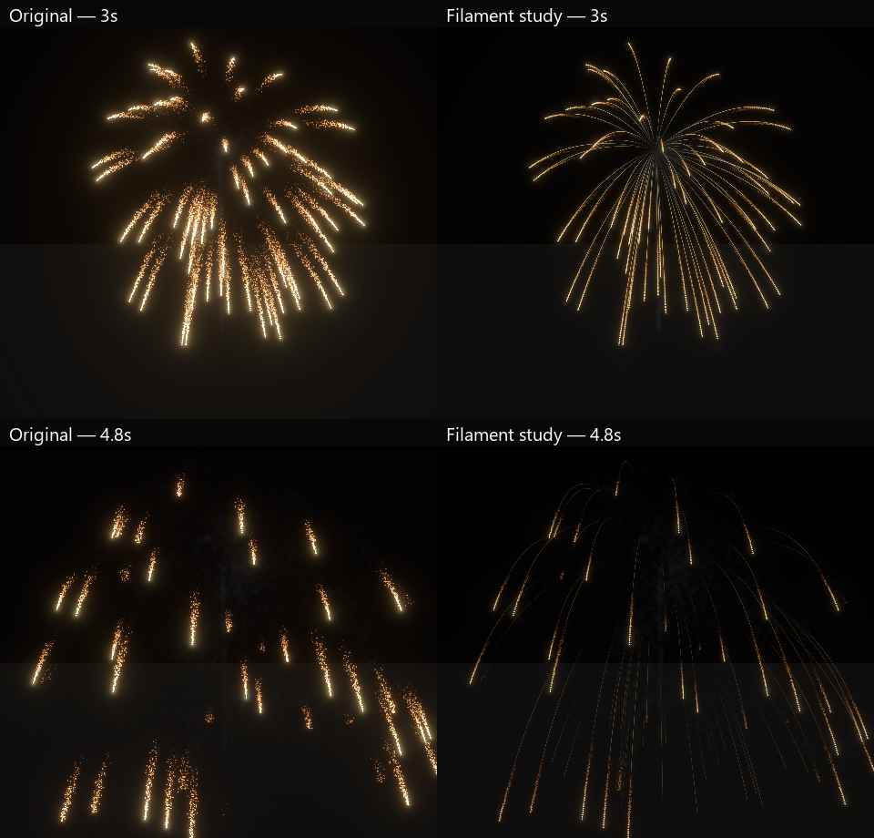

# F8 visual correction: isolated gold filaments

The user's newer video frames show thin connected luminous spokes followed by
progressively dimmer granular falls. Our existing gold shell concentrates image
energy into detached bright heads and loose ember clusters. Expanding the
repertoire does not resolve that morphology.

The saved control exposes an imbalance: head/ember radiance gains are both 24,
versus 4 for its ribbon, whose history lasts only 0.65 seconds. A separate saved
gold-filament study now prioritizes connected trails before more family expansion.

| Property | Control | Study |
|---|---:|---:|
| Head radiance gain | 24 | 18 |
| Ribbon radiance gain | 4 | 32 |
| Ember radiance gain | 24 | 6 |
| Ribbon width (world units) | 0.12 | 0.075 |
| Retained ribbon time | 0.65 s | 2.4 s |
| Maximum history points | 64 | 64 |
| Authored sample interval | 1/60 s | 1/24 s |
| Initial head size | 0.6 | 0.22 |
| Initial ember size | 0.35 | 0.18 |
| Ember launch speed range | 0.6–2.8 | 0.15–0.8 |
| Ember turbulence | 0.9 | 0.08 |

Smaller heads cool/fade earlier. Narrower ember motion keeps residual sparks near
the parent path. The existing ribbon material tapers alpha along the strip; its
longer history makes the connected form visible. The existing 64-point validation
bound is respected through a longer sampling interval. Parent integration is
unchanged. A first connected draft was too dim/clean and remains rejected evidence;
the refinement raises filament and fine-ember brightness without restoring large
sprites. These are generic saved trail, material, appearance and motion settings,
available in the editor. No special firework shader or renderer was added.

Four native high/medium audience runs deliver 28 images with the same HDR/bloom,
lights and experimental transparency. Both have zero observed fragment/event loss
and complete cleanup. Accepted births are identical: 32 main stars, 33,324 gold
embers, 5,554 star-path smoke, 43 launch smoke, one flash and 24 burst smoke.
High preserves its corresponding control birth totals as well. All tiers compile;
four native editor-viewport captures render the study. Strict
Clippy, authoring/host regressions and formatting pass.



These are identical crops from high-tier native captures, with no brightness editing. The
[ledger](f8-gold-filaments-2026-10-30.json) fingerprints assets, reports and PNGs.
Independent forward captures are not photometric calibration against the video
or frame-exact lighting comparisons.

**This is not realism approval.** Continuity is closer, but the spokes remain too
clean/regular. Fine burning texture, brightness variation, cooling timing and
camera response still need reference matching. The stage/background remains a
calibration environment. Dense-overlap costs, low native rendering and
production budgets remain unqualified. This study does not replace frozen demo
assets or repair F9 capacity/performance failures. Review one shell in motion
before applying the look across families or changing the default show.

Run **Aestra: Review Gold Filament Study** in VS Code, or:

```powershell
cargo run --release --locked -p aestra-demo-fireworks -- --smoke-art-show --effect effects/fireworks_gold_filament_candidate.aestra.ron --tier high --experimental-oit --star-lights --no-audio
```

Use `fireworks_gold_filament_control.aestra.ron` for the original look. Both are
editable in the `assets/test` project. Regenerate only this pair with
`cargo run --release --locked -p aestra-demo-fireworks --bin author_fireworks_filament_study`.
