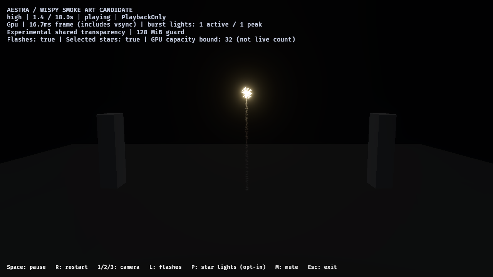
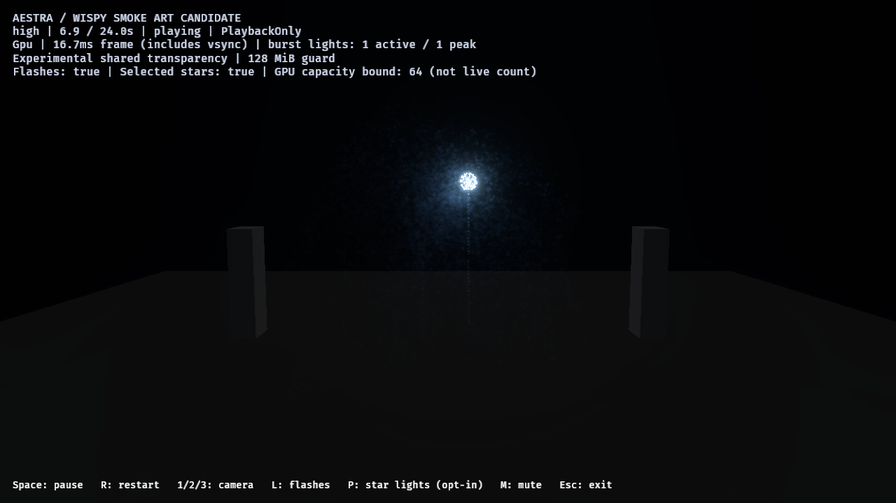

# F8 gold smoke reference draft

This records the first UV-noise draft. The current opt-in candidate is developed
further in the [coherent smoke motion review](f8-coherent-smoke-motion-2026-10-29.md).
The ledger here preserves the earlier fingerprints and local review overlay;
its captures and costs must not be attributed to the later revision.

The separate `fireworks_gold_tail_reference_smoke` candidate changes the smoke
mask and size/opacity curves. It preserves simulation, lifetimes, birth routes,
budgets, luminous renderers and scene/particle lighting. All 97 original asset
fingerprints in the frozen v1 baseline still match. The normal showcase remains
unchanged; this is an opt-in draft, not final art acceptance.

The supplied fireworks video, especially the cached 132/135-second colored-smoke
frames, guides silhouette, lingering strands and later-burst illumination. It is
a qualitative reference: exposure, scale and luminance are not calibrated to the
demo. See the [fingerprinted ledger](f8-gold-smoke-reference-2026-10-29.json) for
the video, author/mask/assets, binary, raw reports and all image hashes.

The mask curves and rotates seed-varied strands, distorts its existing three
noise octaves and erodes old samples. Launch samples start slightly wider; burst
and star-path particle sizes retain the baseline curves after the capacity
revision. Faint late opacity lasts longer without increasing particle lifetime.
Light gains and ambient colors remain unchanged.

## Native checks

All runs use the preserved release opt-level-3 public demo binary, native GPU on
RTX 4070 SUPER/Vulkan, 1280×720 HDR/TonyMcMapface, bloom 0.15, Msaa::Off and audio
off. No runtime code changes or viewer implementation were needed for this draft.

| Image case | Runs / captures | Result |
|---|---:|---|
| Complete isolated gold shell, control/candidate, 0.8–17.5 s | 2 / 16 | No observed fragment loss; natural final population zero |
| Gold then blue burst, control and four candidate lighting/visibility controls | 5 / 35 | Older smoke lighting witness; no observed loss; final zero |
| Gameplay-owned twelve-launch overlap, audience / near | 2 / 10 | Both pass observed capacity, all launches/detonations/flashes and final cleanup |

The isolated shell and two-burst fixtures use authored calibration timelines;
the final audience/near checks use gameplay-owned rockets. The copied review
project replaces only its gold art under the existing effect ID. Blue art stays
unchanged. Original project assets remain intact.

Audience/near image lanes attempted up to 5,993,096 / 20,579,093 fragments across
the partitioned frame, with zero dropped fragments or invalid links. Node/head
storage stays **47,923,200 bytes** under the existing 128 MiB ceiling; this is not
total VRAM. Both preserve **374,514 gold-tail ember and 115,283 star-path smoke
births**, with no source overflow, expansion omission or destination rejection.
The existing benchmark runner explicitly budgets 24 owners, records no admission
waits and drains gameplay rockets/VFX owners to zero; normal showcase admission
remains uncapped. Attempted totals across regions are not simultaneous pool demand.

### Later-burst lighting control

At 6.9 seconds the asynchronously observed old gold shell has no main stars,
embers or burst flash, while 11,209 old star-path smoke particles remain. The
younger blue shell has 128 stars and a flash, but no star-path smoke yet.
The fixed previously used ROI `[500,200,620,360]` excludes the new bright core.
Mean signed native 8-bit RGB for
`(lit-visible − lit-hidden) − (unlit-visible − unlit-hidden)` is:

| Time | RGB difference |
|---|---|
| 6.7 s, before blue break | 0, 0, 0 |
| 6.9 s | 1.191, 3.065, 5.831 |
| 7.4 s | 0.144, 0.294, 0.384 |
| 8 s | 0.112, 0.237, 0.393 |
| 12 / 16 / 23.5 s | 0, 0, 0 |

Hidden controls change star-smoke density only, retaining particle work; unlit
controls disable selected lights and flash intensity. These are independent live
captures, not exact frame-paired or photometric measurements. The controls support
old-smoke illumination, not an artistic approval threshold or attribution to just
one light family. Population observations lag the screenshot request.

## Rejected draft and release cost

The first broader envelope passed the isolated cases but failed full audience
overlap with **64,219 dropped fragments**. Its report, overlay and author/mask
snapshots remain in the ledger as rejected evidence. The revision narrows the
rendered envelope and restores burst/star sizes; no particles were cut and no
storage ceiling was raised to make the check pass.

One fresh sequential control/candidate release profile pair, separate from images
and without overlapping builds/GPU work, reports render-graph GPU p95:

| Phase | Original ms | Candidate ms |
|---|---:|---:|
| Launch / overlap | 9.133 | 8.854 |
| Active fireworks | 10.281 | 10.364 |
| Smoke drain | 9.435 | 9.437 |
| Idle | 2.224 | 2.231 |

Both complete the twelve-launch workload with zero observed loss and cleanup.
This is one observational pair, not a speedup/regression certification or a
replacement for the [repeated release v1 baseline](showcase-v1-release-2026-10-29.md).
Phase populations are asynchronously classified and sample counts differ.
Render-graph timestamps exclude presentation and some uploads; nested pass
quantiles must not be added. These numbers do not certify stable 60 FPS.

## Reproduce and next art gate

The [demo README](../../demos/fireworks/README.md#f8-gold-smoke-reference-draft)
has single-shell and fresh host-overlay commands. The existing review runner now
accepts `-ProjectRoot` and fingerprints its actual asset tree. The final native
overlay is `target/fireworks-f8/f8-reference-project-final-2026-10-29`; raw run
locations and SHA-256s are in the ledger. Target artifacts are local; four selected
unaltered PNGs are retained beside this review.

The author regression regenerates all three saved assets, compiles high/medium/low
and checks unchanged birth routes, renderer/light contracts and all module fields
except smoke size/opacity. Final native images qualify high only.

The wake still looks somewhat beaded, and the later-lit cloud remains too grainy
relative to the reference. Next tune continuity and larger coherent wisps in
motion, preserving deposited particle behavior, then review the blue family and
audience composition. These 61 sampled forward captures are not a continuous
motion comparison. Other tiers/hardware, audio/environment, default adoption and
production-finale/F9 acceptance remain open.
