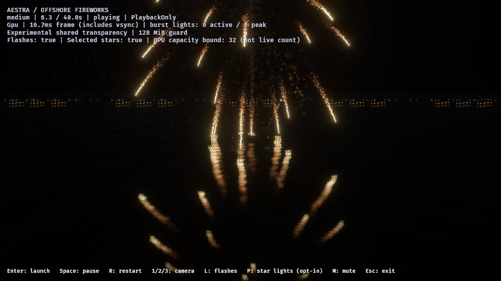
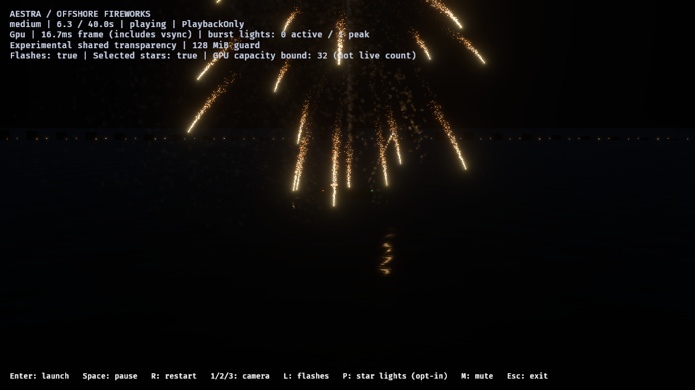
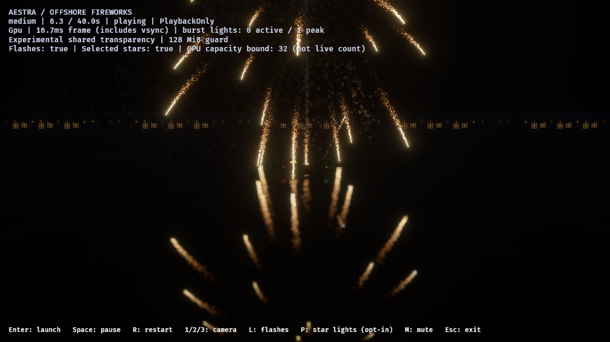

# F8: shared additive planar reflection prototype

The offshore demo and editor water preview now share
`preview::planar::PlanarReflection`. This is explicit experimental opt-in:
`--scene sea --water-reflections` in the demo, or **Settings → Preview → Water
reflections (experimental)** with the editor water surface enabled.

The reflection camera reuses native particle buffers and trail history, with
independent visibility, billboard orientation and trail culling. No player,
simulation tick, host rocket, sound output or replay history is added. It captures
eligible additive sprite/trail/flipbook presentation and ordinary opaque scenery.
All water receivers are excluded, as are foreign transparent draws and alpha
smoke. The main-view partitioned OIT guard remains enabled and unchanged.

The camera uses a proper right-handed mirrored basis and reverse-Z oblique plane
clipping. Water samples the HDR target through the actual mirrored projection,
wave-normal distortion, a normalized nine-tap Gaussian filter and Fresnel. The
capture has no UI, bloom or display tonemapping; main-view display processing is
applied once. Analytical point specular is replaced in reflection mode to avoid
duplicating the luminous source. The initial remaining direct term is unshadowed
clustered point diffuse; general receiver-lighting parity remains open.

## Native evidence

The [ledger](f8-planar-reflections-2026-11-01.json) records a preserved release
binary, source fingerprints, three Vulkan/RTX 4070 SUPER runs and 24 delivered
native images. All use medium-tier, five spaced rockets, PlaybackOnly, no owner
cap, the water-review camera and the unchanged 4×4 experimental OIT transport.
The controls are reflection-off/calm, reflection-on/calm and reflection-on/rough.
The first capture contains just one ascending rocket; later captures cover both
point-star and gold-tail families, detached wakes and final cleanup.

- Every run delivers five launches, five detonations and five main-break output
  messages, with exactly the same 85,893 accepted event-linked births. Entity
  IDs and asynchronous readback sample counts are not used as cross-run identity.
- No observed source overflow, destination rejection, expansion omission,
  fragment loss or invalid links; all runs drain to zero particles and owners.
- Main OIT node/head allocation is identical: 47,923,200 bytes. The reflection
  requests no second OIT list or per-particle alpha permutation.
- Reflection-on reports a 640×360 target, 22 peak queued additive draws and 15
  peak omitted transparent draws. Queue counts are not live particles or GPU
  completion assertions.
- The target-family estimate is 6,451,200 bytes (6.15 MiB): explicit HDR output,
  two HDR intermediates and depth at 28 bytes/pixel. The default 16 MiB policy
  reduces resolution when needed; it does not limit effect owners. View-local
  indirect/geometry resources and driver residency are outside this estimate.

The earlier five-tap cross filter produced visible cross-shaped highlights. Its
images/reports remain retained under `target/fireworks-f8/planar-final-2026-10-31`;
the final matched runs above use the smoother normalized Gaussian. A preserved
launcher failure in that earlier directory is a missing explicit project path
after moving the binary, before any GPU run, and is not discarded or counted as
successful rendering.

## Verification and limits

The shared renderer suite passes 196 tests (four existing hardware tests remain
explicitly ignored), including projection/clipping, an off-screen-source ray,
target reuse/resize/invalid-config/teardown, paused/reset instance ownership and
effective-material filtering. The 56 demo tests, editor water/reflection toggle
lifecycle regression, pipeline-preparation regressions, formatting and strict
Clippy for renderer/editor/demo with optional audio pass. The runner exposes
`-WaterReflections` and `-Camera water`, checks reflection admission and records
the additional source fingerprints.

The water camera intentionally includes more sea: some aerial sources are above
the main frame while their reflections remain visible. The geometry regression
tests this distinction. Native water controls cover that view; wider audience,
moving camera, barge-occlusion negative controls and native editor/view teardown
still need broader qualification. Headless ownership tests are not a GPU fence.

These image runs include health scans/readback and are not isolated GPU timing.
Capture/filter/composite timings, per-view buffer accounting, multiple reflection
resolutions and integrated subpixel-energy measurements remain open. The five-
spaced-rocket fixture does not certify the dense variety/finale workload or close
the existing F9 failures. Alpha-smoke attenuation, roughness mip chains, finite
receiver visibility skipping, other direct/indirect lighting and final realistic
water art remain open. Geometry is still flat, with no foam or refraction.
