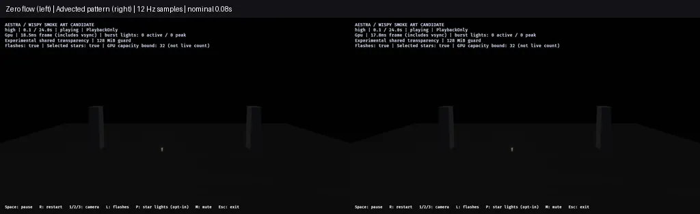

# F8 smoke pattern advection

Review completed 2026-10-30; local capture batch names retain `2026-10-29`.

The opt-in smoke material now samples its shared density field at
`world_position - pattern_velocity * effect_time`. Its exposed **Smoke pattern
velocity** defaults to `[0.6, 0.12, 0.08]` world units per effect second. Neighboring
particles in one effect use the same phase, rather than moving their noise with
individual particle ages/seeds. Zero velocity restores an anchored pattern.

This is procedural density advection, not a fluid solver or a change to particle
physics. Particle motion, smoke size/opacity, births, lifetimes, budgets, lighting
and pair choreography remain unchanged from the
[mixed-family revision](f8-blue-gold-smoke-2026-10-29.md). Only the flow parameter,
its material binding and reference metadata change in the family effects. All
97 original showcase asset hashes still match, and the default showcase remains
unchanged. The existing release binary loads the new material; no runtime code
or replay/history work was needed.



## Clock and host contract

The material uses `MaterialInput::EffectTime`, following the existing playback
clock rather than wall time. It therefore follows effect playback pause/restart;
this pass verifies the clock binding in the compiled material, not a new manual
window/pause lifecycle qualification. Different wake/burst owners have their own
clocks; this is not one global weather phase.

The exposed parameter ID is
`a3574a00-0000-4000-8000-000000f8d810`. Set it on an individual effect player at
spawn through the existing `EffectPlayer::set_parameter` API:

```rust
player.set_parameter(
    aestra_core::ParameterId::from_u128(0xa3574a00_0000_4000_8000_000000f8d810),
    aestra_core::Value::Vec3([0.6, 0.12, 0.08]),
)?;
```

The parameter affects the pattern only, not the smoke Motion modules. Changing
velocity after playback has started rephases `velocity * time`; it does not
integrate changing weather. Set a constant at spawn, or use zero for the previous
anchored appearance. A host requiring continuous changing wind needs an integrated
phase/flow design; this draft does not claim that contract.

Regression tests compile both families and their pair at high/medium/low tiers,
resolve public GPU material bindings, verify the EffectTime input, set zero
velocity through the typed parameter route and refresh its uniform values. The
compiled material `Arc` stays the same across refresh. Existing light/color
values, renderer/scene-output contracts and nonappearance modules remain checked.
Two author tests, strict demo Clippy and workspace formatting pass.

## Native checks

One explicit zero-flow project and one advected project use the same seven-input
shader, seeds, camera and workload. Only four effect files differ between them:
the flow default in the two candidate assets and their host-ID overlay copies.
The common program default is overridden through the effect binding in both cases.

All lanes use native RTX 4070 SUPER/Vulkan, high tier, optimized release,
1280×720 HDR/TonyMcMapface, bloom .15, Msaa::Off, PlaybackOnly and audio off.

| Final image lane | Captures | Maximum attempted fragments across frame | Observed loss / final alive |
|---|---:|---:|---|
| Zero-flow pair | 282 | 855,361 | 0 / 0 |
| Advected pair | 282 | 875,761 | 0 / 0 |
| Advected gameplay audience | 7 | 5,874,284 | 0 / 0 |
| Advected gameplay near | 7 | 20,097,617 | 0 / 0 |

All **578 captures** deliver. Both gameplay lanes retain 12 launches/detonations/
flashes, **374,514 gold-tail ember and 115,283 star-path smoke births**, no source
overflow/expansion omission/destination rejection and zero final gameplay rockets
or VFX owners. Node/head storage stays **47,923,200 bytes** under the existing
128 MiB ceiling, not total VRAM. Frame totals across regions are not simultaneous
pool demand. The existing benchmark budget is 24 owners, with no admission waits;
normal showcase admission remains uncapped.

Both forward sequences sample 0.0833–23.5 seconds at nominal 12 Hz. The labeled
WebP downsizes each side to 512×288 and uses lossy encoding; native PNGs and request
times are fingerprinted in the [ledger](f8-smoke-advection-2026-10-29.json).
These are independent live captures, not exact frame pairs or a performance video.
No exposure adjustment, interpolation or replay is used.

As a separate sanity check against the prior anchored-material sequence, all
282 zero-flow request times match; **251 body crops match byte for byte** outside
the HUD. The other 31 differ, with maximum crop mean absolute RGB difference
0.202 on the native 0–255 scale. Their times/pixel counts/deltas are retained in
the ledger. This is not a full exact-image regression, and no cause for those
live-run differences is asserted.

## Separate release cost observation

One sequential pair compares zero flow and advection, outside screenshot/build
workloads. Render-graph GPU p95:

| Phase | Zero flow ms | Advection ms |
|---|---:|---:|
| Launch / overlap | 9.704 | 9.567 |
| Active fireworks | 10.549 | 10.659 |
| Smoke drain | 9.136 | 9.107 |
| Idle | 2.259 | 2.254 |

Both profiles pass observed capacity/cleanup. The active difference is about
0.110 ms in this one pair; it does not establish a causal regression, repeated
budget or stable 60 FPS. Phase classification is asynchronous, render-graph
timestamps exclude presentation/some uploads, and nested quantiles must not be
added. Material uniform layout gains the flow vector and the shader interpolates
effect time; unchanged node/head bytes are not a claim of identical total memory.

## Visual assessment and next gate

The density pattern now drifts instead of staying fixed in world coordinates,
while the existing particle simulation still carries the plume. The change is
subtle at audience scale. Individual billboard shapes remain visible, and this
projected two-dimensional noise field is not physically coupled smoke flow.
The supplied video remains qualitative guidance without calibrated exposure or
world scale.

Use the [demo commands](../../demos/fireworks/README.md#f8-gold-smoke-reference-draft)
to generate a fresh overlay and preview both families or the gameplay show.
Next review the remaining billboard structure and plume silhouette against the
reference before final art/default adoption. Other-tier native art, hardware,
audio/environment and production-finale/F9 acceptance remain open.
