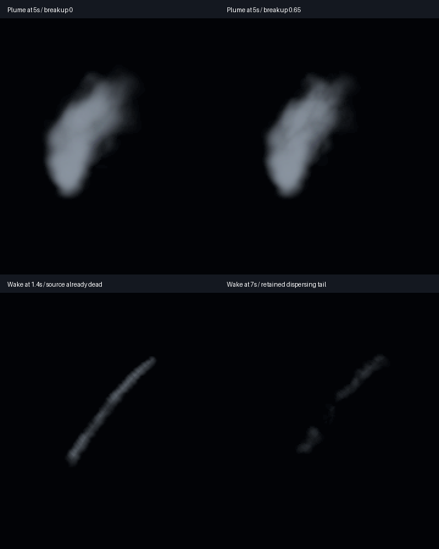

# Shared smoke breakup and deposited-wake editor lab

The shared `ADVECTED_SMOKE_WESL` kernel now exposes **Smoke billow breakup**.
The default 0.65 contracts the rounded envelope unevenly using the shared coarse
density, and amplifies already-sampled detail to fragment older smoke. Fresh
cores retain more continuity. Zero reproduces the previous mask calculations;
the shader clamps the new control to 0–1. Noise remains three octaves, with no
additional texture, noise stack, births or enlarged envelope.

This is a modest sprite-material refinement, not volumetric realism or final F8
art approval. The plume comparison is subtle; older wake fragmentation is clearer.
The original showcase assets and ordinary defaults remain unchanged. The reference
candidate stays opt-in.

## Editor benefit

Both **Smoke Material Lab** and the new **Smoke Wake Lab** use the shared program
and function. Breakup is an exposed effect parameter, also available through the
typed host parameter API without replacing the compiled material. Existing density,
flow and feather controls remain separate. See the [editor guide](../../docs/examples/advected_smoke.md).

Smoke Wake Lab uses ordinary distance events: one deposit per world-space unit,
zero inherited velocity and no independent smoke emission. Its invisible source
dies at 1.3 seconds, leaving slowly drifting deposits with 8–10-second lifetimes.
All deposits expire before the 14-second loop restarts. A slanted trajectory and
wider lab-only sizes make the behavior easier to inspect. Demo particle motion,
birth counts, lifetimes, event links, lights and choreography are unchanged.

The figure uses identical 180×210 crops at 2× nearest-neighbor scale, without
exposure adjustment. Top: plume at five seconds with breakup zero/0.65. Bottom:
the wake at 1.4/seven seconds, both after its source has died. These are fixed-time
editor-viewport captures; the demo evidence below uses forward PlaybackOnly.

Four author tests pass saved regeneration, three-tier compile/native material
bindings, typed uniform refresh/program reuse and deposited-wake graph contracts.
The editor graph test finds the new exposed control. All 51 regular thumbnail tests
pass; the explicit native GPU regression renders both labs, checks visible pixels
and framing, advances hover players and checks resource cleanup. Strict editor/demo
Clippy and formatting pass.

## Native show and lighting checks

RTX 4070 SUPER/Vulkan, high tier, optimized release, 1280×720 HDR/TonyMcMapface,
bloom 0.15, Msaa::Off, PlaybackOnly, audio off. The preserved demo binary loads the
new saved material/function through existing public APIs. The editor renderer was
rebuilt and uses its 960×540 LDR viewport path.

| Image lane | Captures | Maximum attempted fragments across frame | Observed loss / final alive |
|---|---:|---:|---|
| Zero-breakup pair | 14 | 1,337,724 | 0 / 0 |
| Breakup pair | 14 | 976,238 | 0 / 0 |
| Breakup pair, lights off | 4 | 974,027 | 0 / 0 |
| Gameplay audience overlap, 4×4 OIT | 8 | 3,984,890 | 0 / 0 |
| Gameplay near overlap, 4×4 OIT | 8 | 13,645,766 | 0 / 0 |

All **48 demo and 14 final editor captures** deliver. An earlier straight, narrow
wake-lab draft remains under `target`; the final six wake captures use the readable
slanted fixture. Pair controls differ only in four effect-default breakup values;
material/function files are identical. The separate lights-off lane changes only
light settings. At 6.9 seconds, later blue lighting reveals retained smoke that is
faint in the unlit control; this is qualitative image evidence, not calibrated
scattering or an isolated single-cohort radiometric test.

Both gameplay image lanes retain 12 launches/detonations/flashes, 374,514 gold-tail
ember births and 115,283 star-path smoke births. Source overflow, expansion omission,
destination rejection, final gameplay rockets and final VFX owners are zero.
Node/head storage stays 47,923,200 bytes under the same 128 MiB guard; this is not
total VRAM. Across-frame/region attempted totals are not simultaneous pool demand.
The benchmark retains its explicit 24-owner budget with no waits; ordinary showcase
admission remains uncapped.

## Separate release timing observation

One sequential zero/candidate profile pair, outside screenshots and compilation,
uses the same host audience/4×4 lane, including its existing bounded health scans.
Paired render-graph GPU p95:

| Phase | Zero breakup ms | Breakup 0.65 ms |
|---|---:|---:|
| Launch / overlap | 9.333 | 9.250 |
| Active fireworks | 10.395 | 9.933 |
| Smoke drain | 9.042 | 7.951 |
| Idle | 2.228 | 2.233 |

Both profiles pass observed capacity and cleanup. Reduced alpha footprint is
consistent with less transparency work, but this single pair does not establish
a causal speedup, a repeated hardware budget or stable 60 FPS. Phase attribution
is asynchronous, timestamps exclude presentation/some uploads, and nested scopes
must not be summed.

The [ledger](f8-smoke-breakup-editor-2026-10-30.json) records native PNGs, reports,
run manifests, input/binary hashes and retained review images. Independent forward
captures are not exact frame pairs. Final reference acceptance, other-tier/hardware
native art, smoke self-shadowing/physical flow and production-finale/F9 remain open.
