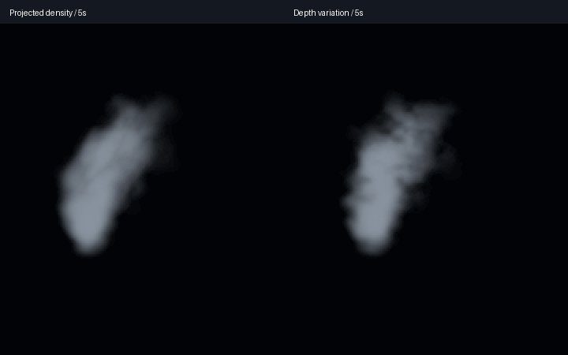

# Shared smoke depth variation and camera review

**Smoke depth variation** is a new Boolean effect/material control. Enabled, the
shared smoke kernel samples a three-dimensional world-space density field. Disabled,
it retains the previous projected two-dimensional field. The projected field has
an oblique direction along which density repeats; the depth mode makes all three
axes independent. Both modes keep the same effect-clock advection, feathering,
breakup and fresh-core treatment.

This changes density sampled on billboard surfaces. It does not provide a volume
raymarch, self-shadowing, optical-mass conservation or physical fluid flow, and it
does not establish final photographic smoke acceptance.

## Editor benefit and compatibility

**Smoke Material Lab** and **Smoke Wake Lab** expose the same toggle in the sample
project. Their program/function and the opt-in fireworks candidates share
`aestra_gpu::shader::ADVECTED_SMOKE_WESL`. The original showcase's 97 frozen asset
hashes still match. Ordinary demo defaults remain unchanged.

The new typed Boolean parameter is
`a3574a00-0000-4000-8000-000000f8d814`; material parameter `...f8d708` binds it.
All three tiers compile, and tests switch it false/true through the public host
parameter API while retaining the same compiled material allocation. Tests also
verify saved regeneration and unchanged demo motion, births, lifetimes, event
links, lighting, budgets and choreography.

Both images show five seconds in the editor's native viewport regression renderer.
They use identical 180×210 crops at 2× nearest-neighbor scale, with no exposure
adjustment. All four full projected-control captures at 2, 5, 9 and 13.9 seconds
match the prior breakup kernel's RGB pixels exactly. The new mode changes the
internal shape; this is not a claim that every view is artistically approved.

The wake lab still leaves deposits after its source dies and drains before its
next loop. Its six captures cover 0.8, 1.4, 3, 7, 11.5 and 13.9 seconds. Both labs
pass the native thumbnail test's visible-pixel/framing, hover advancement and
resource cleanup assertions. All 51 ordinary thumbnail tests and the editor graph
discovery/control test pass. Strict editor/demo Clippy and formatting pass.

See the [editor guide](../../docs/examples/advected_smoke.md) for controls and reuse.

## Forward camera and capacity checks

Native RTX 4070 SUPER/Vulkan, high tier, optimized release, 1280×720,
HDR/TonyMcMapface, bloom 0.15, Msaa::Off, PlaybackOnly and audio off. A preserved
demo executable loads the new authored function/program via existing APIs; the
editor viewport regression executable was rebuilt and uses 960×540 LDR.

| Gameplay image lane | Captures | Maximum attempted fragments across frame | Observed loss / final alive |
|---|---:|---:|---|
| Projected-field orbit control | 12 | 4,742,610 | 0 / 0 |
| Depth-varying orbit | 12 | 4,835,470 | 0 / 0 |
| Depth-varying side | 12 | 4,833,098 | 0 / 0 |
| Depth-varying near | 8 | 13,902,751 | 0 / 0 |

All **44 demo plus 14 editor captures** deliver. The orbit uses the existing smooth
constant-radius camera sweep, separate from profiling. These are independent
forward runs at nominal sample times, not exact paired frames or continuous-motion
artifact certification. Side/orbit images remain useful visual review material;
the finite sprite silhouette and view-dependent sampling are still present.

Every gameplay image lane preserves 12 launches/detonations/flashes, 374,514
gold-tail ember births and 115,283 star-path smoke births. No source overflow,
expansion omission or destination rejection is observed. Final gameplay rockets
and VFX owners are zero. Controls differ only in four effect-default Boolean values;
their material/function files are identical.

All lanes use 4×4 experimental OIT with the existing 128 MiB guard. Node/head
storage stays 47,923,200 bytes, not total VRAM. Density redistribution changes
fragment demand; across-frame/region attempted totals are not simultaneous pool
demand. The benchmark retains its explicit 24-owner limit with zero waits;
ordinary showcase owner admission remains uncapped.

## Separate timing observation

Depth mode interpolates eight corners per octave rather than four, retaining
three octaves and no sampled textures. One sequential release profile pair uses
the audience camera, no screenshots/build activity, and the same bounded 4×4
health scans. Render-graph GPU p95:

| Phase | Projected ms | Depth variation ms |
|---|---:|---:|
| Launch / overlap | 9.001 | 9.255 |
| Active fireworks | 9.908 | 9.999 |
| Smoke drain | 8.008 | 8.418 |
| Idle | 2.227 | 2.249 |

Both profiles pass observed capacity and cleanup. This records the mode's tradeoff;
one pair does not isolate a causal cost or certify stable FPS. Phase classification
is asynchronous, graph timestamps exclude presentation/some uploads, and nested
scopes must not be added.

The [ledger](f8-smoke-depth-editor-2026-10-30.json) records reports, manifests,
PNG/input/binary hashes, previous-control matches and retained review images.
Freeze the shared control set for the next acceptance pass: medium/low native art
and the named finale workload remain to qualify, alongside final visual review.
This pass does not complete F8, adopt the candidate by default or certify F9.
