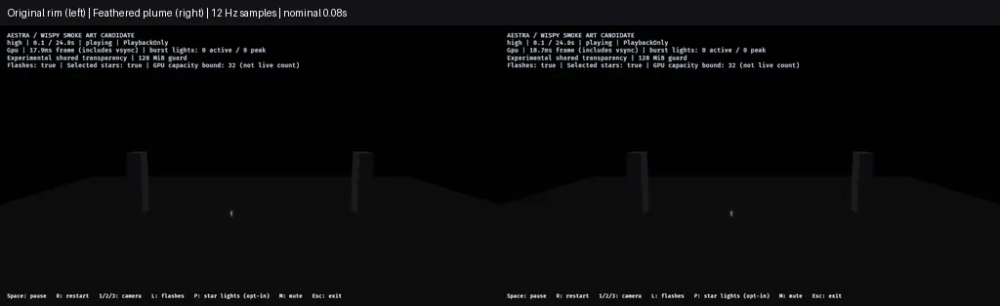
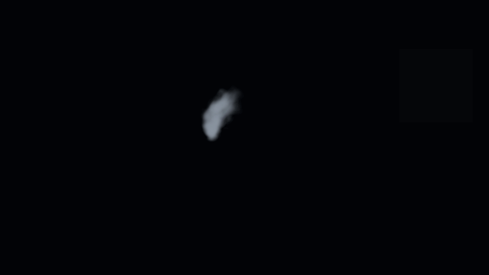

# Shared smoke feathering: editor and demo qualification

This pass addresses individual puff edges and promotes the implementation into
reusable editor content. The new **Smoke edge feather** control widens the outer
falloff and reduces age-driven rotation. A modest central compensation retains
body; it is not an exact optical-mass normalization. Default 0.75 is shader-clamped
to 0–1, and zero retains the previous rim/rotation range. Births, lifetimes,
particle motion, smoke size/opacity curves, lighting and choreography are unchanged
in the fireworks assets.

The change softens boundaries, but does not remove billboard geometry or establish
volumetric/photographic realism. The candidate remains opt-in. The supplied video
is qualitative guidance, without calibrated exposure or world scale.

## Editor benefit

- The canonical source moved from the demo into
  `crates/aestra-gpu/src/shaders/advected_smoke.wesl`, exported as
  `aestra_gpu::shader::ADVECTED_SMOKE_WESL`.
- `sample-project` now includes **Smoke Material Lab**, the **Advected Smoke**
  program and the **Advected Smoke Density** function. The lab is a normal effect
  with one emitter and no host outputs/events or dependency on the demo runtime.
- The lab exposes **Smoke density**, **Smoke edge feather** and **Smoke pattern
  velocity**. Its Material Graph and function palette entry use the same kernel
  as the demo. Brighter ambient response and a readable plume scale make the
  sample usable without night-scene lighting.
- The editor's native material-thumbnail route recognizes this exact shared
  function source, with at most four direct calls. Arbitrary edited custom WESL
  retains the existing background-preview restriction; identity/name alone cannot
  enable it. Normal graph functions and their existing routing remain unchanged.

See [the editor guide](../../docs/examples/advected_smoke.md) for opening, editing
and reusing these assets. The offline author regenerates both project copies;
regression checks compare saved sample data with the generated fixtures.

Two targeted editor tests verify project discovery, exposed controls, function
palette access, opening the material graph, native binding, thumbnail routing and
real GPU-scene preparation. Modified/missing WESL is rejected by the new route.
Three author tests verify deterministic sample/demo regeneration, both families
and pair compilation/binding at all tiers, unchanged work contracts, and uniform
updates without compiled-material replacement. Strict editor/demo Clippy passes.

The viewer's native **editor-viewport regression mode**, separate from the public
demo host, captures the saved lab at 2, 5, 9 and 13.9 seconds. Its report succeeds
on native GPU with one emitter/material program. The first, small-scale lab
capture remains local; the final report uses a larger authored plume for clearer
editor viewing. These are viewport/kernel checks, not a manual entire-editor UI
or a rendered Asset Browser thumbnail pixel acceptance claim.

## Demo capacity and workload

The final zero-feather and candidate projects differ only in four effect-default
values (two family assets and their host-ID overlay copies). Both run the same
eight-input material. The default sample/showcase assets remain unchanged;
all 97 original showcase fingerprints still match.

All demo lanes use the preserved optimized release binary, high tier,
RTX 4070 SUPER/Vulkan, 1280×720 HDR/TonyMcMapface, bloom .15, Msaa::Off,
PlaybackOnly and audio off. The editor regression uses its rebuilt viewer binary
and the editor's 960×540 LDR scene.

| Demo image lane | Captures | Maximum attempted fragments across frame | Observed loss / final alive |
|---|---:|---:|---|
| Zero feather, forward pair | 282 | 875,787 | 0 / 0 |
| Feather 0.75, forward pair | 282 | 835,507 | 0 / 0 |
| Feathered gameplay audience | 7 | 5,629,668 | 0 / 0 |
| Feathered gameplay near | 7 | 19,261,081 | 0 / 0 |

All **578 demo captures plus four final editor-viewport captures** deliver. Both
gameplay image lanes preserve 12 launches/detonations/flashes, 374,514 gold-tail
ember and 115,283 star-path smoke births, with zero source overflow, expansion
omission or destination rejection. Final gameplay rockets/VFX owners are zero.
Node/head storage remains 47,923,200 bytes under the existing 128 MiB ceiling;
this is not total VRAM. Attempted totals across regions are not simultaneous pool
demand. The existing benchmark owner budget is 24, with no waits; ordinary
showcase admission remains uncapped.

The animation contains independent 12 Hz forward samples, downscaled to 512×288
per side and encoded as lossy WebP. Native PNGs, binary/source/project/report
hashes and request-lag bounds are recorded in the
[ledger](f8-smoke-feather-editor-2026-10-30.json). It is not a performance video,
exact frame pair, exposure match or final reference approval.

## Separate release cost observation

One sequential profile pair, outside compilation/screenshots, records render-graph
GPU p95:

| Phase | Zero feather ms | Feather 0.75 ms |
|---|---:|---:|
| Launch / overlap | 9.428 | 9.298 |
| Active fireworks | 10.556 | 10.309 |
| Smoke drain | 9.104 | 8.881 |
| Idle | 2.225 | 2.243 |

Both profiles pass observed capacity and cleanup. This one pair is observational,
not proof of a causal speedup, stable FPS or a production-finale budget. Phase
classification is asynchronous; render-graph timestamps exclude presentation and
some uploads, and nested quantiles must not be added.

## Next gate

Review plume shape and residual billboard structure in both the editor lab and
the reference show before final art/default adoption. Continue promoting demo
improvements into shared implementation, editor controls/content and regression
coverage. Physically coupled flow, other-tier/hardware native art, environment,
audio and production-finale/F9 acceptance remain separate.
