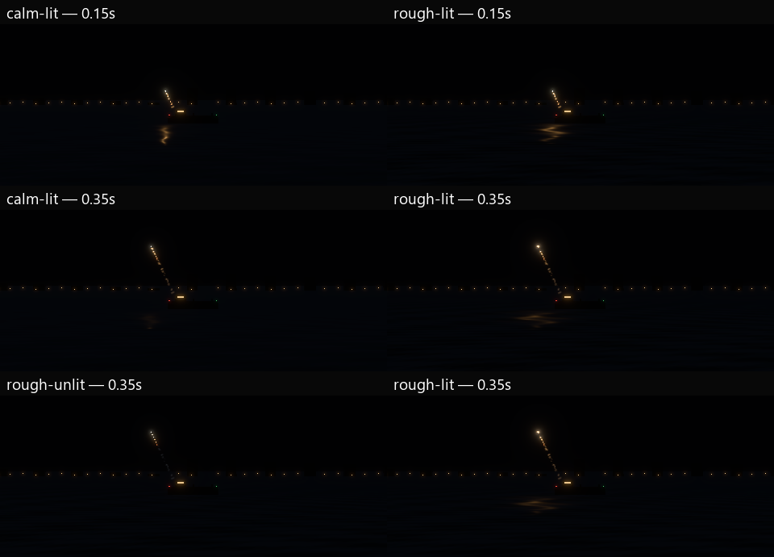
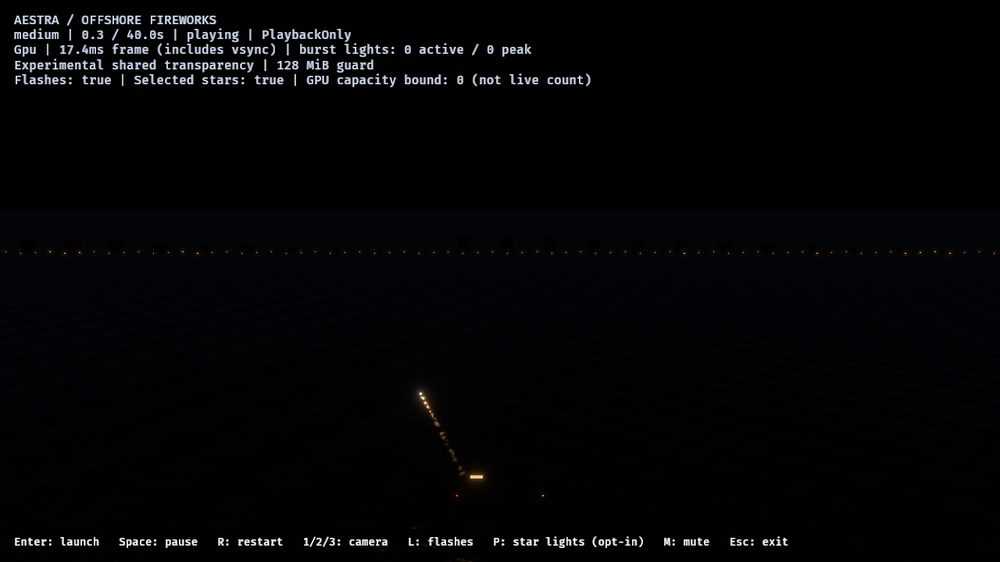

# F8: shared water receiver and wave response

The offshore demo and editor now share one public opaque water material through
`aestra_bevy::preview::water`. The earlier single scrolling normal texture is
replaced by eight directional wave bands with different speeds and wavelengths.
Fragment derivatives filter unresolved bands; their slope variance broadens the
microfacet roughness instead of producing distant subpixel glitter. Water/air IOR
1.333 supplies F0 ≈ 0.02037. The material keeps Bevy's real clustered PBR lighting.

This is a horizontal wave-normal surface. Geometry remains flat, and the small
uniform sky-radiance contribution is art-directed. It does not implement captured
sky imagery, displaced waves, foam, refraction, SSR or particle-image reflections.

The first native draft had excessive blue sky fill and subdued slopes. Its binary
and two reports remain retained. The refined defaults reduce sky radiance and
increase calm/rough wave slopes. These are surface-state controls, independent
of the VFX quality tier and particle/owner admission.

## Shared host/editor behavior

- The demo accepts `--scene sea --water calm|rough`; `--no-launch-lights` remains
  the causal lighting control. The review runner exposes `-Water calm|rough`.
- The editor adds **Settings → Preview → Water surface**, off by default. It
  replaces the grid while retaining the grid preference and follows the editor
  effect clock. One lazily created plane/material is reused across toggles.
- The demo updates its cached water material from the same root effect clock.
  Pause/restart change wave phases consistently; no independent simulation,
  extra VFX owner or per-frame mesh/image creation is introduced.
- HDR/exposure, source effects, star/flash lighting policy and the 128 MiB OIT
  ceiling remain unchanged. The receiver itself is opaque and adds no OIT nodes.

See the [water instructions](../../docs/examples/water_preview.md) for the public
API and editor usage. The uniform sky term should be zero if the host supplies
an environment map, to avoid adding a second environment contribution.

## Native controls

The [ledger](f8-water-waves-2026-10-31.json) records six final Vulkan/RTX 4070 SUPER
runs and 48 native images: calm/rough/unlit/near medium spaced fixtures, followed
by medium and low offshore variety. Every run completes without observed
fragment/event loss and drains to zero particles and gameplay/VFX owners. All
four five-rocket fixtures have identical accepted VFX births. Variety delivers
22 launches and detonations across all eight families, with no owner cap or
admission waiting, at both tiers.

The audience water-only LDR ROI `(480,590)–(720,668)` increases from 3.784 to
4.726 at 0.15 seconds and 3.761 to 4.341 at 0.35 seconds when the rocket light is
enabled. Those are mean display values on a 0–255 scale, not lux or photometric
reference matching. The rough surface breaks the launch highlight; the near
view separately exposes its wave pattern.

The new material/clock regression, 56 demo tests, two editor water/grid lifecycle
regressions, 15 installed viewport-plugin tests and settings-toggle/legacy
round-trip checks pass. Strict Clippy covers the shared renderer, editor and demo
(including optional audio). Formatting and runner syntax checks pass. The layout
guard exposed an existing loose OIT partition test file; it was moved into its
subsystem tests folder without changing the tests or production behavior.

Image runs include GPU health scans/readback and overlapped a compiler workload.
They are not ordinary frame-time, GPU-cost or total-VRAM certification. The source
still looks like an initial water/lighting foundation, not final realistic art;
earlier F9 failures remain open.

## The missing particle reflections

The user's observation is correct: the water should also reflect the visible
stars and trails. Real-light highlights do not reproduce those shapes. The
[selective planar reflection plan](../../docs/new/AESTRA_PLANAR_REFLECTIONS_PLAN.md)
proposes a lower-resolution HDR mirrored presentation pass, reusing authoritative
GPU simulation/history with view-specific culling and draw preparation. It keeps
the current partitioned-OIT guard and makes additive-only/smoke approximation
explicit. This reflection pass is not implemented by this water update.
