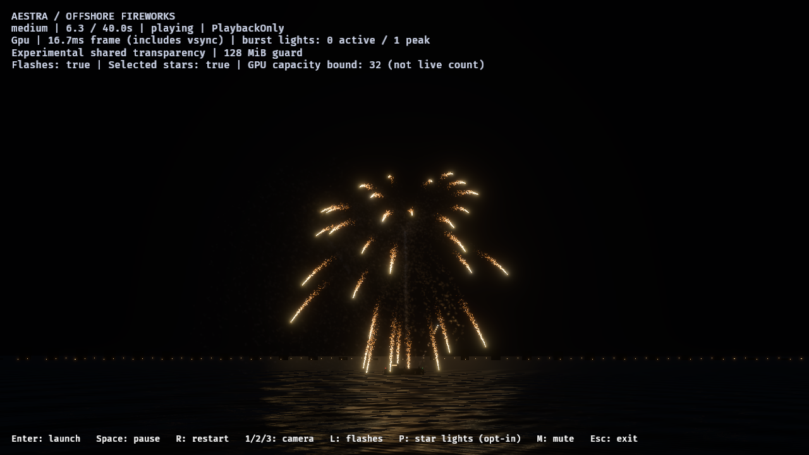
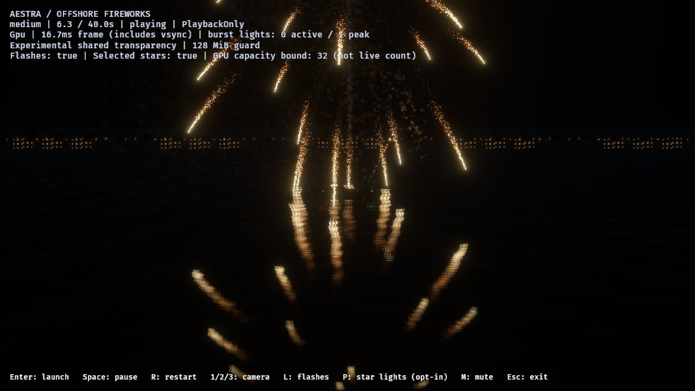
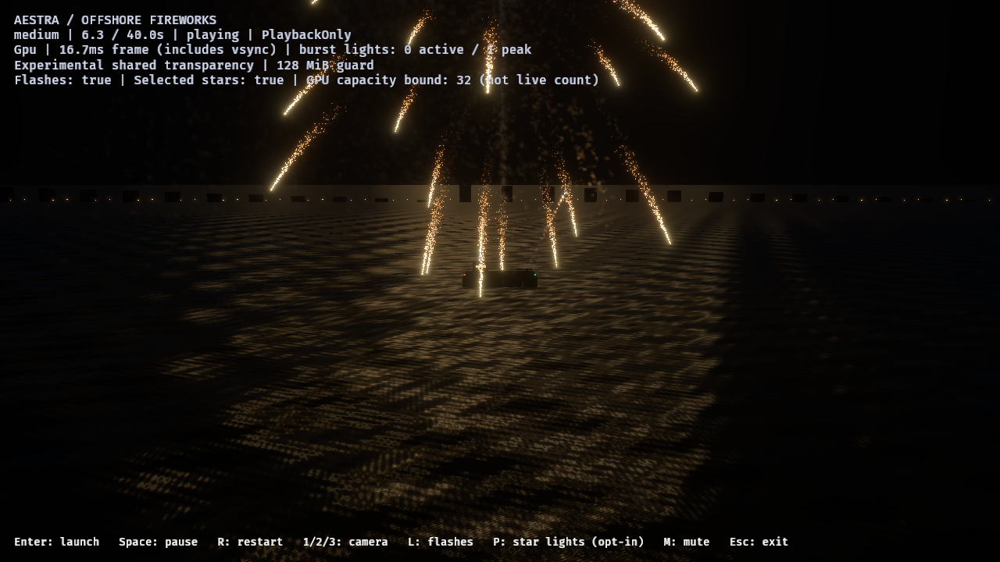

# F8: wave-normal water reflection response

The initial planar prototype read too much like a recognizable inverted firework.
Its tiny UV offset and image-space Gaussian blur are replaced in the shared
editor/demo water shader with wave-normal reflection directions, a rough
microfacet lobe, dielectric Fresnel and visibility weighting. Source emission,
particle births, gameplay motion and camera framing are unchanged. There is no
height cutoff, reflected-image brightness boost or separate reflection clock.

## Visible result

The normal audience camera shows a broken light path on the water rather than
a complete mirrored shell. The downward water-review camera separately exposes
the surface response. Calm water retains more source structure; rough water
spreads it into irregular glints/bands. These remain an art candidate for review,
not final realistic-water approval.

## Shared implementation

- Reflection directions follow the resolved wave normal. Twelve deterministic
  GGX visible-normal samples evaluate exact air/water Fresnel at IOR 1.333 and
  Smith masking, with no renormalization of samples leaving the captured field.
- A separate filtered RGBA16F image receives the capture and an area-weighted
  GPU mip chain. Solid-angle/PDF-based LOD selection replaces a fixed pixel blur.
  Reduction handles odd and one-pixel-wide dimensions without dropping the edge.
- Cached GPU texture views/bind groups rebuild on resize, and both images retire
  through the existing source-view lifecycle. Filtering runs between the mirror
  capture and main receiver draw; the diagnostic scope is `aestra_planar_mips`.
- The target-family estimate at 640×360 becomes 8,908,504 bytes (8.50 MiB), up from
  the original 6.15 MiB. The default configurable ceiling stays 16 MiB; resolution
  scales when needed. This excludes view-local draw buffers and driver residency.
- The same WaterMaterial/PlanarReflection API serves the editor and demo. No new
  source owner, OIT list, alpha permutation, runtime noise dependency or host
  choreography is introduced. Display processing still occurs in the main view.

The visible-normal sampling follows
[Heitz's derivation](https://jcgt.org/published/0007/04/01/paper.pdf).

## Native verification

The [ledger](f8-wave-water-2026-11-01.json) preserves a release binary and source
fingerprints, four image runs/32 delivered native captures and two separate
instrumented GPU runs on Vulkan/RTX 4070 SUPER. Image cases are calm/rough water
review views and rough reflection-on/off audience views. The common workload is
medium-tier, five spaced rockets, PlaybackOnly, no owner limit, and 4×4 guarded
OIT. Images at 0.35 seconds isolate one ascending rocket; later images cover
point-star/gold-tail bursts and final cleanup.

All image cases have identical 85,893 accepted event-linked births, five launches,
five detonations and five main-break output messages. No observed source/target
event loss or fragment/link loss, and every run drains to zero particles and
gameplay/VFX owners. The OIT node/head allocation stays 47,923,200 bytes. Profile
runs retain the same host state/outputs and capacity/cleanup checks; their
per-event birth counts are deliberately unobserved because count readback is off.

The native oracle runs the production filter shader on constant HDR and sparse
edge impulses through the complete mip chain at 5×3, 1×7, 7×1 and 4×4. All eight
cases preserve their expected mean within 0.3% (RGBA16F rounding tolerance).
The renderer suite passes 196 active tests; five hardware tests remain explicitly
ignored in that general suite, with the new filter oracle run separately and
passing. Preview target/lifecycle tests and strict Clippy across renderer/editor/
demo with audio also pass. Formatting and runner parsing pass.

One profiling launcher attempt retained image-only timestamp arguments and was
rejected before GPU startup; its log remains under `profile-off`. The corrected
`profile-off-valid` and `profile-on` runs use no screenshots/image arguments.

## Cost and remaining limits

The distinct mip-filter GPU scope measures 0.106496 ms median, 0.195584 ms p95 and
0.217088 ms max across 1,977 asynchronous samples. The instrumented overall render
graph measures off/on medians of 6.242/6.330 ms and p95 of 6.981/6.929 ms. This
single pair is noisy and does not establish a whole-frame incremental cost or
improvement. Generic repeated per-view diagnostic names are not independent
certificates for each camera. Existing OIT health instrumentation remains active.

Idle render-graph p95 rises from 2.282 to 3.603 ms in this pair: the capture still
renders static opaque scenery and filters its image after particles drain.
Static-view reuse/idle capture suppression is a follow-up optimization, with
correct camera/scene/light invalidation required. Existing F9 failures remain open.

The radiance lookup is directional sampling from a planar capture, not a
depth-aware intersection. Flat normals recover planar alignment; perturbed rays
use a far-field approximation. Nearby barge parallax, finite capture coverage,
wave self-occlusion, smoke attenuation and full receiver-lighting parity remain
limited. The geometry is flat and has no refraction or foam. The native mip
oracle verifies filtering energy, not whole-effect energy across all resolutions
or a complete white-furnace/BSDF convergence certificate. Dense variety/finale,
other GPUs, interactive editor camera/resize and final photographic matching need
further qualification.
