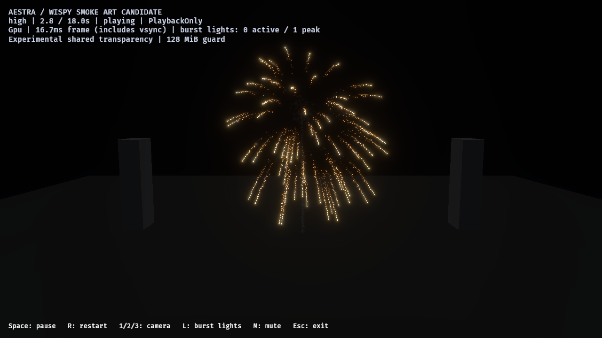
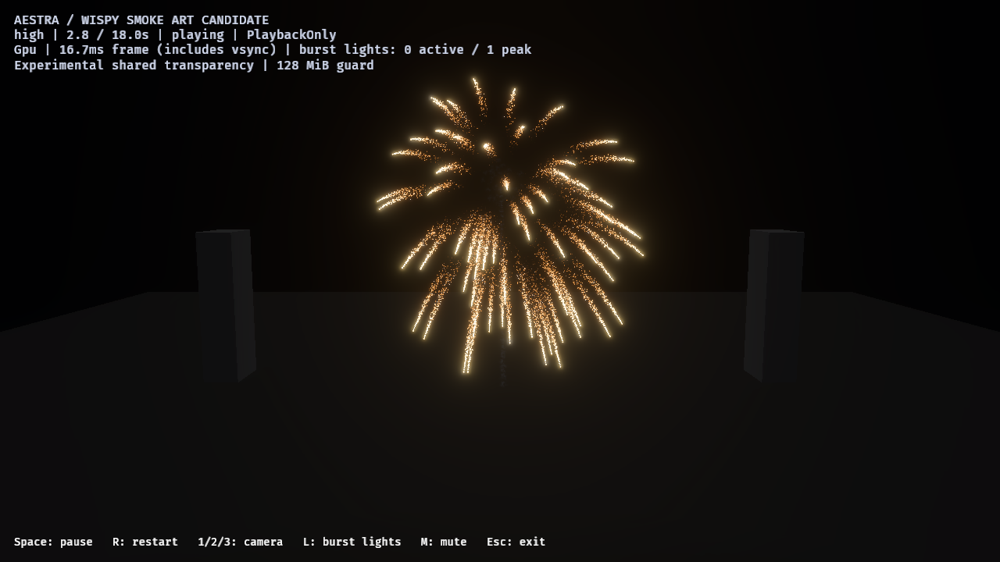

# Dense gold-tail shell calibration — 2026-10-27

A separate saved gold shell now sheds a dense, scattered shower of embers along
ballistic stars, following video 00:22–00:27.5. The first sparse revisions passed
admission but still looked like dotted wires. Following the user's density
feedback, the selected recipe increases ember births per distance **sixfold**
over the preceding revision. It remains an opt-in art candidate; smoke/show
integration and final performance/art approval are open.

[Native counts, source hashes, retained revisions and costs](gold-tail-calibration-2026-10-27.json).

## Saved authoring

`author_fireworks_gold_tails` derives a warm-gold control from the existing
isolated point-star control and creates a separate candidate. The same launch,
flash, launch/burst haze and launch/main-break output bindings remain in both.
Neither contains secondary explosions, deposited star smoke or selected lights.
Previously saved point-star and show assets remain unchanged.

| Property | Dense candidate |
| --- | --- |
| Main stars and matching ribbon capacities, high / medium / low | 64 / 32 / 16 |
| Main-star lifetime / initial speed | 2.8–4 s / 24–30 |
| Main gravity / drag | [0, −9.81, 0] / 0.4 |
| Main head / ribbon radiance gains | 24 / 4 |
| Ribbon width / history | 0.12 / 0.65 s, retained 64-point ceiling |
| Ember trigger | OnDistance spacing 0.4, max two crossings per source/tick |
| Embers per crossing / inherited velocity | 6 / 0.06 |
| Ember pools, high / medium / low | 32,768 / 16,384 / 8,192 |
| Ember lifetime / own speed | 0.45–1.05 s / 0.6–2.8 |
| Ember acceleration / drag / turbulence | [0.25, −3.5, 0.05] / 1.1 / 0.9 |
| Ember size at normalized ages 0 / 0.6 / 1 | 0.35 / 0.18 / 0.035 |

The previous revision used two embers every 0.8 units (2.5 per unit); this one
uses six every 0.4 units (15 per unit). Small random launch velocities/lifetimes
and turbulence widen and break up the spray. Gold-to-orange color, opacity and
size fade provide cooling. Embers are sprites with no ribbon histories and no
independent emission. Source motion creates their birth positions through the
existing GPU distance-event API. Their own motion leaves them behind the heads.
Separate exposed head/tail/ember radiance bindings preserve the launch/flash
materials. No new shader, runtime API or hard-limit increase is required.

Superseded sparse revision at nominal 2.8 seconds, close camera:



Dense candidate at the same time/camera:



These are unchanged native PNG copies, without retouching. The denser tails are
visible from both camera distances and retain scattered cooling embers at 3.8–5
seconds. Medium/low retain the same local spray recipe with fewer parent stars.
This is a qualitative sampled lifecycle review, not a reconstruction of the
recording's lens/exposure or a smooth-motion video acceptance.

## Native admission and cost

Six selected image cases cover gold control/candidate at high audience/close and
candidate medium/low close. Fourteen samples per case span launch, flash,
expansion, fall/cooling and quiet haze: **84 captures delivered**. The unchanged
control cases are reused from the earlier comparison, with exact saved-asset and
executable hashes checked; candidate cases use the final dense assets.

| Tier | Main stars accepted | Ember births accepted | Peak total live particles | Ember pool |
| --- | ---: | ---: | ---: | ---: |
| High, both cameras | 64 | 67,254 | 16,308 | 32,768 |
| Medium, close | 32 | 33,324 | 8,112 | 16,384 |
| Low, close | 16 | 15,354 | 3,921 | 8,192 |

All observed link demand is accepted: zero source overflow, omitted expansion or
destination rejection. Each case records one launch/main-break output and one
bound/accepted flash, zero sampled global transparency drops/invalid links and
zero final asynchronous live particles. PlaybackOnly, native RTX 4070 SUPER /
Vulkan, 1280×720 HDR/TonyMcMapface, bloom 0.15 and the experimental 128 MiB OIT
guard are retained. Image cases each retain one pending global-pipeline update;
per-view preparation reports ready. Zero drops do not prove exact compositing.

The optional host report now records all link admissions in the image lane,
keyed by owner/link index, capped at 256 records with explicit truncation. This
shows real Main-star and ember admissions independently. The legacy star-path
field remains available. Ordinary runs omit these extra records.

One separate ordinary high audience pair, without screenshots/capacity scans,
measures control/candidate host p95 **17.24 / 17.11 ms** and max **31.28 / 19.68 ms**.
Both accept their flash and drain. This is different authored work in a
vsync-inclusive development host; it does not establish equivalent GPU cost,
headroom, a speedup, stable 60 FPS or production-finale acceptance.

The default MSVC link hit LNK1140 on its reused debug database. Validation used
`cargo rustc ... -- -C link-arg=/PDB:NONE`, which created a fresh PDB literally
named `NONE`; that file was moved into ignored `target/fireworks-f8/` afterward.
Symbols were not disabled, and no Cargo profile/linker configuration was changed.
The executable hash is recorded for every selected run.

Validation: 32 public fireworks tests and the new all-tier gold authoring test
pass, with strict host all-target Clippy and workspace formatting/diff checks.
The test checks actual project compilation, saved regeneration, star/ribbon
budgets, history sample capacity, bounded distance source demand and no independent
ember emission. All **208** prior recorded asset/runtime/point-authoring source
hashes still match. Earlier sparse recipe sources and native reports are retained.

## Reproduce and next step

```powershell
cargo run --locked -p aestra-bevy --example author_fireworks_gold_tails
cargo run --release --locked -p aestra-bevy --example fireworks -- --smoke-art-show --effect effects/fireworks_gold_tail_candidate.aestra.ron --experimental-oit --no-audio
```

Replace `candidate` with `control` for the isolated warm shell baseline. Existing
`--tier medium|low` controls select explicit pools. The generic smoke-art HUD
label comes from the host mode; no deposited star smoke is present in this fixture.

```powershell
./benchmarks/fireworks/run-point-star-review.ps1 -OutputDirectory target/fireworks-f8/gold-fresh -Family gold_tail -SampleTimes '0.8,1.3,1.5,1.8,2.3,2.8,3.3,3.8,4.3,5,6,7,12,17'
./benchmarks/fireworks/run-point-star-review.ps1 -OutputDirectory target/fireworks-f8/gold-cost-fresh -Family gold_tail -Cost -Cameras audience
```

Next, integrate deposited smoke with the point-star and dense gold candidates.
Distance routes sharing a source currently must agree on spacing/max-per-tick:
copying the old 0.8-unit smoke link onto these 0.4-unit ember sources will not
compile. Agree on the shared sampler and size/tune smoke births explicitly;
do not silently retain the old 4,096-puff budget. Recheck overlap, opacity,
illumination and drain before composing a denser host show. This single-shell
qualification does not certify simultaneous production-finale loads.
