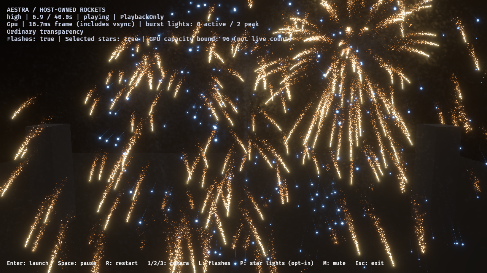
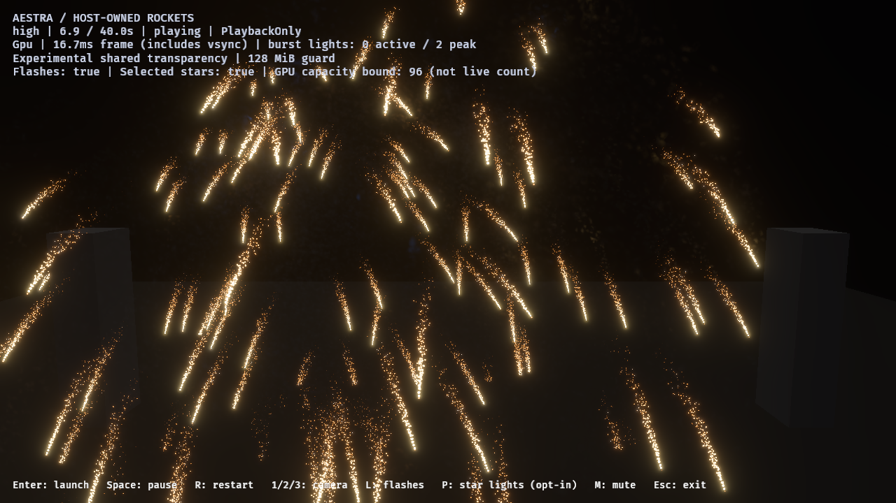
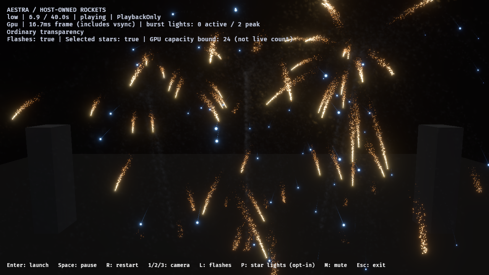
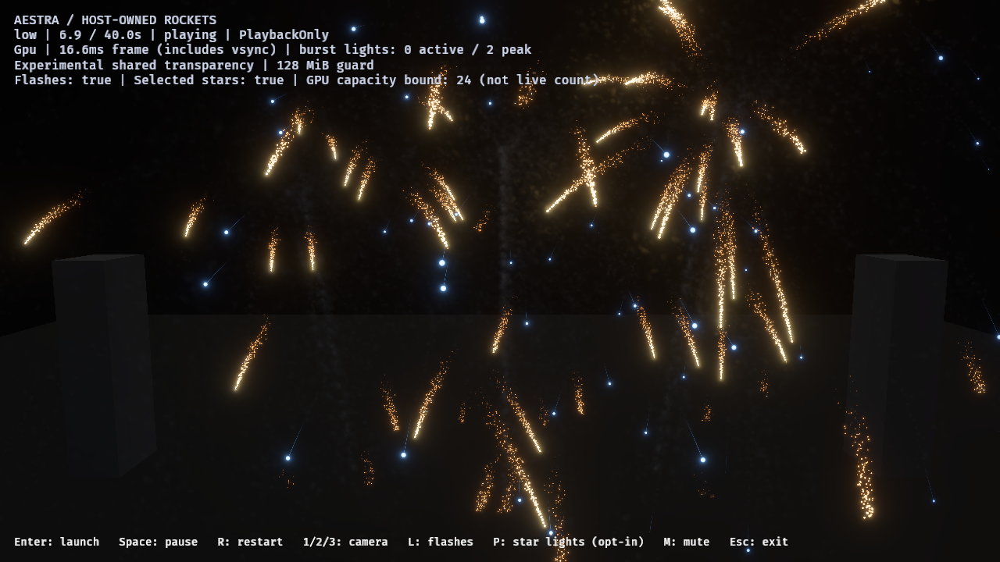

# Independent-host shared transparency — 2026-10-28

The opt-in host integration works, but shared fragment capture is **not ready
for the high-density host workload** within its current memory policy. Low tier
passes the observed near/orbit capacity and lifecycle gates with an explicit
larger reservation inside the same ceiling. Ordinary transparency stays default.
These results do not approve smoke art or production-finale performance.

## Workload and controls

Eight full native image runs deliver **97 captures** on RTX 4070 SUPER/Vulkan,
1280×720 HDR/bloom, PlaybackOnly, no audio. Twelve host-owned rockets overlap at
0.35-second intervals; the report runs explicitly request the benchmark-only
24-owner policy. Normal host admission has no owner ceiling. Shared and ordinary
near controls use the same camera pose/time and explicitly `Msaa::Off`; high
orbit controls use the same clock-driven camera path. Effects, materials, births,
motion, lifetimes, event/sampler and light policies are unchanged between modes.

The existing compiled-renderer audit now admits the independent wake/burst
catalog. Unit coverage checks eligibility and full compiled-content equivalence
at all tiers after normalizing only fresh root/binding identities. Labs and the
default cinematic show remain outside the opt-in admission policy.

All eight runs complete 12 launches, 12 detonations and 12 accepted flashes.
Aggregated event-link demand and accepted totals match exactly within each tier,
with zero source overflow, expansion omissions or destination rejection. Final
gameplay rockets, VFX owners, live particles and selected-light bound capacity
are zero. Async population peaks vary slightly by sampling time; they are not
asserted to be identical. No backend fallback, shader failure or static camera
budget rejection explains the failed images.

## Retained capture failures and bounded passes

| Tier / view / mode | Reserved fragments per pixel | Node/head bytes | Max observed dropped fragments | Max pixels requiring overflow sort | Capacity verdict |
|---|---:|---:|---:|---:|---|
| High / near / shared | 4 | 47,923,200 | 19,144,079 | 15,741 | Failed |
| High / near / ordinary | — | 0 | — | — | Ordinary control |
| High / orbit / shared | 4 | 47,923,200 | 4,321,332 | 36,179 | Failed |
| High / orbit / ordinary | — | 0 | — | — | Ordinary control |
| Low / near / shared | 4 | 47,923,200 | 2,578,830 | 1,846 | Failed |
| Low / near / shared | 8 | 92,160,000 | 0 | 4,385 | Observed pass |
| Low / near / ordinary | — | 0 | — | — | Ordinary control |
| Low / orbit / shared | 8 | 92,160,000 | 0 | 10,882 | Observed pass |

All shared runs observe zero invalid links. The low reserve-eight near/orbit runs
provide 2,385/2,386 completed capacity samples. These are asynchronous observations,
not a guarantee about every frame or arbitrary future launches. The full-target
overflow merge sort already handles accepted lists longer than 32; that work
counter is **not fragment loss**. Sorting cannot recover nodes the global pool
never captured. The renderer and its sorting algorithm were not changed here.

At high near 6.9 seconds, the ordinary control retains blue star geometry that
the failing shared run visibly loses:





At low near 6.9 seconds the explicit reserve-eight case preserves the visible
stars and haze in the matched control:





Both pairs request the same root time and pose `(0,44,95)`. In scene rows
120–680, a simple blue RGB threshold counts high ordinary/shared 3,670/0 pixels
and low ordinary/shared 1,257/1,256. This corroborates the failure visually; it
is not a particle count, photometric measurement or exact compositing oracle.
Screenshots and GPU counts arrive asynchronously. HDR/bloom and packed depth ties
also prevent using equality to the ordinary path as proof of exact fragment order.

## Memory and failure handling

Four fragments/pixel reserves 3,686,400 nodes. The worst observed high near frame
attempts at least 22,830,479 fragments. At the current 12-byte node and 4-byte head
strides, holding those nodes and heads would require **277,652,148 bytes
(264.79 MiB)**, before other GPU allocations or driver overhead. This exceeds the
existing 128 MiB camera ceiling even if its remaining budget were filled. Allocated
node/head bytes are not total VRAM residency.

`--oit-fragments-per-pixel N` exposes the existing camera reservation explicitly;
the default remains four and the ceiling remains 128 MiB. Eight uses 87.89 MiB
at 720p and can be rejected at larger target sizes. No automatic growth, quality
reduction, resolution change, light cap or new engine owner limit is added.

Normal interactive experimental mode now enables the existing bounded async
capacity/integrity diagnostics (three readback slots). After observing dropped
fragments or invalid links, it stops players and exits with an error. It never
silently switches to ordinary rendering. A separate native no-report/no-capture
probe with default audience camera and no owner cap observes 5,201 dropped
fragments, zero invalid links, and the expected exit code 1. Detection is delayed;
earlier frames may already have lost layers.

Reports deliberately finish failed workloads to preserve evidence. The explicit
`fragment_capacity_passed` field and runner `-RequireLossFree` distinguish a
completed execution from acceptance. Cost/profile lanes omit health scans and
return no capacity verdict; they do not measure the full interactive guard cost.
There is no performance acceptance for the failed high path.

## Reproduction and checks

Build `aestra-demo-fireworks` first. Use fresh output directories:

```powershell
# Retain the default-reservation high near failure and matched ordinary control.
./benchmarks/fireworks/run-smoke-look-review.ps1 -OutputDirectory target/fireworks-f8/review-shared-high-near -Mode host-overlap -Camera near -Transparency shared -MatchMsaa -Variants tuned -Tiers high -SampleTimes '4,5,6.9,8,12,16,23,36'
./benchmarks/fireworks/run-smoke-look-review.ps1 -OutputDirectory target/fireworks-f8/review-ordinary-high-near -Mode host-overlap -Camera near -Transparency ordinary -MatchMsaa -Variants tuned -Tiers high -SampleTimes '4,5,6.9,8,12,16,23,36'
# The loss-free gate is explicit; raw evidence survives a rejected run.
./benchmarks/fireworks/run-smoke-look-review.ps1 -OutputDirectory target/fireworks-f8/review-shared-low-near8 -Mode host-overlap -Camera near -Transparency shared -MatchMsaa -FragmentsPerPixel 8 -RequireLossFree -Variants tuned -Tiers low -SampleTimes '4,5,6.9,8,12,16,23,36'
./benchmarks/fireworks/run-smoke-look-review.ps1 -OutputDirectory target/fireworks-f8/review-shared-low-orbit8 -Mode host-overlap -Camera orbit -Transparency shared -MatchMsaa -FragmentsPerPixel 8 -RequireLossFree -Variants tuned -Tiers low -SampleTimes '6,6.5,7,7.5,8,8.5,9,9.5,10,12,16,23,36'
```

57 audio-enabled demo/authoring tests pass. Strict scoped Clippy with and without
audio, workspace formatting and diff whitespace checks pass. Tests cover all-tier
host eligibility/content preservation, explicit reservation validation, unchanged
memory ceiling/default owner policy, MSAA controls and distinguishing real loss
from accepted-list sort work. Native runs verify lifecycle and the interactive
error exit. Build emits environment hard-link cache-copy warnings.

The [JSON ledger](host-shared-transparency-2026-10-28.json) records source/binary,
report and capture hashes, exact per-tier admission totals, poses, capacity and
cleanup. Raw report folders under `target/fireworks-f8/host-*2026-10-28` retain
all attempts. The initial high near pair, later high orbit/low-four cases and final
explicit-reservation cases use three demo revisions; snapshots retain them all.
Renderer, simulation and art inputs remain unchanged across those revisions.

**Next:** compare memory-scalable high-density compositing approaches under the
same admission and cleanup gates. Preserve explicit mixed-scene restrictions and
measure memory/loss before adoption. A larger fast-sort threshold or owner-count
restriction would not solve the observed global-capture problem. Arbitrary foreign
transparency, equal-depth ordering, subviews/resolution overrides, multi-camera
diagnostics, exact image order, final smoke art and production-finale cost remain
unqualified.
