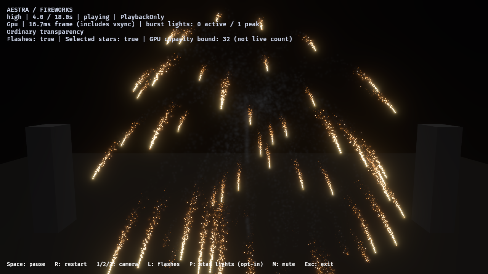

# N1 — shared scalar material noise

The Material Graph now has eight typed built-in fields (Value/Gradient × 2D/3D
× single/fBm), with matching CPU sampling, GPU compilation and preview evaluation.
The opt-in smoke study demonstrates graph reuse in the editor and public demo.
The current fireworks repertoire is not replaced.

Native parity: [retained JSON](n1-procedural-noise-parity-2026-11-01.json).
All eight actual production entry functions passed 4,096 samples each on the
AMD Radeon integrated GPU through Vulkan. Maximum absolute CPU/GPU error was
2.3841858e-7 against a 0.0002 tolerance. Cases include negative coordinates,
eight seeds, eight-octave fBm and explicit filtering. Each function's timestamp
is a single cold compute dispatch, **not** a steady-state cost comparison;
the zero-duration result is below the observed timing resolution.

Release smoke integration: [retained evidence](n1-procedural-noise-2026-11-01.json).
The public fireworks demo used the NVIDIA RTX 4070 SUPER / Vulkan native path,
PlaybackOnly, HDR/bloom and selected star lights. Four requested images at 2,
4, 6.35 and 10 seconds arrived; the 18-second effect drained to zero particles.
Linked births were accepted without observed source overflow, destination
rejection or omitted expansion: 43 launch smoke, 64 main stars, 1 burst flash,
48 burst smoke, 67,254 gold embers and 11,209 star-path smoke. Both launch and
main-break outputs arrived. The authoring test independently verifies identical
source emitters, events, light outputs and particle outputs and compiles all tiers.

The final material swatch uses Scale 2.2 and brighter ambient defaults; the
night-time fireworks instance explicitly binds Scale 0.22 and the dimmer tint.
These are ordinary saved material parameters. The retained 32×32
[editor thumbnail](reviews/n1-procedural-noise-2026-11-01/editor-thumbnail.png)
was evaluated from the final saved graph, with channel maxima 86/88/91 against
the 26/41 checkerboard. Preview and runtime use the same field algorithm.



This is a functional/material-authoring qualification, not final realistic-smoke
approval. The screenshot lane includes asynchronous readbacks and is not a frame
benchmark. Smoke remains billboards, without volume self-shadowing. Existing
specialized smoke/grain kernels retain their prior behavior. Automatic derivative
footprint wiring, spatial particle flow/curl and distributions remain follow-ups.

Validation commands:

```powershell
cargo test --locked --offline -p aestra-compiler -p aestra-gpu -p aestra-runtime --tests --lib
cargo test --locked --offline -p aestra-demo-fireworks --bin author_noise_material_lab
cargo test --locked --offline -p aestra-editor --bin aestra-editor -- --test-threads=1
cargo test --locked --offline -p aestra-bevy-render --test noise_gpu -- --ignored --nocapture
```

The ordinary compiler/GPU/runtime suite passed 354 tests. The complete editor
unit suite passed 2,888 tests (11 existing ignores). Editor qualification
checks all eight shared CPU node evaluations, nested saved graph material
thumbnails, editable seed changes and bounded effect thumbnail/hover preparation.
GPU material contracts validate WGSL, SPIR-V and HLSL for all eight variants.
See the [authoring and API guide](../../docs/examples/procedural_noise.md) for
controls, bounds, asset regeneration and preview budgets.
