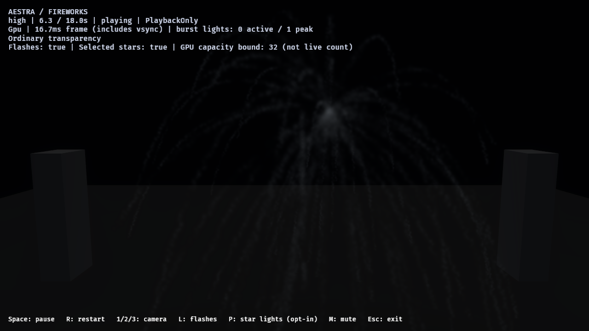
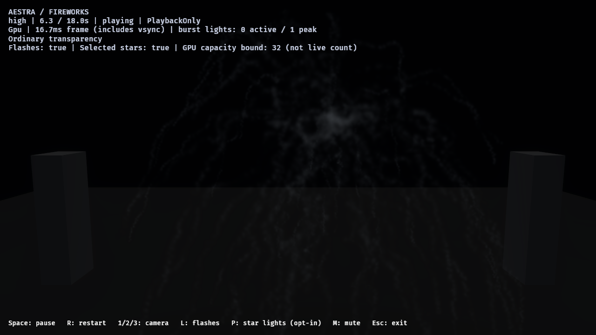
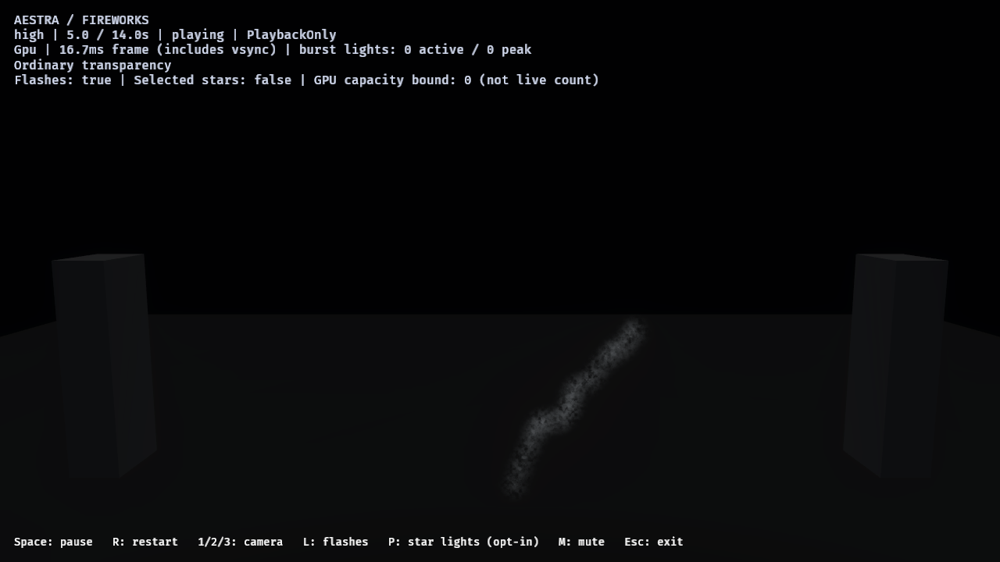

# N2 — shared spatial particle flow

The registered Spatial Flow module, editor controls and typed host settings now
feed CPU reference and native stateful integration. Noise and Curl share N1's
value/fBm basis. Effect/World coordinates, full-u32 seed, scale, strength,
evolution, offset and a bounded octave budget are saved and baked into artifacts.
This is opt-in; the current fireworks repertoire is not replaced.

## Native field parity and cost

[Retained GPU measurements](n2-spatial-flow-cost-2026-11-01.json), RTX 4070 SUPER,
Vulkan. Eight configurations × 4,096 samples compare actual production force
functions against the CPU sampler. Cases include negative coordinates, full-u32
seed wrap, Noise/Curl, one/three octaves and mirrored/nonuniform World placement.
Maximum absolute force difference: **0.00007613**, tolerance **0.003**.

After one warmup, eight timestamped dispatches per case yielded these medians:

| Mode | Octaves | Effect, ms / 4,096 | World, ms / 4,096 |
|---|---:|---:|---:|
| Noise | 1 | 0.006848 | 0.006816 |
| Noise | 3 | 0.01504 | 0.015296 |
| Curl | 1 | 0.019456 | 0.020192 |
| Curl | 3 | 0.0528 | 0.054912 |

These are compute-only force measurements. Integration, buffer upload, scheduling,
rendering, overdraw and transparency are additional. They are not full-frame
benchmarks or a linear throughput promise for arbitrary particle populations.

## Actual fixed-tick integration

The production native dispatch loop matched CPU trajectories for 120 births over
120 ticks while moving the emitter. Largest position differences were 7.15e-7
(Noise/Effect), 2.15e-6 (Curl/Effect) and 7.38e-6 (three-octave Curl/World, mirrored
nonuniform placement), against 0.003 tolerance. A repeated paused frame preserved
state bytes. PlaybackOnly retained zero checkpoints. CPU fixtures additionally
verify restart/checkpoint determinism, finite/component bounds, local continuity,
transform conversion and discrete curl divergence below 0.003.
The pose tests also cover a valid uniform scale of 0.001: an absolute determinant
cutoff must not mistake a small, invertible transform for a singular one.

## Saved editor and fireworks studies

[Retained native reports and source hashes](n2-spatial-flow-2026-11-01.json).
The public release fireworks host rendered the matched control and candidate,
both using ordinary transparency, HDR/bloom, selected star lights and PlaybackOnly.
All four requested images arrived at 2, 4, 6.35 and 10 seconds in each case.
Both accepted exactly **78,619** linked births: 43 launch smoke, 64 main stars,
1 burst flash, 48 burst smoke, 67,254 embers and 11,209 star-path smoke. No source
overflow, rejected destination births, omitted expansion or selected-light
rejection was observed; both drained to zero particles.




**Spatial Flow Wake Lab** in `sample-project` reuses the N1 material and ordinary
editor modules. Its distance-linked smoke has zero inherited source velocity;
flow affects deposits after the moving source retires. The source trajectory,
event links and capacity remain authored independently.



The first full-report attempt on this LoopRestart asset delivered its images but
timed out: it never reaches the reporter's terminal Once-effect condition. The
[failed log](reviews/n2-spatial-flow-2026-11-01/wake-full-report-timeout.log) is retained.
A [fresh single-image capture](reviews/n2-spatial-flow-2026-11-01/wake-native-5s.png)
completed successfully with exit code 0. No full-report completion is claimed for
the looping wake.

## Limits and validation

World field placement is ForwardOnly: a binding trace does not record arbitrary
host root transforms. World-flow draws retain conservative visibility; GPU-derived
bounds are a performance follow-up. Effect-space bounds include the force
excursion after emitter placement. V1 settings are constants, with dynamic
parameter bindings diagnosed. Curl's potential is modulated only by spatially
constant strength; there is no pointwise vector normalization or fluid solver.

Editor tests cover real dropdown/strength edits and undo. Artifact tests preserve
flow configuration and full seed, and reject incompatible analytic classification.
The existing registry tests now explicitly require the eleventh built-in module
and its Stateful classification. The 2,889 active editor tests and 197 active
renderer tests passed (11 and 6 existing/native opt-in skips respectively), along
with the core/extension/compiler/GPU/artifact/runtime suites and strict Clippy.
The core/extension/compiler/GPU/artifact/runtime suite passed 529 tests.

Reproduce:

```powershell
cargo test --locked -p aestra-bevy-render --test spatial_flow_gpu -- --ignored --nocapture
cargo test --locked -p aestra-bevy-render --lib spatial_flow_native_ticks -- --ignored --nocapture
cargo run --locked -p aestra-demo-fireworks --bin author_spatial_flow_study
cargo test --locked -p aestra-demo-fireworks --bin author_spatial_flow_study
```

See the [authoring/API guide](../../docs/examples/spatial_flow.md) for the full
coordinate, integration, bounds and replay contracts. Native screenshots are
functional/art-review evidence, not automatic final smoke-art approval.
