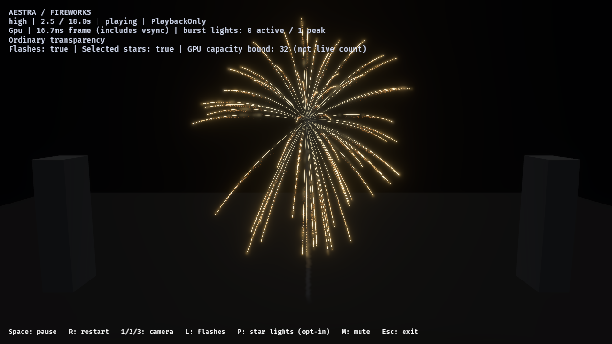
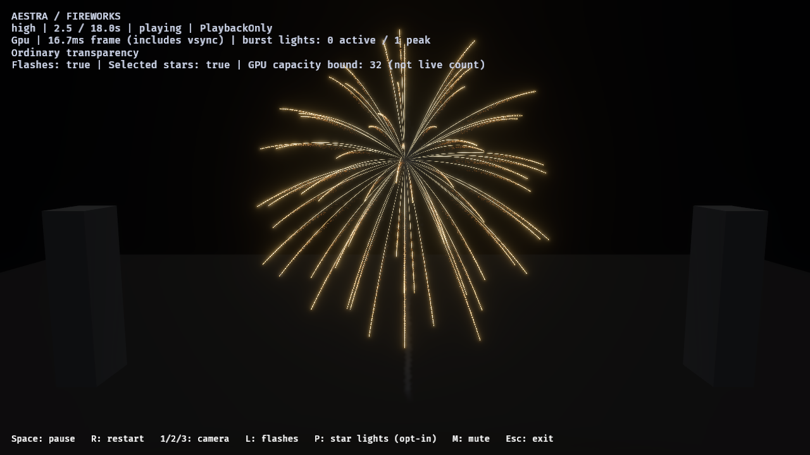
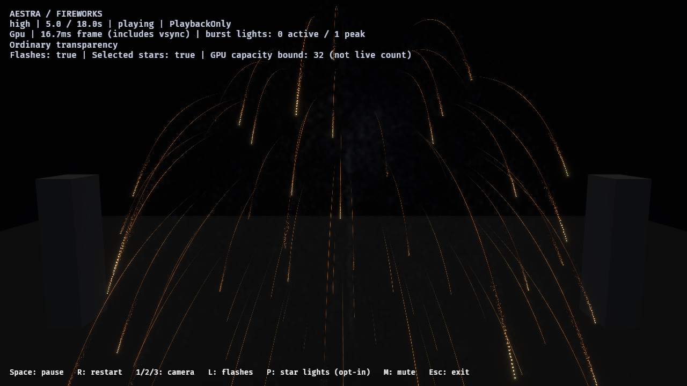
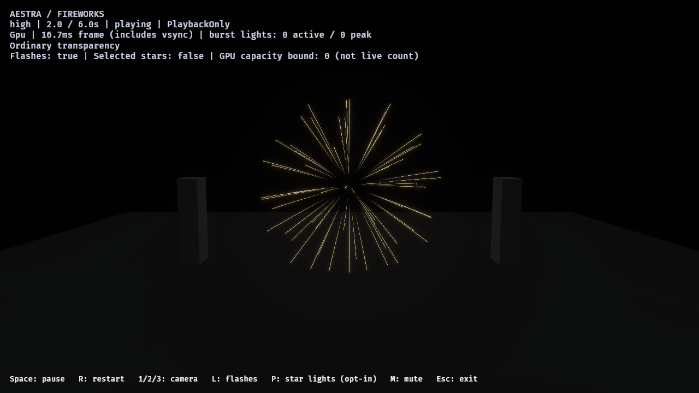

# N3 — Shared launch layouts and gold shell study

2026-11-01. Opt-in editor/runtime capability and matched single-shell study.
This is not repertoire adoption, a finale performance certificate, or final
photorealistic art acceptance.

## Implemented

Particle Sampling is an ordinary saved Particle Spawn module, with independent
Legacy/Uniform/Stratified position and direction controls, bounded jitter, full-u32
seed and a direct-emission pattern length. Sphere directions use a seed-rotated
Fibonacci layout. Shape and Initialize's velocity geometry, speed and lifetime
remain separate. The inspector, undo path, CPU reference, analytic/native GPU
paths, public host facade and offline artifact share the settings.

It does not force analytic effects into stateful simulation or allocate a new
owner table, per-particle state, replay store, clock, storage binding or rejection
loop. Five stateful parameter words and 32 aligned bytes per analytic emitter
carry configuration. Existing admission/identity policies remain in effect.

Event/input lists put child index and requested fan-out in previously unused
record lanes, with an explicit header marker. Generic domain lists retain their
ABI. Each source event gets its own layout; destination prefix admission preserves
the original requested count instead of redistributing survivors. Direct emission
uses an explicitly authored repeating sequence, not an inferred burst boundary.

## Native helper parity and cost

RTX 4070 SUPER / Vulkan. [Retained measurements](n3-particle-sampling-cost-2026-11-01.json)
cover 28 configurations: Uniform/Stratified, counts 1/2/3/7/64/800/65,537, jitter
0/1, full-u32 seed, and large destination ordinals. Each dispatch evaluates
4,096 position/direction pairs across all eight position shapes and six explicit
velocity modes. Maximum absolute component error was **0.00001237**, below the
0.0001 tolerance. Eight timed repetitions follow a warm-up.

Median compute dispatch times ranged **0.002048–0.002752 ms** per 4,096 pairs.
These measure the sampler only; admission, integration, uploads and rendering are
excluded. They are not frame times or proof of arbitrary finale scale.

The production native birth oracle covers separate event cohorts of 1/3/7/129
children, including 200 admitted children from 258 requested. It matches CPU
velocities by birth ordinal, preserves pause state and retains no PlaybackOnly
checkpoints. Direct births match 129 CPU sphere positions and velocities. The
host-input upload path also exercises changing fan-outs and prefix admission.

The analytic oracle matches all eight shapes in both modes through Once,
LoopRestart and LoopContinuous: 48 combinations, five absolute-time observations each, spanning
loop changes. It uses enough capacity to isolate layout
math from the separate admission issue below.

## Saved assets and native visual review

[Reports and source hashes](n3-particle-sampling-2026-11-01.json).

The control and candidate use the same gold cooling-filament shell, HDR/bloom,
near camera, ordinary transparency, selected star lights and PlaybackOnly.
Only main-star Uniform versus Stratified sampling changes. Material, motion,
speed/lifetime ranges, event authoring and capacities remain the same. Four images
arrived in each run at 1.6, 2.5, 3.5 and 5 seconds.

Uniform:

Stratified:

The candidate distributes spokes more evenly in this view, while the same
ballistics create droop and the existing material cools the tail. Projection of
a 3D sphere can still overlap spokes; this is not equal 2D screen spacing.
Filament continuity, grain, brightness and burn curves remain art-review work.

Both runs accepted exactly 64 main stars, 43 launch-smoke births, one flash and
48 burst-smoke births. The Uniform control accepted 64,218 tail embers and 10,703
star-path smoke births; Stratified accepted 65,136 and 10,856. Direction changes
alter gravity/drag trajectories and therefore distance-trigger demand: **total
work is not identical**, and no full-frame speedup is claimed. Observed source
overflow, destination rejection and omitted expansion were all zero. Both runs
completed and drained to zero particles; no selected-light rejection was reported.

The saved **Particle Sampling Lab** uses the same module with ordinary materials
and trail rendering. Its final native single-image capture exited successfully;
the lab loops, so no Once-effect full-report completion is claimed for it.

## Validation and remaining boundary

535 core/extension/compiler/GPU/artifact/runtime contract tests and 197 renderer
tests passed. Seven renderer tests remain opt-in. The real editor dropdown/jitter/
undo regression, deterministic saved-study/all-tier test, artifact compatibility
regression, native helper, production birth and analytic layout checks pass.
Strict Clippy, formatting and whitespace checks are part of final validation.
The generated analytic shader snapshot was updated for the explicit emitter ABI
and reviewed helpers; portable shader translation continues to pass.

An initial 128-slot continuous analytic fixture exposed **80 CPU versus 70 GPU
live particles at 2.55 seconds**. A fresh negative control with Particle Sampling
disabled reproduces it. The GPU maps raw per-cycle births into slots while the
CPU fills from surviving particles, so earlier dead births can consume raw slot
coverage under pressure. The [negative-control excerpt](reviews/n3-particle-sampling-2026-11-01/continuous-pressure-baseline.txt)
is retained. Raising this oracle's capacity to 512 isolates and passes the new
layout math; it does not fix the admission discrepancy. Track that runtime issue
before claiming analytic continuous capacity-pressure parity. Stateful event-born
fireworks use their separately tested admission path.

V1 settings are authored constants. Direction sampling requires an explicit
Initialize velocity mode. Analytic position sampling supports all shapes;
stateful positions support Point/Sphere/Box and diagnose unsupported combinations.
See the [guide](../../docs/examples/particle_sampling.md) for exact contracts and
reproduction commands.
