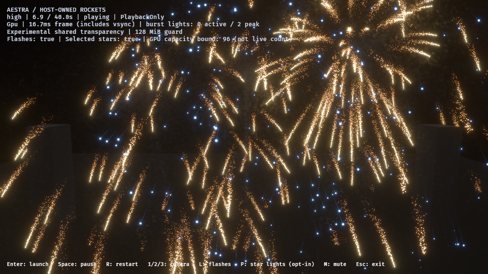
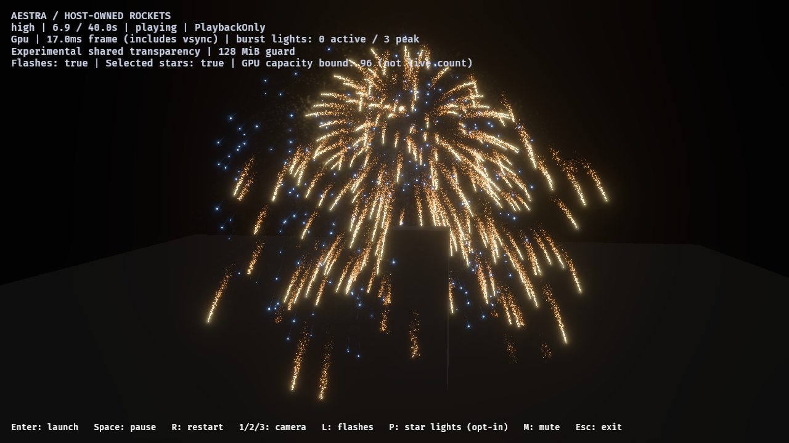

# Native partitioned transparency — 2026-10-29

The scissored prototype now runs through **actual Bevy view bindings, Aestra
material shaders and indirect sprite/trail/mesh draw commands**. This is an
explicit experimental transport, not default rendering or finale acceptance.
The existing 128 MiB ceiling and ordinary default remain unchanged.

## Transport and admission

`ExperimentalOitPartitions { grid }` accompanies `ExperimentalOitSettings` on one
full-target camera. The demo exposes `--experimental-oit --oit-partitions 4`;
the benchmark runner accepts `-Transparency shared -Partitions 4`. The square
CLI grids are 1, 2, 4 or 8 per side. A maximum of 64 diagnostic regions bounds
the experimental transport; it does **not** limit particles, effects or owners.
Normal host admission still has no owner cap. The review's explicit
`--max-owners 24` is the pre-existing controlled benchmark policy.

After queueing, phase sorting and bind-group preparation, the transport holds
the whole retained transparent phase. Native capture sees an empty phase;
removing its resolve ID prevents native diagnostics/sort/resolve from running
again. The retained phase is restored before Bevy cleanup, preserving visibility
retirement and later ordinary-mode use. No global Bevy shader or schedule system
is replaced. Opaque rendering and Aestra's automatic depth prepass still run once.

Each disjoint scissor region repeats capture, sorts accepted links and resolves
into the same full-size HDR target, then reuses the node pool. Projection, pixel
addresses, materials, simulation, births and density are unchanged. Heads keep
full-target addressing. Explicit initial/final head clears and inter-region
counter clears prevent stale lists on empty frames and mode transitions.

Capture waits for the **adapter premultiplied resolve**, link sorter and queued
capture pipelines/bindings. A ready ordinary fallback pipeline is insufficient:
actual descriptors must contain the fragment-list specialization. Foreign
transparent command IDs, ineligible dynamic material/render modes, transmissive
phases, multiple OIT cameras, jitter, viewport subrectangles and resolution
overrides are rejected. Scene-depth material commands remain outside this first
transport. Arbitrary custom render nodes are not audited or certified.
Pending/rejected requested phases are suppressed; they do not silently draw
ordinary transparency. Hosts must consume the status, as the demo does.

## Health and cost scope

`ExperimentalOitPartitionStatus` publishes readiness, rejection and bounded
asynchronous per-region counters. Three in-flight slots each reserve 64 aligned
16-byte results (98,304 bytes total output/staging storage, plus uniforms/bind
groups). Missing/backpressured/mapping-failed observations are not success.
Generation checks invalidate stale callbacks after resize, reconfiguration,
rejection or removal. Observed loss is sticky within an admitted configuration;
a clean or out-of-order callback cannot hide it before the main thread reads it.
The interactive demo stops on rejection or observed loss. Report runs finish and
mark failed capacity explicitly. Ordinary OIT diagnostics are invalidated while
partitioned transport is requested, rather than retaining a stale success.

Drops are summed as `sum(max(region_attempts - node_capacity, 0))`; subtracting
one pool from frame-wide attempts would incorrectly classify pool reuse as loss.
The existing diagnostic bounds traversal at the fast-sort threshold plus one;
its invalid-link count is not a proof about every link or arbitrary counter wrap.

This first integration deliberately keeps the production **full-target sort and
health scan per region**, unlike the prototype's region-limited sort dispatch.
Every region also repeats geometry, material and draw work. All partition lanes,
including cost/profile, include health scans. They are not directly comparable
to older unpartitioned scan-free cost lanes. Profiling gives each capture/sort/
resolve region its own path and one aggregate span including health/clear/copy
commands. Percentiles of separate spans must not be summed.

## Native oracle

Three final GPU executions each pass 12 exact comparison cases: grids 1×1, 2×2
and 4×4; 480×360 and odd 257×193 targets; opposite camera directions. The frozen
fixture contains 40 interleaved alpha layers, a bright additive layer and partial
opaque occlusion. It uses Bevy's automatic depth prepass, real compiled semantic
materials, native indirect mesh commands and HDR/Reinhard presentation.

All 36 cases preserve capture demand and match the full-list reference across
**every captured SDR byte**, with no observed drops/invalid links and unchanged
node/head bytes for a given extent. The full-list reference explicitly reserves
16 fragments/pixel inside 128 MiB and is independently checked loss-free.
This is exact native-phase **display-image** evidence, not native raw-HDR
readback. The preceding isolated prototype remains the raw Rgba16Float oracle.

Each execution also verifies forced undersized-pool failure and recovery,
actual foreign transparent draw rejection, invalid grid/subviewport rejection,
hidden/visible retained-item recovery and removal back to ordinary shared lists.
Offscreen target resizing is qualified; arbitrary window/minimize, multiview and
custom-pass lifecycles remain separate.

## Live host evidence

The accompanying [JSON ledger](native-partition-2026-10-29.json) records the
final native cases, host reports, route totals, binary/source/image hashes and
retained failed attempts. The live near/orbit captures are forward playback and
asynchronous, **not exact frozen image pairs**. Their capacity and cleanup checks
remain separate from photographic art approval and production performance.

The 2×2 high near run fails capacity despite a faster frame distribution. The
4×4 high near run passes observed capacity while keeping the same **47,923,200
node/head bytes (45.70 MiB)**. No opacity, births, simulation workload, camera
resolution or memory-ceiling reduction/increase is used to obtain that result.

| High host view / grid | Peak attempted fragments | Peak observed drops | Host interval p95, vsync included |
|---|---:|---:|---:|
| Near / 2×2 | 20,107,857 | **6,841,306 — failed** | 17.627 ms |
| Near / 4×4 | 20,106,371 | 0 | 19.777 ms |
| Orbit / 4×4 | 7,020,507 | 0 | 18.350 ms |

These three image runs preserve identical aggregate event-route demand/accepted
counts: **374,514 gold-tail embers and 115,283 star-path smoke births**. No source
overflow, expansion omission or destination rejection is observed. All four
completed host runs (including profiling) launch/detonate 12 rockets, accept 12
flashes and end with zero live particles, gameplay rockets and VFX owners.
Different live capture times explain small peak attempted/population differences;
they are not a proof of frame-matched image equivalence.

The separate 4×4 near profile records 2,008 aggregate GPU observations: whole-run
GPU p95 **11.846 ms**, active-fireworks p95 **13.753 ms** (214 observations), and
idle p95 **4.894 ms** (890 observations). These include partition health scans
and clears/copies. This is one instrumented run, not a repeated full-frame or
incremental-cost certificate. The profile lane intentionally omits event-link
readbacks, so it cannot independently certify the exact route totals above.
Its retained generic `profile.scope` text predates the partition exception;
`oit_health_scope` is explicit, and the source's generic text is now corrected.
The final renderer also makes optional resources conditional on unsupported
devices; the full native oracle is repeated after that portability guard.
Host manifests retain the exact binary and source hashes used for each run.





## Reproduction and next gate

Validation: 187 renderer tests and 54 demo/authoring tests pass (four renderer
GPU-only tests remain explicitly ignored in the ordinary suite). The native
phase oracle is additionally run explicitly three times. Scoped strict Clippy
across renderer, demo and viewer targets, workspace formatting and diff checks
pass. Earlier failed native attempts and an incomplete exit-zero host run remain
listed in the ledger; they are not counted as accepted evidence.

Run GPU oracles alone, using a fresh absolute report directory:

```powershell
$env:AESTRA_CROSS_POOL_IMAGES = "$PWD/target/fireworks-f8/native-partition-fresh"
cargo test --locked -p aestra-viewer native_partition_phase_matches_full_lists_and_rejects_unsupported_draws -- --ignored --test-threads=1

./benchmarks/fireworks/run-smoke-look-review.ps1 -OutputDirectory target/fireworks-f8/partition-near-fresh -Mode host-overlap -Camera near -Variants tuned -Tiers high -Transparency shared -Partitions 4 -RequireLossFree
```

The next gate is reducing and measuring repeated region/draw work while
preserving the same capacity, route demand and exact native image controls.
Start by retiring repeated empty-phase work, then region-limited sort/health
dispatch and measured per-region geometry work; retain the lossy 2×2 control.
Broader mixed-scene support, hardware/window
lifecycle, raw native HDR readback, full-game/finale budgets and final smoke art
remain open. Ordinary transparency remains the default.
