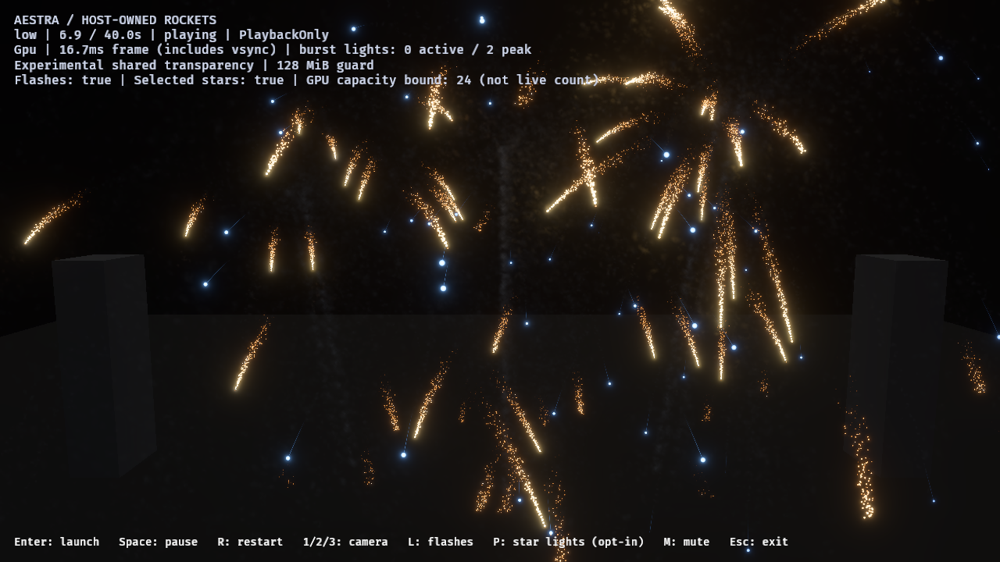
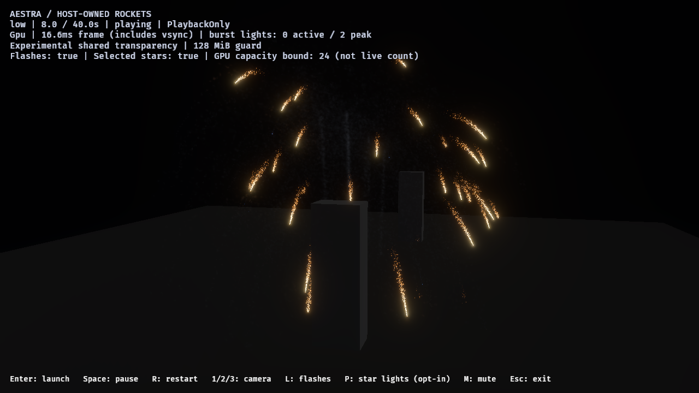

# Packed-zero fragment pruning — 2026-10-28

Experimental shared transparency now skips Aestra fragments whose **stored RGB9E5
mantissas and stored 8-bit extinction are both zero**, before requesting a node.
This removes an exact identity of the existing packed compositor. It introduces
no visibility epsilon, smoke-density reduction or particle/owner limit. Ordinary
rendering and the portable material compiler remain unchanged.

The measured high-tier near-view capture demand falls **11.93%**, but still exceeds
the existing memory ceiling. This is a bounded improvement, not a replacement
compositor or high-density acceptance. See the retained
[original capacity failures](host-shared-transparency-2026-10-28.md).

## Correctness boundary

The native adapter uses Bevy 0.20's actual `vec3_to_rgb9e5_` and
`pack_24bit_depth_8bit_alpha` functions, matching the representation subsequently
stored by `oit_draw`. Only a payload that decodes to `(0,0,0,0)` is omitted.
Nonzero extinction short-circuits the predicate before RGB packing. In particular:

- black smoke with nonzero packed alpha still absorbs light;
- additive light retains nonzero premultiplied RGB even though its extinction is zero;
- colored fragments below the alpha packing half-step still contribute emission;
- the test uses RGB mantissas, so exponent bits alone cannot mistake zero RGB for light.

This preserves the **existing quantized** compositing operator. It does not make
RGB9E5/alpha8 equal to unquantized physical transparency. Packed-depth ties and
the existing mixed-scene restrictions remain unchanged. Accepted long lists still
use the existing overflow merge sort; its work counter is not a loss counter.

## Native proof

The ignored native test
`fragment_list_packed_identities_preserve_black_absorption_and_faint_emission`
runs **20 frozen semantic-mesh cases**, with both camera directions. Ten neutral
cases place 64 overlapping fragments in front of a real background. Their node
attempt counts equal the hidden-foreground control and their full images match
that control **byte for byte**. The other ten cases retain strictly more node
attempts than the control and pass the linear-color oracle, including visible
black absorption and faint emission. Both sides of the RGB9E5 and alpha8 packing
half-steps are covered. All cases have zero dropped fragments/invalid links;
largest linear-color error is 0.002697, below the existing 0.01 image budget.

An earlier 16-case harness and its repeated execution remain in raw output.
The final 20-case proof uses the rebuilt `aestra_viewer-538ef1e28ceedb66.exe`;
the ledger records that executable and report hash explicitly.

## Host workload and capacity

Five full native host image runs deliver **45 captures**, including repeated high
near and low near runs plus the final low orbit run. Hardware is RTX 4070 SUPER /
Vulkan, 1280×720 HDR/bloom, PlaybackOnly, Msaa::Off and no audio. Twelve rockets
overlap at 0.35-second intervals under the explicit benchmark-only 24-owner policy.
No default host admission ceiling is introduced.

Every run preserves per-tier aggregated route demand/accepted totals from the
previous review, with zero source overflow, expansion omissions, destination
rejections or light-policy rejections. All twelve launches/detonations/flashes
complete, and final gameplay rockets, VFX owners, live particles and selected-light
bound capacity are zero.

| Case | Max observed node attempts | Max observed dropped | Allocated nodes/heads | Verdict |
|---|---:|---:|---:|---|
| Previous high near, reserve 4 | 22,830,479¹ | 19,144,079 | 47,923,200 B | Failed |
| Pruned high near, first run | 20,107,767 | 16,421,367 | 47,923,200 B | Failed |
| Pruned high near, final repeat | 20,107,637 | 16,421,237 | 47,923,200 B | Failed |
| Pruned low near, reserve 8, first run | 5,542,656 | 0 | 92,160,000 B | Observed pass |
| Pruned low near, reserve 8, final repeat | 5,542,579 | 0 | 92,160,000 B | Observed pass |
| Pruned low orbit, reserve 8 | 1,854,671 | 0 | 92,160,000 B | Observed pass |

¹ Derived from fixed node capacity plus the observed dropped count. New reports
record `max_attempted_fragments` directly from the existing diagnostic; no new GPU
buffer or readback is added. Peaks are asynchronous observations, not matched
per-frame counters. The first high run overlapped the renderer test suite; the
final high repeat ran without another GPU test and reproduces the demand saving.
No timing result is inferred from either run.

The final high peak removes **2,722,842 node attempts** versus the previous
observation. Holding its remaining nodes/heads would still need **244,978,044 B
(233.63 MiB)**, beyond the unchanged 128 MiB ceiling. Allocated buffer bytes do
**not** decrease: this change frees capacity inside the existing pool. It does
not claim total VRAM savings, zero lost fragments, or a free shader-cost improvement.

Low near at approximately 6.9 seconds:



Low moving view at approximately 8 seconds:



The full host captures are asynchronous forward-playback images, not exact frozen
references. Against the old low near captures, scene rows 120–680 retain nonzero
differences: maximum mean RGB-byte error is 0.411 and a bright-phase pixel can
differ by 202 bytes. Request times match except for one tick at 12 seconds; that
does not prove matching GPU simulation/capture times. Images at 23/36 seconds
match in the scene region. These comparisons are retained rather than called
bit-identical preservation. The separate frozen identity oracle supplies that
exact control for the pruning rule.

## Reproduction and validation

```powershell
cargo test --locked -p aestra-bevy-render --lib
cargo test --locked -p aestra-demo-fireworks --features fireworks-audio
# Run native image tests alone, with a fresh absolute output directory.
$env:AESTRA_CROSS_POOL_IMAGES = "$PWD/target/fireworks-f8/packed-identity-fresh"
cargo test --locked -p aestra-viewer fragment_list_packed_identities_preserve_black_absorption_and_faint_emission -- --ignored --test-threads=1
./benchmarks/fireworks/run-smoke-look-review.ps1 -OutputDirectory target/fireworks-f8/pruned-high-near-fresh -Mode host-overlap -Camera near -Transparency shared -MatchMsaa -Variants tuned -Tiers high -SampleTimes '4,5,6.9,8,12,16,23,36'
./benchmarks/fireworks/run-smoke-look-review.ps1 -OutputDirectory target/fireworks-f8/pruned-low-orbit-fresh -Mode host-overlap -Camera orbit -Transparency shared -MatchMsaa -FragmentsPerPixel 8 -RequireLossFree -Variants tuned -Tiers low -SampleTimes '6,6.5,7,7.5,8,8.5,9,9.5,10,12,16,23,36'
```

The renderer suite passes 184 tests (three existing ignored), the audio-enabled
demo/authoring suite passes 57, and all five final shader-composition tests pass.
Strict Clippy for renderer/viewer/demo all targets with demo audio, workspace
formatting and whitespace checks pass. The 20-case native test is an additional
explicit execution. Builds emit environment hard-link/cache-copy warnings.

The [JSON ledger](packed-identity-2026-10-28.json) preserves raw report, binary,
shader and capture hashes, source versions, route totals and image differences.
The runner now fingerprints the shader-composition and OIT admission sources too.
The initial RGB-first and final alpha-first predicates have identical truth tables;
both host executions remain in the evidence. No artifacts from the earlier failed
capacity qualification are replaced.

**Next:** prototype spatially partitioned capture/resolve in an isolated native
oracle, reusing the same node pool between disjoint screen regions. Verify full
pixel coverage, opaque depth, alpha/additive order, resets, overflow and cleanup
against an adequately provisioned full-list reference before host integration.
Measure repeated draw/vertex work and sort/resolve costs: this is a candidate
tradeoff, not an assumed game-performance win. Keep it explicit and reject
unsupported views/foreign draws. Ordinary rendering remains default; high-density
shared transparency and production-finale performance remain open.
