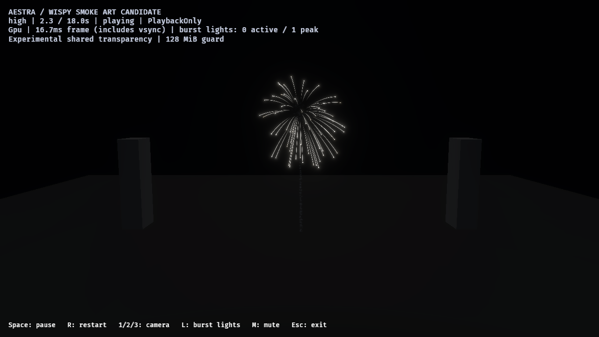
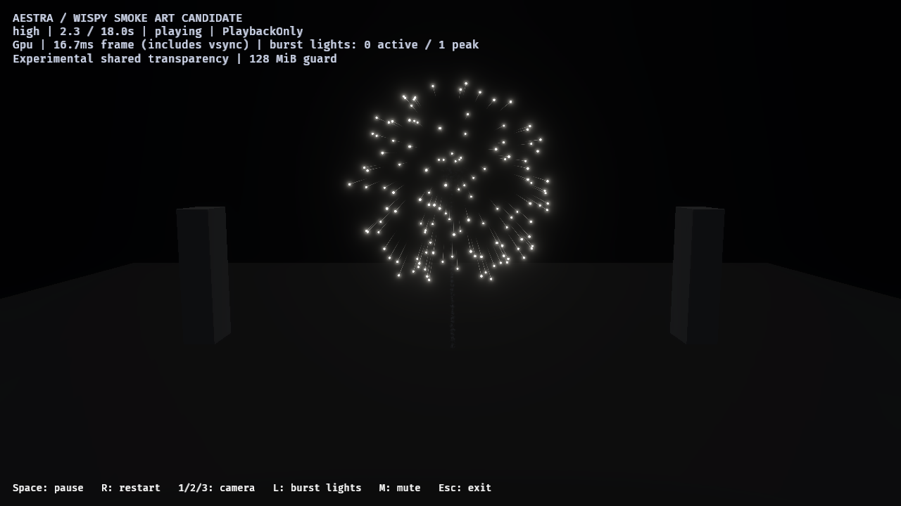

# Single-shell point-star calibration — 2026-10-27

An opt-in saved shell now emphasizes bright point heads, short cooling tails and
a longer varied burn, following the video's 00:03.5–00:08 sequence. This improves
the head/tail balance without adding a renderer feature or changing the normal
show. Gold-tail calibration, deposited-smoke integration and final art approval
remain open. [Native evidence and hashes](point-star-calibration-2026-10-27.json).

## Saved controls and authoring

`author_fireworks_point_stars` derives two standalone 18-second effects from the
retained wind-haze multi-break family. Both remove secondary sparks and deposited
star smoke to isolate the luminous shell, prune their event/budget targets and
keep the original launch, burst/launch haze, representative flash and launch/main
break output routes. Both use the same exposed white-to-warm Main-star gradient.
Thus the control is an isolated white-shell comparison, not the unmodified pink
show. Both have distinct EffectIDs; all previously saved assets remain unchanged.

| Main-star property | Control | Candidate |
| --- | --- | --- |
| Authored high / medium / low births and matching trail capacities | 64 / 32 / 16 | 128 / 64 / 32 |
| Lifetime range | 1.2–1.6 s | 2.4–3.2 s |
| Initial speed range | 18–22 | 27–31 |
| Gravity / drag | [0, −9.81, 0] / 0.45 | retained |
| Head radiance gain | 12 | 48 |
| Tail radiance gain | 6 | 1.2 |
| Tail width / history lifetime | 0.35 / 0.7 s | 0.09 / 0.22 s |

The candidate also holds the small sprite size and opacity longer before cooling
and fading. Random lifetime variation spreads extinction. Separate Main-star
material instances and exposed head/tail radiance parameters avoid increasing
launch/flash brightness through the previously shared material. Existing sphere
velocity distribution, sprite/trail programs and runtime APIs suffice here.
Radiance gains and speeds are authored scene values, not calibrated photometry.

Native close-camera comparison at nominal 2.3 seconds:





The candidate continues through wider spread at 2.8 seconds and uneven cooling
at 3.8 seconds. Full-resolution native images are retained alongside the evidence.
They are unchanged copies, not retouched comparisons. The larger spread is an
intentional speed/lifetime change; these are equal-time/camera captures, not equal
radius or work-matched pairs. An isolated point-star shell is not a gold willow.

## Native review and limits

Six final public-window runs cover control/candidate at high audience/close plus
candidate medium/low close. Thirteen samples per run cover launch (0.8/1.3), break
(1.5), expansion (1.8/2.3/2.8), cooling/extinction (3.3/3.8/4.3/5) and residual
haze/drain (7/12/17). All **78 captures** delivered. Two initial close preview runs
also completed with no sampled global drops; their assets match the final pair.

Every final run used native Vulkan on RTX 4070 SUPER, PlaybackOnly, 1280×720 HDR,
TonyMcMapface, bloom 0.15 and experimental OIT with the existing 128 MiB guard.
Each completed at 18 seconds, reported one launch/main-break message, one bound
flash accepted with no flash rejection and zero final asynchronous live particles.
Sampled global fragment drops and invalid links were zero. These are transparency
observations, not exact per-emitter birth-admission counts or exact blending proof.
All six retain one pending global-pipeline update; per-view preparation reports
ready. These instrumented captures do not qualify ordinary frame pacing.

The sampled lifecycle now reads as separate luminous heads with subordinate short
tails, rather than long arcs followed by an early fade. Medium/low intentionally
retain fewer heads and are visibly sparser. Close camera: position [0,42,145],
target [0,24,0]; audience: [0,48,180], target [0,28,0]. The centered shell has unit
scale in both. Camera/exposure are fixed within each comparison. The reference
has a different lens/scale; exact screen-space matching, smooth-motion recording,
gold-tail variation, smoke relighting and full-show density remain separate reviews.

The source executable is reused unchanged from C4U. All **205 recorded asset and
runtime-library source hashes** from the wind-haze evidence still match. No shader,
runtime limit, light policy, history mode or default changes. The standalone
fixture reduces overlap; passing here is not full-show or finale acceptance.

Validation: one authoring test resolves/compiles both saved effects at all three
tiers and checks matching event demand/pool/trail budgets; 32 public fireworks
example tests pass. Strict `aestra-bevy` all-target Clippy, workspace formatting and
diff checks pass. The saved assets match deterministic regeneration.

## Reproduce

```powershell
cargo run --locked -p aestra-bevy --example author_fireworks_point_stars
cargo run --release --locked -p aestra-bevy --example fireworks -- --smoke-art-show --effect effects/fireworks_point_star_candidate.aestra.ron --experimental-oit --no-audio
```

Replace `candidate` with `control` for the retained dynamics in the same isolated
white-shell setup. Use `--tier medium` or `--tier low` for explicit density budgets.
The generic smoke-art HUD label comes from the existing host mode; this fixture
does not contain deposited star smoke. It remains an opt-in asset.

For image runs with a built debug executable:

```powershell
./benchmarks/fireworks/run-point-star-review.ps1 -OutputDirectory target/fireworks-f8/point-star-high-fresh
./benchmarks/fireworks/run-point-star-review.ps1 -OutputDirectory target/fireworks-f8/point-star-tiers-fresh -Variants candidate -Tiers medium,low -Cameras close
```

Next: tune a separate gold-tail family against video 00:22–00:27.5, then integrate
deposited smoke with the accepted luminous shells and review bounded relighting.
