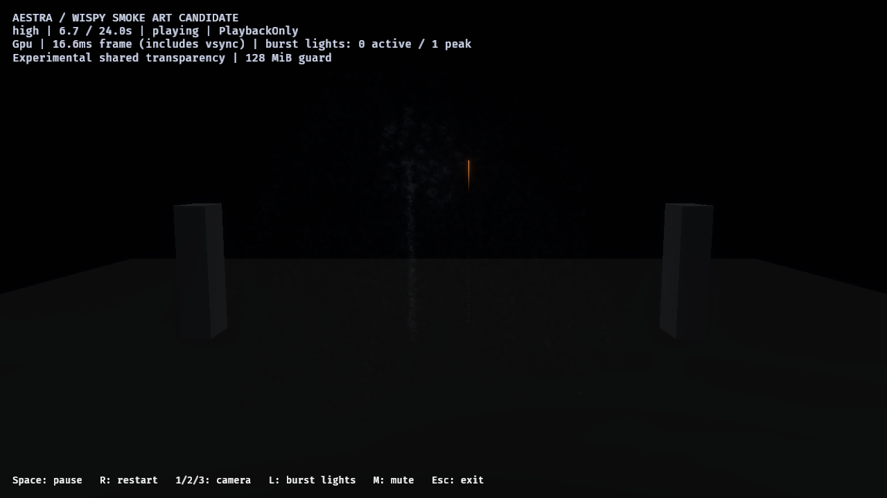
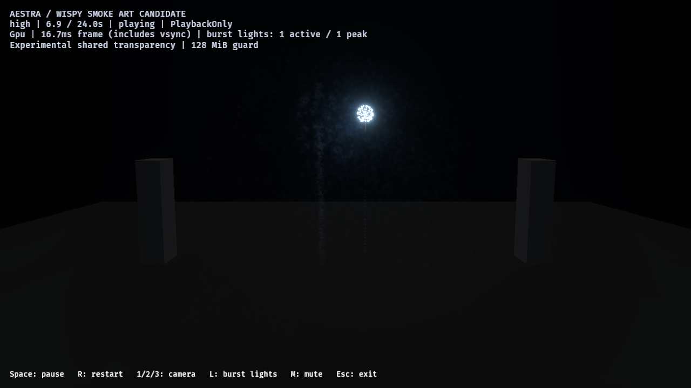

# Calibrated shells with deposited smoke — 2026-10-28

The point-star and dense gold-tail candidates now have separate saved variants
that leave smoke behind their moving stars. A two-shell fixture fires gold first
and blue point stars 5.5 seconds later, exposing older smoke to a fresh flash.
The calibrated luminous emitters and their births remain unchanged. This is
bounded smoke integration and visual review, not full-show or final art approval.

[Counts, lifecycle observations, controls, costs and hashes](shell-smoke-integration-2026-10-28.json).

## Saved assets and budgets

`author_fireworks_shell_smoke` generates two source variants and a 24-second
candidate/control pair. The control references the original calibrated sources;
the candidate references the variants with smoke. Both use the same clip timing,
transforms, fixed source seeds and blue color override. The first clip starts at
0 seconds and the second at 5.5; each lasts 18 seconds. Original launch/burst haze,
output bindings, flashes and gold embers remain present.

| Property | Point-star path smoke | Gold-tail path smoke |
| --- | --- | --- |
| Distance spacing / per-parent tick bound | 0.8 / 2 | 0.4 / 2, shared with ember route |
| Smoke children per crossing / inherited velocity | 1 / 0 | 1 / 0 |
| High / medium / low smoke pools | 16,384 / 8,192 / 4,096 | 32,768 / 16,384 / 8,192 |
| Opacity scale relative to retained wind-haze recipe | 0.5 | 0.25 |

Both retain 7–9-second lifetimes, small independent speed (0.12–0.55), acceleration
[0.8, 0.12, 0.16], drag 0.25 and turbulence 3. There is no independent emission.
Size grows from 1.2 through 1.8/2.5 to 3.2. The lower opacity and smaller footprint
account for the additional path samples and longer star lives.

The existing wind-haze material/function is reused. New material instances set
scene-light gain to 0.08, with ambient, albedo and density retained. The initial
0.02-gain variant passed admission but its local light response was subtle; its
sources and native evidence remain under ignored `target/`. No existing material,
calibrated effect, renderer library or runtime API/default changes.

The gold smoke route deliberately shares its parent's existing 0.4/max2 sampler.
Appending an old 0.8 route would not compile. Both destinations consume the same
bounded source samples, with separate child counts and explicit destination pools.

## Native work and visual controls

Eight image cases cover high close/audience, light-muted, path-smoke-hidden,
combined hidden/muted, medium/low close and the original-source control. All
**128 captures** deliver across launch, spread, cooling, later flash and quiet
phases. The unchanged control case is reused with its exact source/executable
hash verified. Four visibility/light combinations preserve all simulation counts.

| Tier | Gold path-smoke births | Point path-smoke births | Gold ember births |
| --- | ---: | ---: | ---: |
| High | 11,209 | 9,130 | 67,254 |
| Medium | 5,554 | 4,585 | 33,324 |
| Low | 2,559 | 2,280 | 15,354 |

All observed link demand is accepted, with no source overflow, omitted expansion
or destination rejection. Each run records two launches, two main breaks and two
bound/accepted flashes, no sampled global fragment drops/invalid links and final
owner cleanup. The calibrated stars/embers match the original-source control.

Old haze just before the later break (nominal 6.7 seconds):



The later blue burst (6.9 seconds):



The fixed ROI [440,140]–[590,330], outside the fresh star cluster, compares full,
light-muted, path-hidden and combined hidden/muted captures. Its difference of
differences is approximately [0.20, 0.57, 1.17] in mean 8-bit sRGB channels,
supporting a small blue contribution from lit path smoke. These are asynchronous
HDR-to-LDR captures with bloom/tone mapping, not physical irradiance measurements
or exact-frame subtraction. Puff structure and residual umbrella organization
remain visible art limitations; this is not volumetric-depth approval.

## Persistence and natural lifetime

The optional image report now includes per-owner/per-emitter asynchronous counts
and observed source times at capture requests. A separate nine-capture high-tier
witness verifies lifetimes before owner retirement:

- At root 6.9 seconds, gold Main stars and embers are zero; all 11,209 gold
  path-smoke particles remain.
- At root 16 seconds, the gold owner still exists, observed near source 15.95
  seconds, with every emitter empty. Its clip ends at 18 seconds.
- At root 20 seconds, point path smoke is empty; the retained longer-lived burst
  haze still contains 27 particles in the initial witness.
- At root 23 seconds, the point owner still exists near source 17.45 seconds,
  with every emitter empty. Its clip ends at root 23.5 seconds.

This separates path-smoke expiry, original burst-haze expiry and later owner
removal. Counts are asynchronous observations rather than GPU completion fences.
The eight art/admission cases use the earlier executable; the lifecycle witness
adds capture telemetry only. Binary/source fingerprints are recorded separately,
including the intermediate telemetry-label version used for ordinary costs.
No particle simulation/rendering library code changes between them.

## Pacing, validation and limits

One separate high audience pair without screenshots/capacity scans records
control/candidate host p95 **18.12 / 17.82 ms** and max **30.62 / 46.30 ms**. Both
have zero pending pipelines, accept both flashes and clean up. The candidate's
46 ms outlier remains recorded. This vsync-inclusive development pair uses
different authored workloads; it does not prove GPU equivalence, headroom or
stable 60 FPS. Expanded-show and production-finale performance remain open.

Native image controls use RTX 4070 SUPER/Vulkan, PlaybackOnly, 1280×720 HDR,
TonyMcMapface, bloom 0.15 and the existing 128 MiB experimental OIT guard. Each
image run retains one pending global-cache update, while its view preparation
reports ready. Some pixels exceed the 32-fragment exact-sort window; zero global
drops alone do not certify exact compositing. The fixture remains opt-in.

The new authoring test preserves luminous emitters/events/cues and compiles all
four saved assets at every tier, checking compatible distance routes and no
independent smoke emission. It and 32 public fireworks tests pass; strict host
all-target Clippy, formatting/diff and native provenance checks pass. All 211
prior recorded asset/runtime/other-authoring hashes match, excluding intentionally
updated report/runner tooling. No reference-video media is added to Git.

## Reproduce and next step

```powershell
cargo run --locked -p aestra-bevy --example author_fireworks_shell_smoke
cargo run --release --locked -p aestra-bevy --example fireworks -- --smoke-art-show --effect effects/fireworks_shell_smoke_candidate.aestra.ron --experimental-oit --no-audio
```

Replace `candidate` with `control` to play the same luminous pair without added
path smoke. The generic smoke-art HUD label is retained. With a built executable:

```powershell
./benchmarks/fireworks/run-point-star-review.ps1 -OutputDirectory target/fireworks-f8/smoke-fresh -Family shell_smoke -Variants candidate -Cameras close -SampleTimes '1.3,1.8,2.8,4,5,6.3,6.7,6.9,7.1,7.4,8,9,12,16,20,23'
```

Add `-MuteFlashes`, `-HideStarSmoke`, or both for independent image controls.
Use `-Cost -Cameras audience` in a fresh directory for the separate ordinary pair;
visibility controls are rejected in that lane. With the final report build, a
shorter `-SampleTimes '2.8,6.9,16,20,23'` records the lifetime witnesses.

Next, author bounded selected-star light outputs on this small pair and expose
host enablement independently of smoke labs. Review representative-only,
selected-only and combined response before expanding the saved show. Final smoke
art, coherent volume/depth, full-show adoption and production-load costs remain open.
