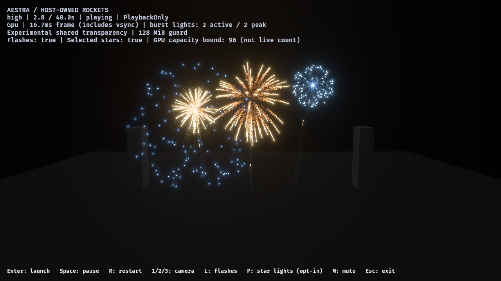

# Showcase v1 release baseline

`--showcase` freezes high-tier host overlap, tuned smoke, selected-star and flash
lights, PlaybackOnly, four reserved fragments/pixel and 4×4 experimental OIT. Normal
CLI defaults remain unchanged; VS Code's demo task explicitly chooses the candidate.
The baseline uses the initial audience camera, 1280×720, HDR/TonyMcMapface, bloom
0.15, Msaa::Off, no audio and uncapped owners on RTX 4070 SUPER/Vulkan. Cargo release
opt-level 3 and disabled debug assertions are verified from embedded build metadata.



One hardware/view release baseline, not final art/F9 approval. Warm-up and images excluded from timing tables. Phase classification and diagnostic sampling are asynchronous.

Ranges below are independent per-run p95/p99 values; they are not pooled or added.

| Phase | Ordinary host p95 / p99 ms (vsync included) | Instrumented render-graph GPU p95 / p99 ms |
|---|---:|---:|
| launch-and-overlap | 17.670–17.745 / 18.140–18.406 | 9.110–9.259 / 9.354–9.426 |
| active-fireworks | 17.739–17.848 / 18.368–18.565 | 10.381–10.480 / 10.534–10.635 |
| smoke-drain | 17.569–17.720 / 18.123–18.408 | 9.416–9.528 / 9.703–10.008 |
| idle | 16.995–17.035 / 17.245–19.165 | 2.225–2.244 / 2.233–2.257 |

| Instrumented CPU wall interval | Phase | p95 ms | p99 ms |
|---|---|---:|---:|
| cpu_render_graph_ms | launch-and-overlap | 1.388–1.463 | 1.535–1.623 |
| cpu_playback_ms | launch-and-overlap | 0.108–0.120 | 0.135–0.155 |
| cpu_encoding_ms | launch-and-overlap | 0.672–0.713 | 0.897–1.048 |
| cpu_stateful_preparation_ms | launch-and-overlap | 0.090–0.102 | 0.766–0.867 |
| cpu_render_graph_ms | active-fireworks | 1.557–1.629 | 1.652–1.685 |
| cpu_playback_ms | active-fireworks | 0.104–0.110 | 0.115–0.125 |
| cpu_encoding_ms | active-fireworks | 0.755–0.797 | 0.851–0.905 |
| cpu_stateful_preparation_ms | active-fireworks | 0.016–0.017 | 0.019–0.020 |

Paired timestamps around RenderGraph Begin through Render and selected-light copy, before diagnostic resolve/submission. GPU includes intervening graph work and gaps, not presentation latency or every upload. CPU is command-encoding wall time, not whole-game CPU or active CPU cycles. Nested scopes overlap; never add their quantiles.

Partition health is included in every lane. Image runs separately verify births and capacity. Node/head storage is 47,923,200 bytes, not total VRAM. Audio is disabled; owners are uncapped. A quiet full-show percentile is not an active-load budget.

## Integrity and interpretation

All eight lanes (images, excluded warm-up, three alternating ordinary/profile
pairs) complete 12 host launches/detonations and flashes, observe zero dropped
fragments/invalid links, retain zero particle-sort allocation, and drain particles,
gameplay rockets and VFX owners to zero. The separate image lane preserves
374,514 gold-tail ember and 115,283 star-path smoke births with no source overflow,
expansion omission or destination rejection. Its five images and source/binary
fingerprints are recorded in the [ledger](showcase-v1-release-2026-10-29.json).

No builds or other agent GPU workloads overlap the measured run. The prior pilot
image passed, but its runner incorrectly carried image sample times into warm-up;
that rejected invocation is retained under `target/fireworks-f8/showcase-v1-release-baseline-2026-10-29`.
The corrected runner removes image-only controls from pacing/profile lanes. Only
the fresh `showcase-v1-release-baseline-final-2026-10-29` run supplies this baseline.

The active audience-view render graph has GPU headroom under 16.67 ms on this
machine. Ordinary host p95 still exceeds that interval, including vsync; this is
not stable-60-FPS certification or an end-to-end latency measurement. Earlier
near-view development measurements have a different camera/build/instrumentation
and cannot establish a release speedup. Repeated partition geometry remains a
known cost, but this baseline does not justify an immediate general runtime rewrite.

Next prioritize the F8 reference/art pass on one complete shell and overlapping
audience shots. Revisit geometry work for near views, higher resolutions or a
larger finale when their named budget requires it. Audio, other tiers/hardware,
final choreography and final-art acceptance remain separate gates.

## Reproduce

```powershell
cargo run --release --locked -p aestra-demo-fireworks -- --showcase
cargo build --release --locked -p aestra-demo-fireworks
& ./benchmarks/fireworks/run-showcase-baseline.ps1 -OutputDirectory target/showcase-baseline
python ./benchmarks/fireworks/summarize-showcase-baseline.py target/showcase-baseline --output-prefix target/showcase-baseline/summary
```

The analyzer validates configuration, phase samples, health, workload, births and
cleanup before producing JSON and timing tables. Use fresh output paths. 52 demo
tests, strict default-feature all-target Clippy, PowerShell/Python syntax checks,
workspace formatting and diff checks pass. This baseline intentionally builds
without the optional audio feature and makes no new audio qualification claim.
