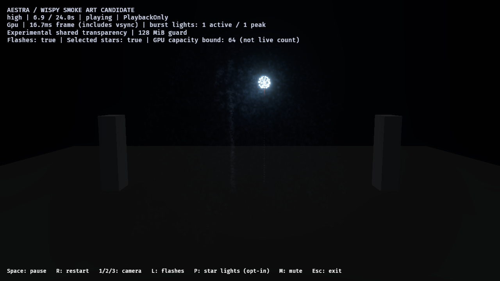
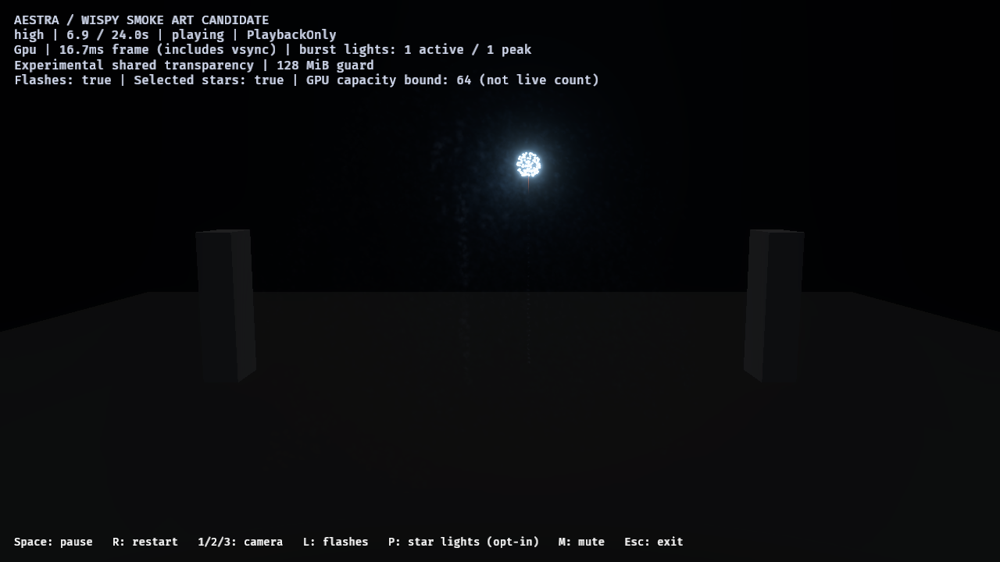
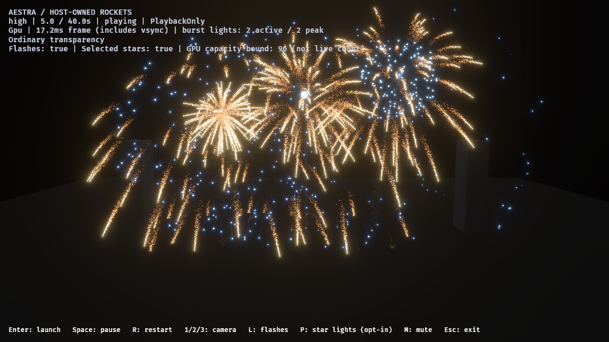
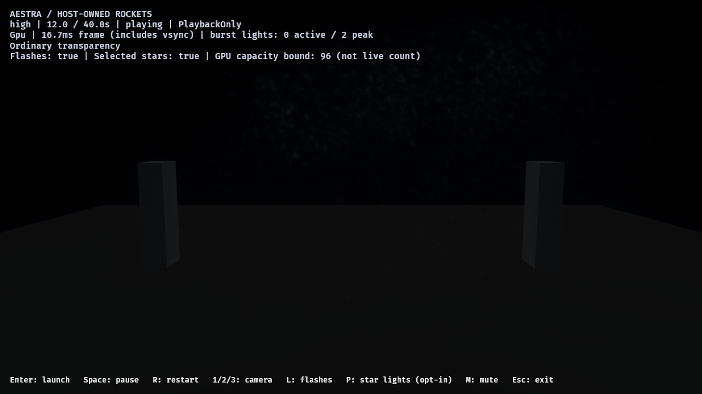
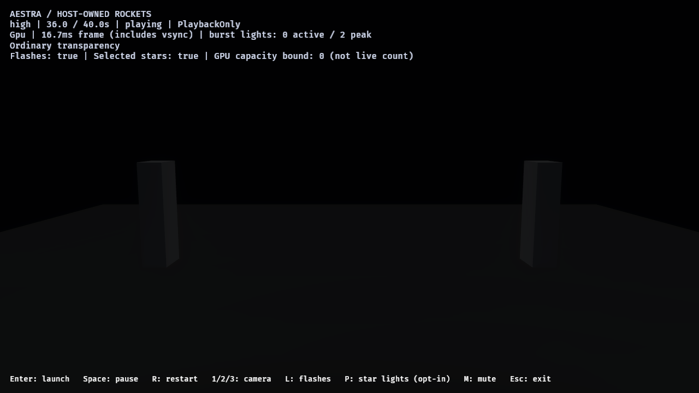

# Eroding smoke and host overlap review — 2026-10-28

A separate smoke-look candidate now reduces the round, uniformly dense centers
of the existing wisps. A twelve-rocket host pattern exercises retained smoke,
independent burst clocks, source outputs and cleanup. [Reports, source hashes and
image fingerprints](smoke-look-host-overlap-2026-10-28.json) retain the bounded
review; the normal demo has no fixed owner-count admission limit.

## Candidate

`author_fireworks_smoke_look` generates separate point/gold/pair effects and a
separate material/function. Previous calibrated assets retain their hashes.
Luminous particle modules, renderers, seeds, event links, lifetimes, smoke motion,
sound/flash routes and capacity ceilings are preserved.

The mask removes its 75% uniform erosion floor, increases interior noise detail,
elongates/warps its density and fades every tile edge to zero. Path smoke starts
thinner and expands as it ages; shell haze expands more slowly. The gold Main-star
light is tuned from 6000 to 12000 initial lumens and range 12 to 16, retaining all
output/host count ceilings. These are art values, not calibrated photometry.

The result is less uniformly round and more broken up under the later flash:





This remains an opt-in draft. The overall shell-path silhouette and flat sprite
depth are still visible; final photographic/volume approval is open.

## Host pattern and admission policy

`--launch-pattern overlap` launches twelve host-owned rockets at 0.35-second
intervals, using three launch lanes, two depths, three fuse lengths, fixed seeds
and alternating gold/blue styles. The host applies the blue gradient through the
public parameter API; Aestra's light output samples that same gradient. Gameplay
owns each rocket and detonation. VFX owners retain their finite tails afterward.

Normal admission has **no owner-count ceiling**. The review runner explicitly
passes `--max-owners 24` to name its workload budget. This is a demo host choice,
not an Aestra runtime limit. A regression checks budgeted admission and then
removes the policy, admitting a thirteenth firework and exceeding 24 owners while
old tails remain alive. Increasing or omitting the option does not change engine
code. The saved twelve-launch pattern is choreography, not an instance limit.



The existing report hook now supports independently clocked host effects. It
records host launch/detonation/owner counts, per-owner asynchronous populations,
event-link demand and native encoding observations. Host particle outputs use
their source owner's clock for delivery age. A host report no longer labels the
unused default cinematic asset as its active effect. Reports disable interactive
launch/restart controls to keep their input sequence fixed.

## Native results

Eight final RTX 4070 SUPER/Vulkan runs include a cinematic control/candidate pair,
high-tier host control/candidate, medium/low host candidate and a separate ordinary
high-tier host timing pair. Six image runs deliver **58 captures**.

All host runs admit twelve launches and twelve detonations/flashes, with five
gameplay rockets concurrently active at peak and 24 gameplay/VFX owners at peak.
There are no admission waits. Both gameplay and VFX owner counts finish at zero;
asynchronous particle totals and selected-light capacity finish at zero. Selected
capacity bounds stay within 96/48/24 at high/medium/low, with no observed adapter
rejections. Those bounds are not live-light counts.

All sampled event-link demand is accepted with no source overflow, expansion
omission or destination rejection. High control/candidate child-birth totals
match exactly in both the pair and host tests. Host peak asynchronous populations
are about 154k / 77k / 40k at high/medium/low; small high control/candidate peak
differences reflect asynchronous sampling rather than different cumulative demand.
The encoding ledger records no blocked owner frames or positive host encoding
lag in these host runs; it does not certify GPU completion/display latency.

The cinematic OIT pair has zero global drops/invalid links. Its maximum pixels
exceeding the 32-fragment exact-sort window change from 5104 to 3210; it remains
approximate. Host overlap uses ordinary depth-sorted transparency, so it does
not inherit that pair's global compositing guarantee. Image cases retain one
global-cache pending update while view preparation is ready.

Quiet retained smoke and final empty state:





## Pacing and remaining work

The ordinary high-tier host pair, without screenshots/capacity scans, records:

| Whole 40-second host interval | Control | Candidate |
| --- | ---: | ---: |
| p95 | 17.5368 ms | 17.4664 ms |
| p99 | 22.85 ms | 31.3863 ms |
| Maximum | 66.7551 ms | 51.0624 ms |
| Intervals above 33.33 ms | 23 | 23 |

These are single development, vsync-inclusive runs with a long drain/quiet period,
not GPU costs or sustained active-load percentiles. The outliers remain visible;
the candidate is not a performance win or stable 60 FPS acceptance. Next, profile
activation and the active overlap separately, then address the measured spikes.
Final smoke art, depth/compositing and broader host overload policies remain open.

49 package/authoring tests pass. Strict Clippy with audio enabled/disabled,
formatting/diff checks and source/evidence fingerprints pass. Portable runtime
and rendering libraries are unchanged.

## Reproduce

```powershell
cargo run --locked -p aestra-demo-fireworks --bin author_fireworks_smoke_look
cargo run --release --locked -p aestra-demo-fireworks -- --star-lights --tuned-smoke --launch-pattern overlap
./benchmarks/fireworks/run-smoke-look-review.ps1 -OutputDirectory target/fireworks-f8/fresh-look-pair -Mode pair
./benchmarks/fireworks/run-smoke-look-review.ps1 -OutputDirectory target/fireworks-f8/fresh-look-host
./benchmarks/fireworks/run-smoke-look-review.ps1 -OutputDirectory target/fireworks-f8/fresh-look-lower -Variants tuned -Tiers medium,low
./benchmarks/fireworks/run-smoke-look-review.ps1 -OutputDirectory target/fireworks-f8/fresh-look-cost -Cost
```

The runner defaults to a built `target/debug/fireworks.exe`; pass `-Binary` for
another profile. It requests the optional 24-owner budget only in host review mode.
