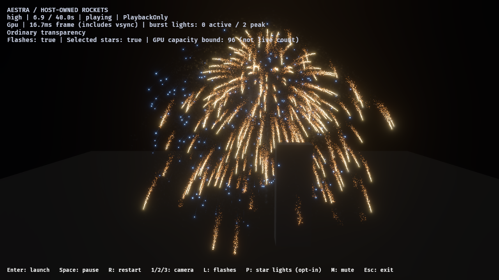
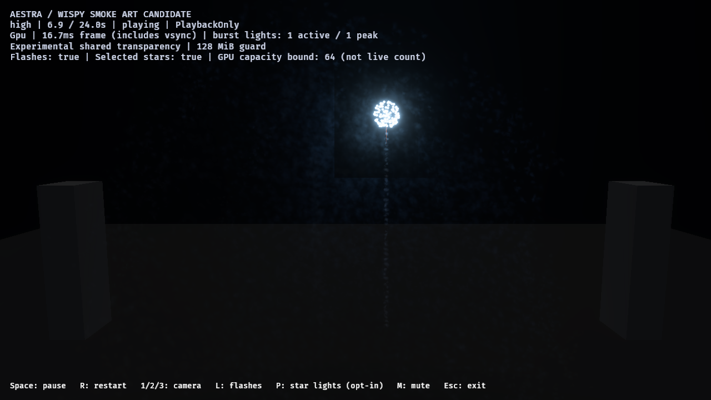

# Smoke depth and camera-motion review — 2026-10-28

The tuned smoke retains a spatially placed wake/haze field in the reviewed side,
near and sampled orbit views. Selected stills and adjacent orbit samples do not
show an obvious collapse into a single flat card or rectangular tile edges.
Close inspection makes the mottled, separate-puff structure more apparent; it is
still an art draft, not close-up volumetric or photographic acceptance.

The review adds deterministic report-only camera views and request-pose metadata.
No effect, material, emission, motion, light budget or render algorithm changes.
It does not justify replacing particle smoke with fluid simulation. The next
integration gate is the independent host's cross-draw transparency, using the
existing shared OIT path rather than inventing another sorting limit.

## Views and captured motion

All runs use native GPU, high tier, 1280×720 HDR/bloom, PlaybackOnly and no audio
on RTX 4070 SUPER/Vulkan. Host overlap remains twelve independent fireworks with
an explicit benchmark-only 24-owner admission policy. Normal host admission is
unchanged. The authored two-shell pair is a separate experimental-OIT fixture;
it is not a matched transparency A/B for the host workload.

| View | Eye / target | Purpose |
|---|---|---|
| Side | (180,48,0) / (0,28,0) | Inspect overlapping paths and pillar occlusion from the side |
| Near | (0,44,95) / (0,32,0) | Magnify puff silhouettes and dense haze; expanded shells intentionally extend beyond the frame |
| Orbit | Horizontal radius 180, y=48 / (0,28,0) | Smooth yaw from −45° to +105° and back over a 16-second cycle |

Orbit yaw is `30 - 75*cos(2*pi*t/16)` degrees, driven by the existing root clock.
The review system reads that clock after playback without advancing/seeking it.
It publishes both local and world transforms for this unparented camera before
main-world view preparation, avoiding stale pre-propagation poses. Normal
interactive camera controls and non-report playback remain unchanged. Orbit is
rejected in ordinary cost/profiling lanes.

Six image runs deliver **209 captures**: host side/near/orbit 8/8/145, pair
side/near/orbit 9/9/30. Every requested pose is checked against the static view or
orbit formula at the recorded root time. Largest nominal-to-request delay is
one 60 Hz tick for the host orbit and half a tick for the pair orbit. Images and
GPU population observations remain asynchronous; request poses are not GPU
completion timestamps or exact image-delivery times.

[Host orbit preview](reviews/smoke-views-2026-10-28/host-orbit.mp4): 142 screenshot
frames, nominally 12 FPS, approximately 0.25–12 seconds of playback.
[Two-shell orbit preview](reviews/smoke-views-2026-10-28/pair-orbit.mp4): 25 frames,
nominally 8 FPS, 6–9 seconds. Both are H.264 assemblies of unmodified screenshots,
not continuous native video recordings. Decoding verifies every exported frame;
original PNGs and pose/time metadata remain authoritative. These samples do not
prove the absence of sub-frame sorting pops or subtle texture swimming.

Side-view host at approximately 6.9 seconds:



Near-view relighting of retained haze in the two-shell fixture:



The side and orbit samples preserve legible stars, deposited paths, pillar
occlusion and an older haze field. Near view exposes granular/mottled puff detail
and stronger layered haze. This supports keeping the current representation for
show-distance tuning while leaving close-up art and default adoption open.

## Overflow sorting: work counter, not a new failure

Observed pair diagnostics:

| View | Maximum pixels above local fast-sort threshold | Global fragment drops | Invalid links |
|---|---:|---:|---:|
| Side | 1,066 | 0 | 0 |
| Near | 7,379 | 0 | 0 |
| Orbit | 1,267 | 0 | 0 |

The larger near-view counter initially prompted an overly cautious interpretation.
Source inspection confirms that it counts long accepted lists **before** the
existing full-target overflow merge sort. It does not itself mean approximate
blending, an exceeded final quality limit, or discarded layers. That sort already
reuses node links with O(N log N) work and O(1) private state before resolve;
raising the local threshold is not the proposed fix.

A seventh, separate near-view profile verifies actual execution of
`render/aestra_oit_overflow_sort/elapsed_gpu`: **1,447 observations**, median
0.167936 ms, p95 0.283648 ms, maximum 0.539648 ms. It completes with two flashes,
zero final particles and a ready prepared view. This confirms the existing pass
runs for the qualified full-target setup. The timing is not frame-paired with
the images, an incremental-cost comparison, or whole-game performance approval.

The source qualification still matters: sub-viewports, resolution overrides and
cold/unsupported paths are outside the verified overflow-sort route. Equal-depth
physical semantics and non-participating ordinary transparent draws are separate
limitations. The independent host currently sorts within renderer draws and uses
draw-center ordering between them; that does not provide global per-fragment
ordering across independent fireworks. No such failure is inferred solely from
the pair's fast-path counters.

## Workload and validation

Cumulative event demand/accepted totals match exactly across the three views
within each workload. All observed source overflows, expansion omissions and
destination rejections are zero. Each host run completes twelve launches,
detonations and flashes; each pair run completes two flashes. Final gameplay/VFX
owners, live particles and enabled selected-light capacity bounds drain to zero.
Peak selected bounds remain 96 for the host and 64 for the pair, not live-light
counts. Image runs record one global-cache pending update with prepared views
ready. No CPU command encoding is blocked; host requested-minus-encoded lag is
zero and the pair records at most one expected simulation tick. This is command
encoding metadata, not a completed GPU submission fence.

53 demo/authoring tests pass, including explicit camera parsing/image-only motion,
orbit continuity/target/radius, and unchanged root seed/time/history during camera
updates. Strict all-target Clippy with and without audio, formatting and diff
checks pass. The rendering algorithms and tuned smoke assets are unchanged.

The [JSON evidence](smoke-views-2026-10-28.json) retains binary/source/report/video
hashes, all 209 request poses/times and image hashes, population summaries,
admission totals and the separate overflow profile. Raw images/reports live under
`target/fireworks-f8/smoke-views-*-2026-10-28`.

Reproduce fixed or sampled moving review with a freshly built demo and fresh
output directories:

```powershell
& ./benchmarks/fireworks/run-smoke-look-review.ps1 -OutputDirectory target/fireworks-f8/side-review -Mode host-overlap -Camera side -Variants tuned -SampleTimes '1.2,4,6.9,8,12,16,23,36'
$times = ((3..144 | ForEach-Object { ($_ / 12.0).ToString('0.######',[Globalization.CultureInfo]::InvariantCulture) }) + @('16','23','36')) -join ','
& ./benchmarks/fireworks/run-smoke-look-review.ps1 -OutputDirectory target/fireworks-f8/orbit-review -Mode host-overlap -Camera orbit -Variants tuned -SampleTimes $times
```

Next: qualify opt-in shared transparency for the independent host with matched
ordinary/shared near and orbit controls, retaining budgets and lifecycle demand.
Verify the existing full-target overflow path and mixed-scene restrictions rather
than adding a new hard limit. No automatic default-art adoption, fluid rewrite,
all-hardware guarantee or production-finale acceptance follows from this review.
