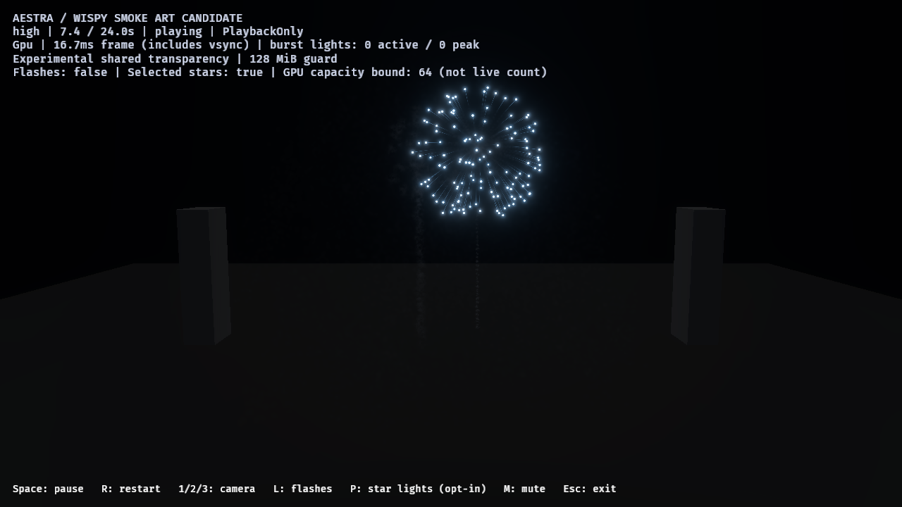
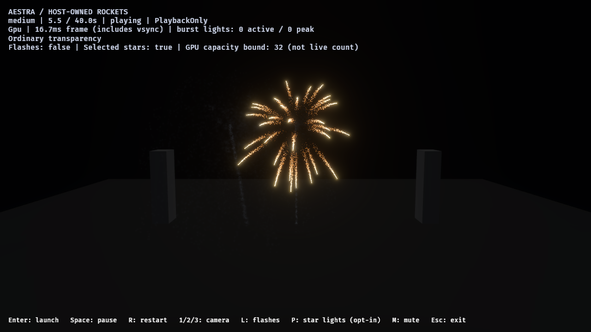

# Bounded star lighting on calibrated smoke — 2026-10-28

The calibrated point/gold smoke pair now has separate saved Main-star light
outputs and independent host enablement. The same outputs work in the host-owned
rocket demo. [Native reports, fingerprints and image hashes](star-light-smoke-integration-2026-10-28.json)
record this bounded integration; final smoke art and expanded-show acceptance
remain open.

## Art and host boundary

`author_fireworks_star_lights` produces `fireworks_point_star_lit_smoke`,
`fireworks_gold_tail_lit_smoke` and `fireworks_shell_star_lights`. Every original
module, renderer, material, event link, particle budget, representative flash and
sound output is retained. Only Main stars gain a material-free scene output;
smoke, dense embers and flash particles do not become individual lights.
The original calibrated point/gold smoke sources retain their recorded hashes.

The output samples `Main stars color`, including the blue clip override. Its
normalized-age intensity is 6000 / 3000 / 0 lumens at ages 0 / 0.65 / 1, range
12 units, radius 0.1, no shadows. These are scene tuning values. Per-output
high/medium/low ceilings are 32/16/24; low retains the earlier qualified sparse-star
admission instead of the rejected eight-light draft. Host ceilings remain 96/48/24.

`--star-lights` installs the public same-frame GPU adapter independently of smoke
labs. `--no-flash-lights` disables representative flashes independently. L and P
toggle the two families through the public lighting policy; selection, transport
and realization caps stay synchronized. This does not recompile or restart VFX.
An explicitly selected cinematic asset without light outputs produces a clear
preflight error. Selected-star lighting remains opt-in.

An added tier test caught a host loader issue: flattened particle budgets were
compiled with the default high-quality light output. The host now passes its
quality tier to compilation as well. The regression checks both shell families,
all three tiers, and the absence of light outputs on attached rocket wakes.

## Native controls and lifetime

Ten final real-window runs on RTX 4070 SUPER/Vulkan use PlaybackOnly, fixed HDR
exposure, TonyMcMapface, bloom 0.15 and 1280×720. Eight image runs deliver **84
captures**; two separate ordinary runs contain no screenshots/capacity scans.

| Control | Tier | Accepted flashes | Peak selected capacity bound |
| --- | --- | ---: | ---: |
| Neither family | High | 0 | 0 |
| Representative only | High | 2 | 0 |
| Selected only | High | 0 | 64 |
| Combined | High | 2 | 64 |
| Combined | Medium | 2 | 32 |
| Combined | Low | 2 | 24 |

The high selected capacity includes both scheduled owners; it is **not a live
light count**. Metadata reservations persist while a smoke owner drains, even
after its Main stars die. All final selected capacity bounds are zero; the
bounded GPU slot pool remains reusable. No selected-position readback is used.

All runs preserve two launch/two main-break source messages. Image runs accept
all event-link demand, with zero source overflow, omitted expansion or destination
rejection, zero global fragment drops/invalid links and final zero particles alive.
The high births remain 11,209 gold / 9,130 point path-smoke particles and 67,254 gold
embers. Selected adapter observations report no rejected updates and zero invalid
sources at final observation.

Selected-only blue smoke after the representative flash has faded, at 7.4 seconds:



Matched no-light control:


The response is subtle and localized. In ROI [440,120]–[800,360], subtracting
stars-on/off differences with path smoke visible and then hidden gives mean RGB
approximately **[0.163, 0.302, 0.418]** in 8-bit sRGB at 7.4 seconds, falling to
[0.058, 0.110, 0.167] at 8 seconds and zero at 16 and 23 seconds. This supports a
small blue contribution from the path smoke, rather than just sprite bloom.
Asynchronous captures, occlusion, bloom and tone mapping prevent interpreting it
as physical irradiance or exact-frame subtraction. Gold's ROI response is much
weaker; cross-family perceptual matching remains open.

A separate medium-quality host screenshot uses ordinary depth-sorted transparency
and selected-only lighting at 5.5 seconds. It shows the GPU backend, a 32-slot
capacity bound, detached rocket smoke and a host-started gold burst. It is an
integration witness, not full host lifecycle/cost qualification:



## Pacing and limits

The separate high audience representative-only/combined pair records host p95
**18.216 / 18.3745 ms**, maximum **30.9555 / 31.1707 ms**, with zero pending pipeline
updates and cleanup. This single development, vsync-inclusive pair does not prove
GPU overhead, headroom or stable 60 FPS. Repeated expanded-host/finale costs remain
open.

Image runs retain one pending global-cache update while per-view preparation is
ready. Their 128 MiB experimental OIT guard has zero global loss, but up to
5104/741/25 high/medium/low pixels exceed the 32-fragment exact-sort window.
That approximation and the existing puff/umbrella structure are retained limits;
this is not final art, exact compositing or volumetric-depth approval.

46 audio-enabled package/authoring tests pass. Strict Clippy passes with audio on
and off, along with formatting and diff checks. Portable runtime/rendering library
code is unchanged. Final smoke texture/volume, natural-star light distribution,
all-tier perceptual matching and expanded host performance are the next gates.

## Reproduce

```powershell
cargo run --locked -p aestra-demo-fireworks --bin author_fireworks_star_lights
cargo run --release --locked -p aestra-demo-fireworks -- --star-lights
./benchmarks/fireworks/run-star-light-review.ps1 -OutputDirectory target/fireworks-f8/fresh-star-lights
./benchmarks/fireworks/run-star-light-review.ps1 -OutputDirectory target/fireworks-f8/fresh-star-lights-lower -Modes combined -Tiers medium,low
./benchmarks/fireworks/run-star-light-review.ps1 -OutputDirectory target/fireworks-f8/fresh-star-lights-hidden -Modes neither,stars -SampleTimes '2.8,7.4,8,9,16,23' -HideStarSmoke
./benchmarks/fireworks/run-star-light-review.ps1 -OutputDirectory target/fireworks-f8/fresh-star-lights-cost -Modes flashes,combined -Camera audience -Cost
```

The runner defaults to a built `target/debug/fireworks.exe`. Pass `-Binary` to
review another profile; ordinary and image lanes use fresh separate directories.
