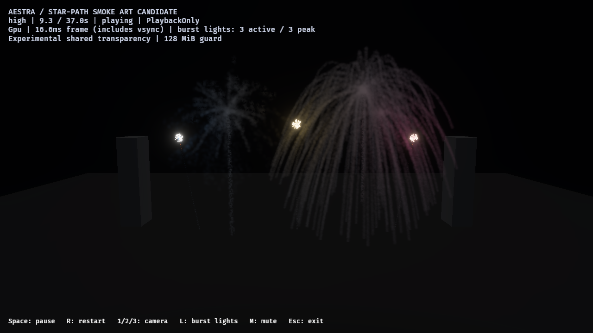
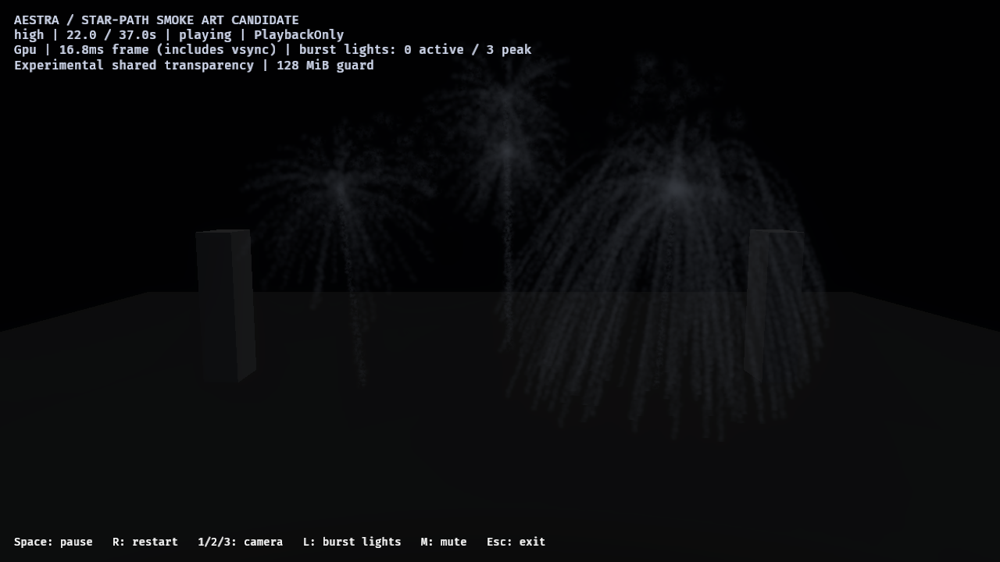
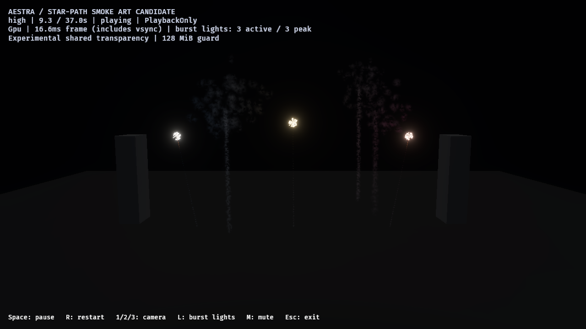

# F8.1C4S — saved continuous star-path smoke

The public Bevy example now has a separate saved candidate that deposits smoke
along the **Main stars** paths. It preserves the existing rocket wake, stars,
choreography and light/cue routes. The deposition/admission/lifecycle mechanism
passes the bounded high-tier runs below. Photographic smoke art, native all-tier
acceptance, default adoption and stable 60 FPS remain open.

This follows uncommitted C4R parameter reuse; its historical measurements remain
in [the separate C4R record](reused-stateful-parameters-2026-10-27.md).
Raw reports, historical/current source inventories, binary and file hashes are
in [the machine-readable evidence](star-path-smoke-2026-10-27.json).

## Authored behavior

The offline `author_fireworks_star_smoke` example derives four family assets and
one 13-clip root from the retained wispy candidate. The public host loads their
saved RON through its normal project compiler. No host-side particle simulation,
schema change or new renderer implementation is needed.

Each family adds a distinct `Star path smoke` emitter, fed by actual GPU
`Main stars` distance crossings: spacing 0.8, at most two crossings per source
per tick, one child per crossing and **zero inherited velocity**. Free emission
and burst are zero. A point spawn and own speed 0–0.08 leave deposited smoke near
the path instead of launching it from the origin or carrying it with the star.

Puffs live 7–9 seconds with slow wind/buoyancy acceleration [0.27, 0.035, 0.04],
drag 0.45, turbulence 0.35 and slow rotation. Size grows 2.0 → 2.3 → 2.7; opacity
fades in to 0.09, then through 0.028 to zero. A dedicated material instance and
new seeded smooth low-frequency density function soften the previous granular
cutouts. Lighting retains the existing wispy scene-irradiance response. Existing
shell-born haze is subdued (size ×0.6, opacity ×0.35); other original emitters
and existing event/light/parameter routes are retained.

New destination capacities are explicit at each tier:
`next_power_of_two(main-star tier capacity * 64)`. The largest high-tier source
has 192 slots; its two distance crossings plus death fit within 576 capture
records per tick, below the existing 1,024-record capture limit. No global hard
limit or OIT storage guard is raised. This bound is specific to these assets.

## Native review and retained failures

All native runs use Windows/RTX 4070 SUPER/Vulkan, Rust 1.98.1, Bevy 0.20.0 and
wgpu 30.0.1. The dev build uses application opt-level 1/dependencies opt-level 3.
The public 1280×720 HDR target uses TonyMcMapface, bloom 0.15, Off MSAA and
experimental OIT average4/K32 under the unchanged 128 MiB guard. History is
PlaybackOnly. Each full 37-second show receives ten cleanup updates.
`fireworks-audio` is compiled; playback uses `--no-audio`.

| Stage | Accepted new smoke births | OIT maximum global drops | Decision |
| --- | ---: | ---: | --- |
| Coarse granular draft, spacing 2.25 | 13,135 | 0 | Reject art: separated beads/grain |
| Smoother large puffs, spacing 1.25 | 24,123 | **216,314** | Reject capacity; preserve failed report |
| Smaller bounded intermediate, spacing 1.25 | 24,123 | 0 | Capacity passes; periodic beading remains |
| Current connected candidate, spacing 0.8 | **37,996** | **0** | Bounded mechanism passes; art still open |

Historical `final-audience`/`final-close` filenames refer to the intermediate
bounded draft, not the current connected candidate. Their provenance is retained
separately. The current source inventory (257 files) and native executable hash
were rechecked after validation.

The final audience, close and star-smoke-hidden close runs each observe all
13 owners and exactly 37,996 accepted births, with zero captured-source overflow,
expansion omission or destination rejection. All retain 13 representative flashes
and drain to zero live particles. Final async OIT observations record zero dropped
fragments and invalid links. Async scans can skip frames; these counts do not
constitute an exact-blending or every-frame capacity proof.

The hidden control sets only the distinct new material's Density to zero before
GPU preparation: it retains the same 37,996 simulated births. The new radial
strands disappear while the rocket wake, original haze, stars and flash routes
remain. This isolates the layer's visible contribution, not individual light-family
causality. Separate light on/off controls are still required.







These are byte-identical native captures, without cropping or retouching. Smoke
is more continuous and remains after the bright stars; older density drifts,
fades and picks up later burst colors. Regular radial strands remain visible,
and broad asymmetric haze/physical depth still need art work. This is a billboard
approximation, not photographic smoke approval.

All seven image runs deliver eight samples (56 total), requested at 2.8, 3.8,
9.3, 12, 18.4, 22, 30 and 33 seconds during forward playback. Screenshot delivery
is asynchronous: these are nominal times, not frozen or exact pixel pairs.
Image runs also perform OIT scans; their HUD/intervals are not cost measurements.

Each image run records **one update with the global Bevy pipeline cache not
ready**. This counter does not identify the pipeline or its exact time; the cause
is not attributed to screenshots. Effect preparation reports Ready. Keep the
observation: the image lane does not establish zero late pipeline work. All three
separate cost runs below record zero pending updates.

## Separate ordinary pacing observations

No screenshots, OIT scans or encoding/GPU profiling run in these timing windows.
Existing bounded asynchronous admission/playback counters remain enabled. Runs
are sequential, with no agent-launched builds or other native GPU probes active.
Camera, HDR/OIT configuration, quality, seed and playback policy are retained.

| Audience high, ordinary host intervals | p95 | Maximum | Sampled encoding lag |
| --- | ---: | ---: | ---: |
| Retained wispy control | 18.37 ms | 41.01 ms | 16.67 ms |
| Star-path candidate, repetition 1 | 20.28 ms | 70.04 ms | 16.67 ms |
| Star-path candidate, repetition 2 | 26.71 ms | 52.49 ms | 16.67 ms |

Each retains all 13 flashes, exact clip scheduling, zero blocked/missing owner
observations, zero late pipeline updates and a full drain. Candidate repetitions
retain the same 37,996 births with zero admission drops. OIT capacity scans are
intentionally absent here; capacity observations come from the image lane.

These are whole-host intervals including vsync and scheduling, not GPU pass costs.
The retained control has less smoke simulation and is not a work-matched pure
draw control. Variability prevents a fixed marginal-cost or speedup claim.
Stable 60 FPS and whole-host tail latency remain open. The initial cost setup
failed before native playback because an empty custom-times environment variable
could not parse; its log is retained, excluded from accepted measurements.

## Reproduce

Interactive saved candidate (release is convenient for users; measurements above
used the dev executable):

```powershell
cargo run --release --locked -p aestra-bevy --example fireworks -- --smoke-art-show --effect effects/fireworks_show_star_path_smoke.aestra.ron --experimental-oit
```

Rebuild the saved effect assets and the measured host configuration:

```powershell
cargo run --locked --offline -p aestra-bevy --example author_fireworks_star_smoke
cargo build --locked --offline -p aestra-bevy --example fireworks --features fireworks-audio
```

Example image/capacity run; use fresh report filenames for each invocation:

```powershell
$env:AESTRA_EXAMPLE_REPORT = Join-Path (Get-Location) 'target/star-review-close.json'
$env:AESTRA_EXAMPLE_REPORT_IMAGES = '1'
$env:AESTRA_EXAMPLE_REPORT_CAMERA = 'close'
$env:AESTRA_EXAMPLE_REPORT_SAMPLE_TIMES = '2.8,3.8,9.3,12,18.4,22,30,33'
$env:AESTRA_EXAMPLE_REPORT_STAR_SMOKE = '1'
Remove-Item Env:AESTRA_EXAMPLE_PROFILE -ErrorAction SilentlyContinue
& .\target\debug\examples\fireworks.exe --smoke-art-show --effect effects/fireworks_show_star_path_smoke.aestra.ron --experimental-oit --tier high --no-audio
```

Repeat with camera `audience`, then camera `close` and `STAR_SMOKE='0'` for the
separate density control. That control is deliberately image-only. For ordinary
cost repetitions, use a fresh report path, camera `audience`, visibility `1`, and
**remove** `AESTRA_EXAMPLE_REPORT_IMAGES`, `AESTRA_EXAMPLE_REPORT_SAMPLE_TIMES` and
`AESTRA_EXAMPLE_PROFILE` rather than setting them to empty strings. The old control
uses `effects/fireworks_show_wispy_smoke.aestra.ron` under the same options.
`host-default`/omitted camera preserves the original interactive startup pose;
the report-only camera switch does not change normal example behavior.

## Validation and next gate

All 31 public-example tests pass with audio compiled. New checks compare typed
authoring to saved RON, roundtrip it, verify preserved emitters/routes/parameters,
zero free emission/inheritance and distinct control material, then compile all
three tiers through the public host and OIT audit. Strict workspace Clippy with
GPU/audio features, workspace format and diff checks pass. Environmental
incremental hard-link fallback warnings remain in the Clippy log. No renderer
library code changes in C4S; C4R's renderer/host results remain separately scoped,
and full workspace tests are not claimed rerun here.

Next: native medium/low audience/close bright/quiet admission/capacity/drain
controls, followed by independent representative/selected lighting controls on
older star smoke. Fine-tune strand regularity and broad wind-drifted haze before
art approval or default adoption. Secondary child-star paths, generic fluid
injection, production-finale density and whole-host latency remain open.
