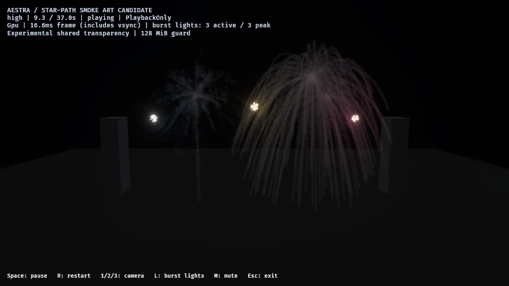
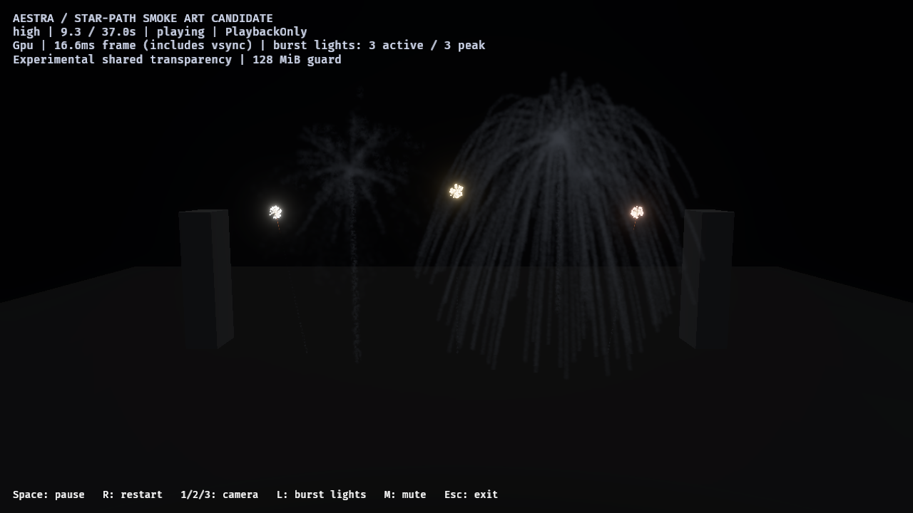

# F8.1C4T — all-tier smoke review and representative-flash control

The saved C4S candidate now has native audience/close reviews at high, medium and
low quality, plus an independent representative-flash intensity control. All smoke
admission/capacity/drain checks pass. **Robust flash delivery is not accepted:** one
medium close run accepts only 12 of 13 flashes without a recorded rejection. A
successful repeat is retained alongside that failure, not substituted for it.

This is a report/control slice. Saved effects/materials, renderer implementation,
catch-up policy, hard limits and default show are unchanged. It follows uncommitted
C4R/C4S work; their historical evidence remains separate. See the
[raw reports, assessment and provenance](star-path-tiers-lighting-2026-10-27.json).

## Controls and qualification

The public example's report hook accepts `AESTRA_EXAMPLE_REPORT_FLASHES=0` only
with `AESTRA_EXAMPLE_REPORT_IMAGES=1`. It sets the public representative adapter's
`max_lumens` to zero before playback. The adapter remains enabled with its authored
bindings, request/range/light caps and pooled proxy/event admission intact. It does
not disable emission, hide stars or change smoke simulation. Omitted/`1` retains
ordinary lighting. Muted cost runs and invalid values are rejected.

Each screenshot request records the maximum main-world pooled light intensity,
active count and accepted count. Final reports add budget/expiry/invalid/disabled
rejection counters. These observations are not an exact displayed-frame light
record or a GPU fence; earlier capture/transport/binding stages are not fully traced.

The saved show currently uses **representative flashes only**. Selected moving-star
lighting is disabled by its quality policy, and no new selected outputs are authored
for this gate. This does not qualify selected-star contribution to smoke.

Same public Windows/RTX 4070 SUPER/Vulkan environment as C4S: Rust 1.98.1,
Bevy 0.20.0/wgpu 30.0.1, dev application opt-level1/dependencies opt-level3,
1280×720 HDR/TonyMcMapface/bloom0.15, Off MSAA, experimental OIT average4/K32 and
unchanged 128 MiB guard. PlaybackOnly, full 37-second shows plus ten cleanup
updates; audio compiled and `--no-audio`. Native windows run sequentially, with no
agent-launched builds or other native GPU probes during their capture windows.

The initial matrix is audience lit, close lit and close intensity-muted at each
tier. A separate fresh medium close-lit repetition makes ten native runs and
80 delivered captures. Samples are requested at 2.8, 3.8, 9.3, 12, 18.4, 22, 30
and 33 seconds during forward playback. No seeking or frozen replay is used.

| Tier | Accepted new smoke births per run | Smoke owners | Source/expansion/destination drops | Sampled OIT drops/invalid links | Final live |
| --- | ---: | ---: | ---: | ---: | ---: |
| High | 37,996 | 13 | 0 | 0 | 0 |
| Medium, including repeat | 18,959 | 13 | 0 | 0 | 0 |
| Low | 9,313 | 13 | 0 | 0 | 0 |

Camera and flash mute preserve the exact per-tier birth totals. Every run reports
zero blocked/missing owner observations and no clip scheduling error. All ten
image reports retain one global-cache pending update; the pipeline/cause is not
identified, so zero late pipeline work is not claimed. Async aggregate readbacks
can miss frames and do not prove every-frame capacity or exact blending.

## Visible older-smoke response

The upper-right older wake at nominal 9.3 seconds visibly brightens and shifts
from cool gray toward the later representative burst colors. Muted proxies retain
accepted events but have zero recorded intensity at every sample; lit runs record
positive intensity. Stars/bloom and smoke emission remain enabled in both controls.





[Medium close capture](reviews/star-path-tiers-2026-10-27/medium-lit.png) and
[low close capture](reviews/star-path-tiers-2026-10-27/low-lit.png) show reduced
density with retained deposition and recoloring. These are unmodified native PNGs.
Regular strands and inadequate broad asymmetric haze remain visible; this is not
photographic smoke approval.

A fixed close-camera rectangle `[740,135,925,230]`, away from the HUD/current bright
heads, describes this response. The checker decodes display sRGB and measures mean
linear luminance; this is descriptive evidence, not an exact-pixel acceptance
threshold or isolated per-particle/light-family proof.

| Close older-wake ROI | Lit at 9.3 s | Muted at 9.3 s | Quiet 22 s comparison |
| --- | ---: | ---: | --- |
| High | 0.01600 | 0.01156 | Identical ROI, 0.003925 |
| Medium, initial failed playback | 0.009377 | 0.006811 | **Different**: 0.002624 vs 0.002032 |
| Medium, fresh lit repeat vs original mute | 0.008668 | 0.006811 | Identical ROI, 0.002032 |
| Low | 0.005686 | 0.004228 | 0.001180 vs 0.001181; requests differ by one tick |

The initial medium quiet images differ despite zero active flashes; its playback
outlier cannot establish a matched quiet control. The repeat matches the muted
quiet ROI exactly. All screenshots remain asynchronous nominal-time requests, not
guaranteed frame pairs. The image lane performs scans/readbacks and is not a cost
lane; no performance acceptance comes from its HUD or host intervals.

## Retained flash-delivery failure and low-tier policy

| Case | Accepted flashes | Explicit budget drops | Maximum sampled encoding lag |
| --- | ---: | ---: | ---: |
| High, all three controls | 13 | 0 | 16.67 ms |
| Medium audience lit | 13 | 0 | 50.00 ms |
| Medium close lit, initial | **12** | **0** | **1,100.00 ms** |
| Medium close muted | 13 | 0 | 16.67 ms |
| Medium close lit, fresh repeat | 13 | 0 | 33.33 ms |
| Low audience lit | 11 | 2 | 66.67 ms |
| Low close lit/muted | 11 | 2 | 33.33 ms |

All recorded expiry/invalid/disabled counters are zero. The medium failure has no
reported realization rejection to account for its missing flash. Its sampled
owner encoding lags requested time by 1.1 seconds; this correlation does **not**
identify the source/capture/transport/binding failure or prove visible/GPU delay.
The repeat recovers 13 flashes and a matched quiet ROI, but does not erase the
original failure or establish reliable delivery under instrumented load.

Low's reduction is different: every run records two budget rejections under the
existing two-light ceiling (high/medium ceilings remain 8/4). Native peaks respect
each ceiling. This passes budget safety/accounting, not complete 13-flash delivery.
No limits are raised to force acceptance.

The automated assessment deliberately returns **exit 1** for the unexplained medium
failure. Smoke admission/capacity/drain and light-budget safety pass; universal
flash delivery/accounting does not. Failed captures and raw report hashes remain
in the evidence. The separate
[initial quiet image](reviews/star-path-tiers-2026-10-27/medium-quiet-initial.png),
[repeat](reviews/star-path-tiers-2026-10-27/medium-quiet-repeat.png) and
[muted control](reviews/star-path-tiers-2026-10-27/medium-quiet-muted.png) remain reviewable.

## Reproduce and validate

```powershell
cargo build -p aestra-bevy --example fireworks --features fireworks-audio --locked --offline
& ./benchmarks/fireworks/run-star-path-review.ps1 -OutputDirectory target/fireworks-f8/NEW-MATRIX
& ./benchmarks/fireworks/run-star-path-review.ps1 -OutputDirectory target/fireworks-f8/NEW-REPEAT -Tiers medium -Cases close-lit
python benchmarks/fireworks/check-star-path-review.py target/fireworks-f8/NEW-MATRIX target/fireworks-f8/NEW-REPEAT
```

The runner requires fresh output paths, writes native exit codes/arguments and
binary hash, restores report environment variables in `finally`, and does not
build while windows are running. The Python checker requires Pillow/NumPy, reads
captures without editing them, writes `assessment.json`, and keeps initial
failures when adding a repetition. Low budget drops are recorded separately from
unaccounted flashes. A successful rerun cannot make this historical record pass.

All 33 example tests pass with audio compiled, including image-only mute parsing
and preserved admission/caps at every tier. Strict example Clippy, workspace
format/diff checks and PowerShell parser checks pass. Environmental incremental
hard-link fallback warnings remain. No full workspace/renderer suite is claimed
rerun for this report-only slice. Source/binary/file hashes are recorded separately
from the preceding historical C4S inventory.

Next: trace representative source capture, bounded readback transport, binding and
expiry against encoded owner time to explain the missing flash under load. Keep
async transport bounded, retain failure telemetry, and preserve PlaybackOnly and
short pulses. Then resume art tuning/selected-star lighting authoring; ordinary
host pacing, final smoke art/default adoption and production-finale density remain
open.
