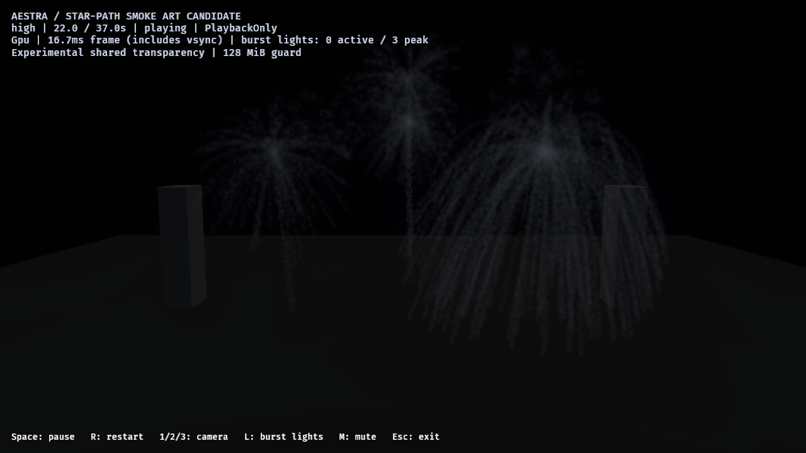
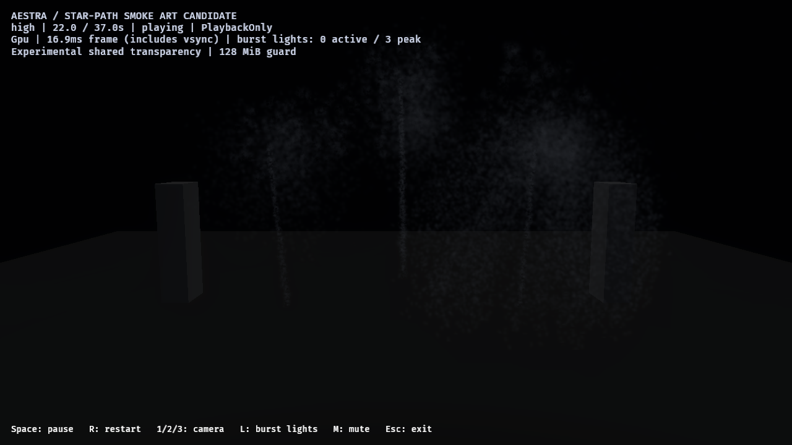

# F8.1C4V — wind-drifted smoke art candidate

A separate saved variant now breaks up the narrow C4S radial strands into a
wider drifting field. Older smoke spreads and fades unevenly, with softer puff
centers and fewer regular tracks. This is a bounded art-direction improvement;
individual billboard puffs remain visible. Photographic art approval, default
adoption and stable 60 FPS remain open.

The normal, wispy, persistent and C4S saved assets are unchanged: all 69 retained
asset hashes match C4U. New effects/materials are editable saved assets loaded by
the public Bevy host. No renderer library code, shader ABI, birth/capture limits,
light ceilings or OIT guard changes. See the
[raw evidence, rejected drafts and hashes](wind-haze-smoke-2026-10-27.json).

## Authored changes

`author_fireworks_wind_smoke` derives four family assets and a new 13-clip root
from the retained C4S candidate. Root/dependency EffectIDs are distinct; clip
timing/transforms/seeds, stars, rockets, original shell/launch haze, event/cue/light
routes, parameters, budgets and 7–9-second path-smoke lifetimes are retained.
The existing distance births remain spacing 0.8/max2, count one, zero inherited
velocity and zero independent emission. Smoke still deposits along the path.

Only deposited-smoke motion/appearance and its dedicated material change:

| Property | Wind-haze candidate |
| --- | --- |
| Small independent speed | 0.12–0.55 |
| Acceleration / drag / turbulence | [0.80, 0.12, 0.16] / 0.25 / 3.0 |
| Angular velocity | −0.28–0.28 |
| Size at normalized ages 0 / 0.25 / 0.65 / 1 | 1.6 / 2.2 / 3.1 / 4.0 |
| Opacity at ages 0 / 0.035 / 0.45 / 0.8 / 1 | 0 / 0.065 / 0.027 / 0.007 / 0 |

The new density function emphasizes low-frequency noise, seed-dependent late
wisp extent, age advection and anisotropic warping. A soft exponential core
replaces the earlier flat-center mask. Lower opacity/footprint limits individual
puff contrast while stronger motion supplies the wider field. Original scene
light gain, ambient response, gray albedo and alpha/depth policy are retained;
uniform ambient brightening is not used to make the new smoke visible.

## Native before/after and rejected attempts

Before: retained C4S, nominal quiet 22 seconds, close camera:



Wind-haze candidate at the same nominal time/camera:



The new field is more displaced and diffuse, although small puffs/mottling remain.
The comparison uses the same C4U runtime binary/configuration/seed. These are live
asynchronous nominal-time captures, not frozen or exact pixel pairs. PNGs are
byte-identical native copies, without cropping or retouching.

Two preceding attempts are explicitly rejected:

| Preview | Maximum sampled globally dropped fragments | Decision |
| --- | ---: | --- |
| Larger, sparse eroded wisps | **26,799** | Reject capacity and granular appearance |
| Smoother, broader masks with stronger drift | **36,535** | Reject capacity; still mottled |
| Smaller soft-core version | 0 | Continue to final controls |

Failed reports, captures and source/asset copies remain archived under their
`target/fireworks-f8/wind-haze-{draft,refined}-2026-10-27/sources` directories and
are hashed in the evidence. The final candidate stays under the existing 128 MiB
guard; no storage increase is used to accept a failed attempt.

## Final controls

Six full native image runs cover high audience/close/flash-muted, medium close,
low close and high close with only the deposited-smoke Density set to zero.
All 48 final captures deliver. The three previews deliver another 24 captures.
All runs use the public 1280×720 HDR/Tony/bloom 0.15/OffMSAA window, experimental
OIT average4/K32/128 MiB, PlaybackOnly, 37-second show plus ten cleanup updates.
Windows/RTX 4070 SUPER/Vulkan, Rust 1.98.1/Bevy 0.20.0/wgpu 30.0.1; dev application
opt-level 1/dependencies opt-level 3, audio compiled and `--no-audio`. Native windows
run sequentially without agent-launched builds/other native GPU probes active.

| Tier | Deposited smoke births per run | Launch / main-break cues | Bound light intents | Accepted flashes / budget drops |
| --- | ---: | ---: | ---: | ---: |
| High, including muted/hidden controls | 37,996 | 13 / 13 | 13 | 13 / 0 |
| Medium | 18,959 | 13 / 13 | 13 | 13 / 0 |
| Low | 9,313 | 13 / 13 | 13 | 11 / 2 |

Every final cell observes zero source overflow/expansion omission/destination
rejection, zero sampled global OIT drops/invalid links and zero final live
particles across 13 smoke owners. Binding classification and realization outcomes
account for all packets/intents without hidden scan, invalid, stale, duplicate or
expiry loss. Low's two explicit rejections enforce its existing two-light policy.
All six exact cells pass `check-fireworks-output-audit.py --wind-haze`; the
original five-cell C4U checker mode still passes its unchanged controls.

The [bright capture](reviews/wind-haze-2026-10-27/wind-bright.png) shows later burst
colors on the older field. [Flash intensity zero](reviews/wind-haze-2026-10-27/wind-muted.png)
retains the smoke but removes representative-light intensity; all capture-time
proxy intensities are zero. [Path-smoke density zero](reviews/wind-haze-2026-10-27/wind-hidden.png)
retains the same simulated births/cues and removes that field, leaving the original
launch/shell haze and stars. The
[audience quiet capture](reviews/wind-haze-2026-10-27/wind-audience.png) remains
reviewable separately. Selected-star lighting is not enabled or qualified here.

Async scans can skip frames: zero sampled loss is not an every-frame capacity or
exact-blending proof. Every image run retains one global-cache pending update;
its pipeline/cause is unclassified. Image timing/HUD data is not a cost gate.

## Separate ordinary pacing pair

Same runtime/configuration and audience camera, no screenshots, OIT scans or
profiling. Existing bounded source/admission/playback counters remain on.

| Ordinary high-tier host intervals, including vsync | p95 | Maximum |
| --- | ---: | ---: |
| Retained C4S control | 27.94 ms | 60.21 ms |
| Wind-haze candidate | 27.84 ms | 52.84 ms |

Both retain all 13 launches/main breaks/bound intents/flashes, zero pending
pipeline updates and a full drain. This is **one sequential dev-build pair**;
similar host percentiles do not establish equal GPU cost, a speedup or fixed
overhead. Whole-host tail latency and stable 60 FPS remain open.

## Reproduce and validate

```powershell
cargo run --release --locked -p aestra-bevy --example fireworks -- --smoke-art-show --effect effects/fireworks_show_wind_haze_smoke.aestra.ron --experimental-oit
cargo run -p aestra-bevy --example author_fireworks_wind_smoke --locked --offline
```

For native controls, build the host with `--features fireworks-audio`, then run
the existing review runner with `-Effect effects/fireworks_show_wind_haze_smoke.aestra.ron`:
fresh `ROOT/high` with `-Tiers high`, `ROOT/medium` and `ROOT/low` with their tier
and `-Cases close-lit`, and `ROOT/hidden` with `-Tiers high -Cases close-lit -HideStarSmoke`.
Then:

```powershell
python benchmarks/fireworks/check-fireworks-output-audit.py ROOT --wind-haze
```

Runner defaults retain C4S when `-Effect` is omitted. For ordinary costs, use a
fresh absolute `AESTRA_EXAMPLE_REPORT`, audience camera, visibility/flash flags set to 1,
and remove image/sample-times/profile/capture variables rather than setting them
empty. Launch each saved root separately with otherwise identical arguments.

All **36 example tests pass**, including preserved birth/budget/cue/non-path
authoring and choreography, and actual public compilation/OIT audit at every tier.
Strict host all-target Clippy, workspace format/diff and runner parsing pass.
Environmental incremental hard-link notices remain. No renderer/workspace full
test suite is claimed rerun for this asset/offline-authoring slice; C4U results
remain separately scoped. The C4U runtime executable is reused because saved
effects/materials are compiled normally by the host; new author/test code does
not require a changed runtime implementation.

Next: author bounded selected-star light outputs on an opt-in show and expose
host lighting enablement independently of the small smoke labs. Review older
wind haze with representative/selected paths controlled separately, under the
existing budgets. Coherent volumetric depth, final art/default adoption, generic
fluid coupling and production-finale performance remain open.
